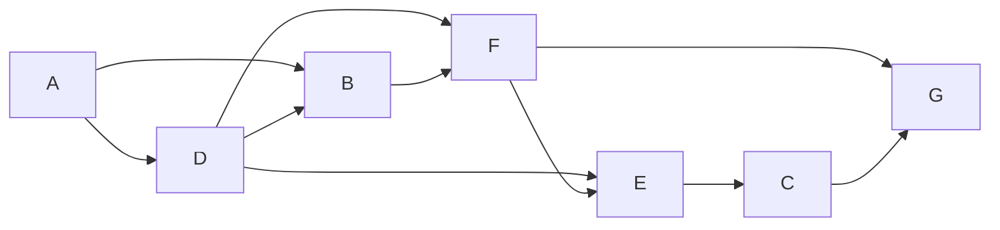
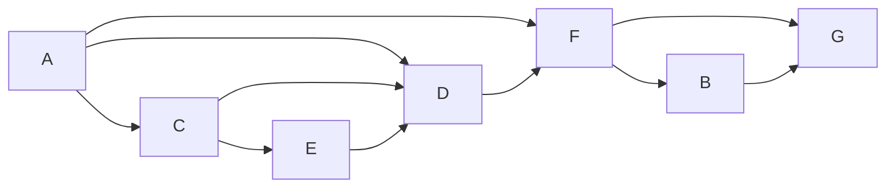
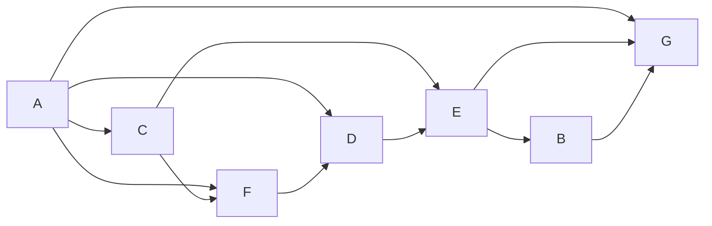
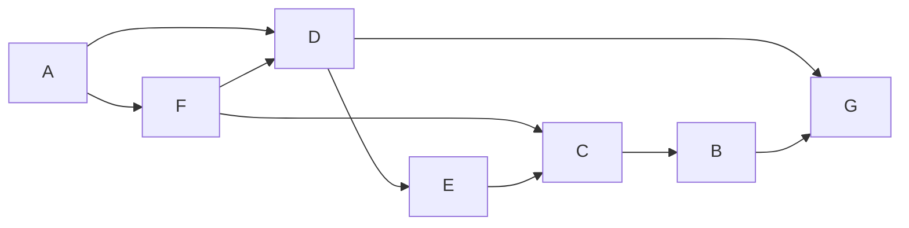
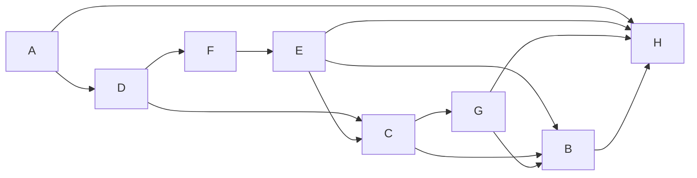
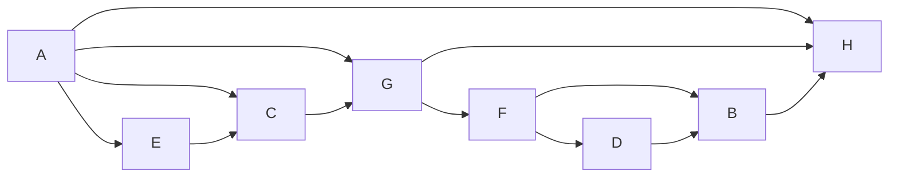
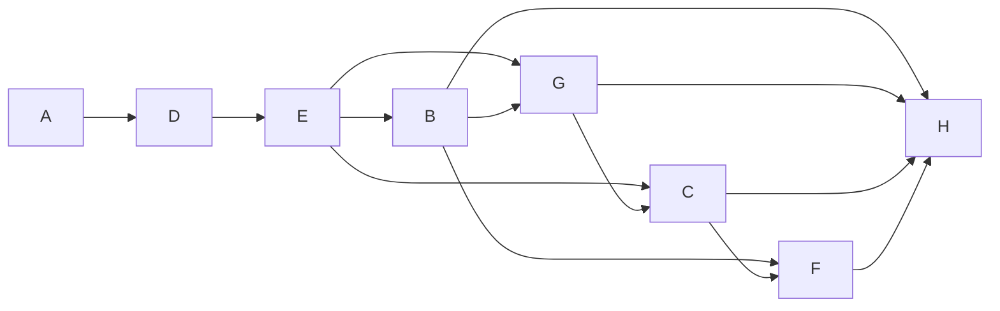
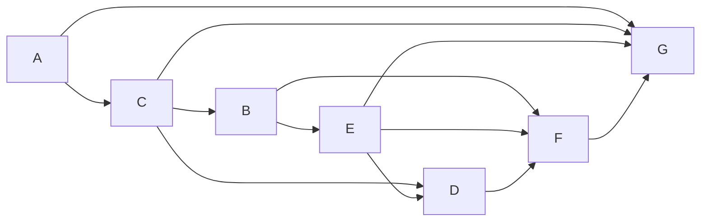
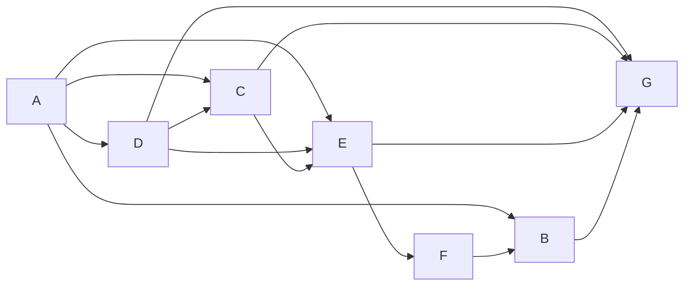
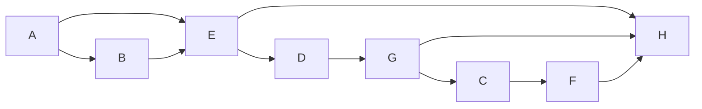

# T3.15: №9, 10 задач для предметного ревью

Авторские условия. Предметное ревью человеком ожидается; повторный Gate 3 остаётся открытым.

[Ответы и решения](answers.md) открывай после самостоятельного решения.

## 1. Количество путей на схеме

ID: paths-diagram-v2. Seed: `t3.15-review-20261016:9:900795`. Сложность: 1.

На рисунке показана схема дорог между городами A, B, C, D, E, F, G. Двигаться можно только в направлении стрелок. Сколько различных путей ведёт из A в G?

Схема дорог: движение только по стрелкам, начальный город A, конечный G.

## 2. Количество путей на схеме

ID: paths-diagram-v2. Seed: `t3.15-review-20261016:9:882317`. Сложность: 1.

На рисунке показана схема дорог между городами A, B, C, D, E, F, G. Двигаться можно только в направлении стрелок. Сколько различных путей ведёт из A в G?

Схема дорог: движение только по стрелкам, начальный город A, конечный G.

## 3. Количество путей на схеме

ID: paths-diagram-v2. Seed: `t3.15-review-20261016:9:473340`. Сложность: 2.

На рисунке показана схема дорог между городами A, B, C, D, E, F, G. Двигаться можно только в направлении стрелок. Сколько различных путей ведёт из A в G?

Схема дорог: движение только по стрелкам, начальный город A, конечный G.

## 4. Количество путей на схеме

ID: paths-diagram-v2. Seed: `t3.15-review-20261016:9:537388`. Сложность: 1.

На рисунке показана схема дорог между городами A, B, C, D, E, F, G. Двигаться можно только в направлении стрелок. Сколько различных путей ведёт из A в G?

Схема дорог: движение только по стрелкам, начальный город A, конечный G.

## 5. Количество путей на схеме

ID: paths-diagram-v2. Seed: `t3.15-review-20261016:9:566389`. Сложность: 2.

На рисунке показана схема дорог между городами A, B, C, D, E, F, G, H. Двигаться можно только в направлении стрелок. Сколько различных путей ведёт из A в H?

Схема дорог: движение только по стрелкам, начальный город A, конечный H.

## 6. Количество путей на схеме

ID: paths-diagram-v2. Seed: `t3.15-review-20261016:9:81432`. Сложность: 2.

На рисунке показана схема дорог между городами A, B, C, D, E, F, G, H. Двигаться можно только в направлении стрелок. Сколько различных путей ведёт из A в H?

Схема дорог: движение только по стрелкам, начальный город A, конечный H.

## 7. Количество путей на схеме

ID: paths-diagram-v2. Seed: `t3.15-review-20261016:9:464690`. Сложность: 2.

На рисунке показана схема дорог между городами A, B, C, D, E, F, G, H. Двигаться можно только в направлении стрелок. Сколько различных путей ведёт из A в H?

Схема дорог: движение только по стрелкам, начальный город A, конечный H.

## 8. Количество путей на схеме

ID: paths-diagram-v2. Seed: `t3.15-review-20261016:9:223950`. Сложность: 2.

На рисунке показана схема дорог между городами A, B, C, D, E, F, G. Двигаться можно только в направлении стрелок. Сколько различных путей ведёт из A в G?

Схема дорог: движение только по стрелкам, начальный город A, конечный G.

## 9. Количество путей на схеме

ID: paths-diagram-v2. Seed: `t3.15-review-20261016:9:980467`. Сложность: 2.

На рисунке показана схема дорог между городами A, B, C, D, E, F, G. Двигаться можно только в направлении стрелок. Сколько различных путей ведёт из A в G?

Схема дорог: движение только по стрелкам, начальный город A, конечный G.

## 10. Количество путей на схеме

ID: paths-diagram-v2. Seed: `t3.15-review-20261016:9:26404`. Сложность: 1.

На рисунке показана схема дорог между городами A, B, C, D, E, F, G, H. Двигаться можно только в направлении стрелок. Сколько различных путей ведёт из A в H?

Схема дорог: движение только по стрелкам, начальный город A, конечный H.

