# Задание №9 — 12 примеров

## 1. Количество путей на схеме

Генератор: paths-diagram-v2

Seed: "t3.15-final-20261017:0"

На рисунке показана схема дорог между городами A, B, C, D, E, F, G, H. Двигаться можно только в направлении стрелок. Сколько различных путей ведёт из A в H?

Схема дорог: движение только по стрелкам, начальный город A, конечный H.

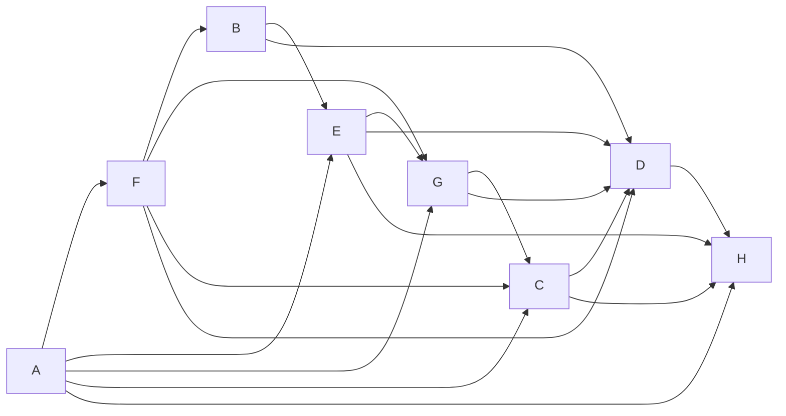

Текстовое описание: Схема дорог: движение только по стрелкам, начальный город A, конечный H. Вершины: A, B, C, D, E, F, G, H. Дуги: A → F; A → E; A → G; A → C; A → H; F → B; F → G; F → C; F → D; B → E; B → D; E → G; E → D; E → H; G → C; G → D; C → D; C → H; D → H.

**Ответ:** 23

### Решение

1. Положи число способов попасть в A равным 1.

2. Для каждого следующего города сложи числа у его непосредственных предшественников: A — 1; B — 1; C — 6; D — 14; E — 2; F — 1; G — 4; H — 23.

3. Число у конечного города H равно 23.

## 2. Количество путей на схеме

Генератор: paths-diagram-v2

Seed: "t3.15-final-20261017:1"

На рисунке показана схема дорог между городами A, B, C, D, E, F, G, H. Двигаться можно только в направлении стрелок. Сколько различных путей ведёт из A в H?

Схема дорог: движение только по стрелкам, начальный город A, конечный H.

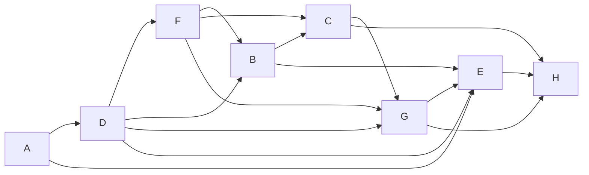

Текстовое описание: Схема дорог: движение только по стрелкам, начальный город A, конечный H. Вершины: A, B, C, D, E, F, G, H. Дуги: A → D; A → E; D → F; D → B; D → G; D → E; F → B; F → C; F → G; B → C; B → E; C → G; C → H; G → E; G → H; E → H.

**Ответ:** 17

### Решение

1. Положи число способов попасть в A равным 1.

2. Для каждого следующего города сложи числа у его непосредственных предшественников: A — 1; B — 2; C — 3; D — 1; E — 9; F — 1; G — 5; H — 17.

3. Число у конечного города H равно 17.

## 3. Количество путей на схеме

Генератор: paths-diagram-v2

Seed: "t3.15-final-20261017:2"

На рисунке показана схема дорог между городами A, B, C, D, E, F, G. Двигаться можно только в направлении стрелок. Сколько различных путей ведёт из A в G?

Схема дорог: движение только по стрелкам, начальный город A, конечный G.

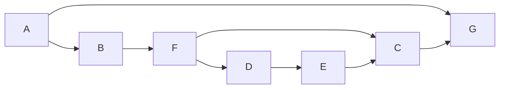

Текстовое описание: Схема дорог: движение только по стрелкам, начальный город A, конечный G. Вершины: A, B, C, D, E, F, G. Дуги: A → B; A → G; B → F; F → D; F → C; D → E; E → C; C → G.

**Ответ:** 3

### Решение

1. Положи число способов попасть в A равным 1.

2. Для каждого следующего города сложи числа у его непосредственных предшественников: A — 1; B — 1; C — 2; D — 1; E — 1; F — 1; G — 3.

3. Число у конечного города G равно 3.

## 4. Количество путей на схеме

Генератор: paths-diagram-v2

Seed: "t3.15-final-20261017:3"

На рисунке показана схема дорог между городами A, B, C, D, E, F, G, H. Двигаться можно только в направлении стрелок. Сколько различных путей ведёт из A в H?

Схема дорог: движение только по стрелкам, начальный город A, конечный H.

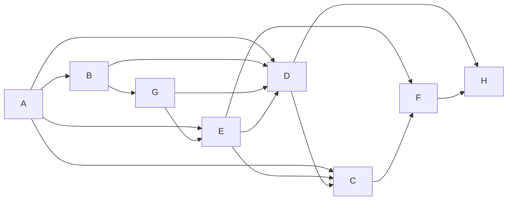

Текстовое описание: Схема дорог: движение только по стрелкам, начальный город A, конечный H. Вершины: A, B, C, D, E, F, G, H. Дуги: A → B; A → E; A → D; A → C; B → G; B → D; G → E; G → D; E → D; E → C; E → F; D → C; D → H; C → F; F → H.

**Ответ:** 15

### Решение

1. Положи число способов попасть в A равным 1.

2. Для каждого следующего города сложи числа у его непосредственных предшественников: A — 1; B — 1; C — 8; D — 5; E — 2; F — 10; G — 1; H — 15.

3. Число у конечного города H равно 15.

## 5. Количество путей на схеме

Генератор: paths-diagram-v2

Seed: "t3.15-final-20261017:4"

На рисунке показана схема дорог между городами A, B, C, D, E, F, G. Двигаться можно только в направлении стрелок. Сколько различных путей ведёт из A в G?

Схема дорог: движение только по стрелкам, начальный город A, конечный G.

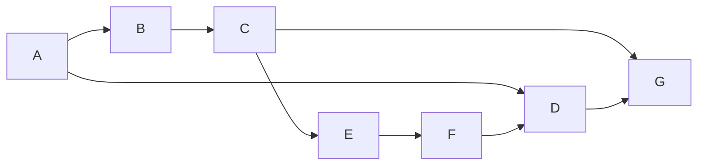

Текстовое описание: Схема дорог: движение только по стрелкам, начальный город A, конечный G. Вершины: A, B, C, D, E, F, G. Дуги: A → B; A → D; B → C; C → E; C → G; E → F; F → D; D → G.

**Ответ:** 3

### Решение

1. Положи число способов попасть в A равным 1.

2. Для каждого следующего города сложи числа у его непосредственных предшественников: A — 1; B — 1; C — 1; D — 2; E — 1; F — 1; G — 3.

3. Число у конечного города G равно 3.

## 6. Количество путей на схеме

Генератор: paths-diagram-v2

Seed: "t3.15-final-20261017:5"

На рисунке показана схема дорог между городами A, B, C, D, E, F, G, H. Двигаться можно только в направлении стрелок. Сколько различных путей ведёт из A в H?

Схема дорог: движение только по стрелкам, начальный город A, конечный H.

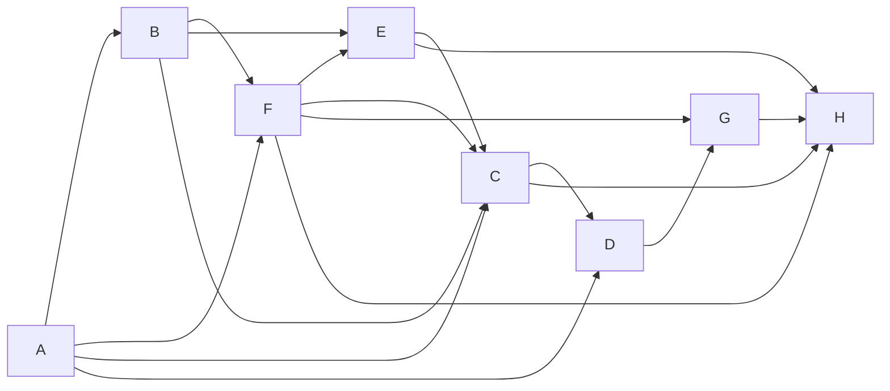

Текстовое описание: Схема дорог: движение только по стрелкам, начальный город A, конечный H. Вершины: A, B, C, D, E, F, G, H. Дуги: A → B; A → F; A → C; A → D; B → F; B → E; B → C; F → E; F → C; F → G; F → H; E → C; E → H; C → D; C → H; D → G; G → H.

**Ответ:** 22

### Решение

1. Положи число способов попасть в A равным 1.

2. Для каждого следующего города сложи числа у его непосредственных предшественников: A — 1; B — 1; C — 7; D — 8; E — 3; F — 2; G — 10; H — 22.

3. Число у конечного города H равно 22.

## 7. Количество путей на схеме

Генератор: paths-diagram-v2

Seed: "t3.15-final-20261017:6"

На рисунке показана схема дорог между городами A, B, C, D, E, F, G, H. Двигаться можно только в направлении стрелок. Сколько различных путей ведёт из A в H?

Схема дорог: движение только по стрелкам, начальный город A, конечный H.

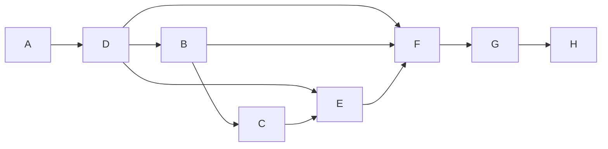

Текстовое описание: Схема дорог: движение только по стрелкам, начальный город A, конечный H. Вершины: A, B, C, D, E, F, G, H. Дуги: A → D; D → B; D → E; D → F; B → C; B → F; C → E; E → F; F → G; G → H.

**Ответ:** 4

### Решение

1. Положи число способов попасть в A равным 1.

2. Для каждого следующего города сложи числа у его непосредственных предшественников: A — 1; B — 1; C — 1; D — 1; E — 2; F — 4; G — 4; H — 4.

3. Число у конечного города H равно 4.

## 8. Количество путей на схеме

Генератор: paths-diagram-v2

Seed: "t3.15-final-20261017:7"

На рисунке показана схема дорог между городами A, B, C, D, E, F, G, H. Двигаться можно только в направлении стрелок. Сколько различных путей ведёт из A в H?

Схема дорог: движение только по стрелкам, начальный город A, конечный H.

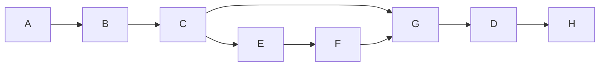

Текстовое описание: Схема дорог: движение только по стрелкам, начальный город A, конечный H. Вершины: A, B, C, D, E, F, G, H. Дуги: A → B; B → C; C → E; C → G; E → F; F → G; G → D; D → H.

**Ответ:** 2

### Решение

1. Положи число способов попасть в A равным 1.

2. Для каждого следующего города сложи числа у его непосредственных предшественников: A — 1; B — 1; C — 1; D — 2; E — 1; F — 1; G — 2; H — 2.

3. Число у конечного города H равно 2.

## 9. Количество путей на схеме

Генератор: paths-diagram-v2

Seed: "t3.15-final-20261017:8"

На рисунке показана схема дорог между городами A, B, C, D, E, F, G, H. Двигаться можно только в направлении стрелок. Сколько различных путей ведёт из A в H?

Схема дорог: движение только по стрелкам, начальный город A, конечный H.

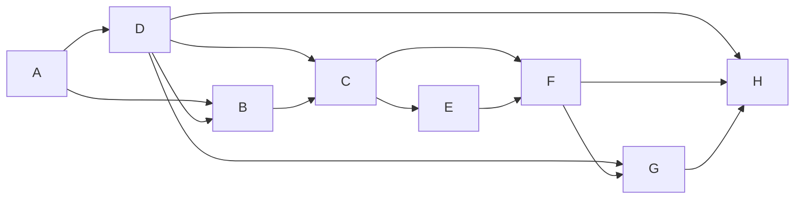

Текстовое описание: Схема дорог: движение только по стрелкам, начальный город A, конечный H. Вершины: A, B, C, D, E, F, G, H. Дуги: A → D; A → B; D → B; D → C; D → G; D → H; B → C; C → E; C → F; E → F; F → G; F → H; G → H.

**Ответ:** 14

### Решение

1. Положи число способов попасть в A равным 1.

2. Для каждого следующего города сложи числа у его непосредственных предшественников: A — 1; B — 2; C — 3; D — 1; E — 3; F — 6; G — 7; H — 14.

3. Число у конечного города H равно 14.

## 10. Количество путей на схеме

Генератор: paths-diagram-v2

Seed: "t3.15-final-20261017:9"

На рисунке показана схема дорог между городами A, B, C, D, E, F, G. Двигаться можно только в направлении стрелок. Сколько различных путей ведёт из A в G?

Схема дорог: движение только по стрелкам, начальный город A, конечный G.

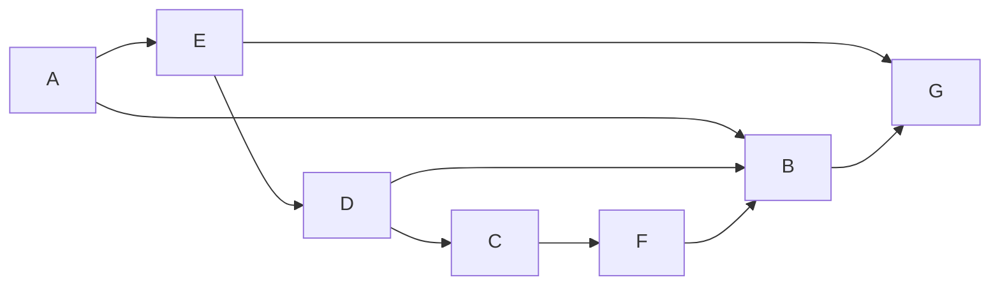

Текстовое описание: Схема дорог: движение только по стрелкам, начальный город A, конечный G. Вершины: A, B, C, D, E, F, G. Дуги: A → E; A → B; E → D; E → G; D → C; D → B; C → F; F → B; B → G.

**Ответ:** 4

### Решение

1. Положи число способов попасть в A равным 1.

2. Для каждого следующего города сложи числа у его непосредственных предшественников: A — 1; B — 3; C — 1; D — 1; E — 1; F — 1; G — 4.

3. Число у конечного города G равно 4.

## 11. Количество путей на схеме

Генератор: paths-diagram-v2

Seed: "t3.15-final-20261017:10"

На рисунке показана схема дорог между городами A, B, C, D, E, F, G. Двигаться можно только в направлении стрелок. Сколько различных путей ведёт из A в G?

Схема дорог: движение только по стрелкам, начальный город A, конечный G.

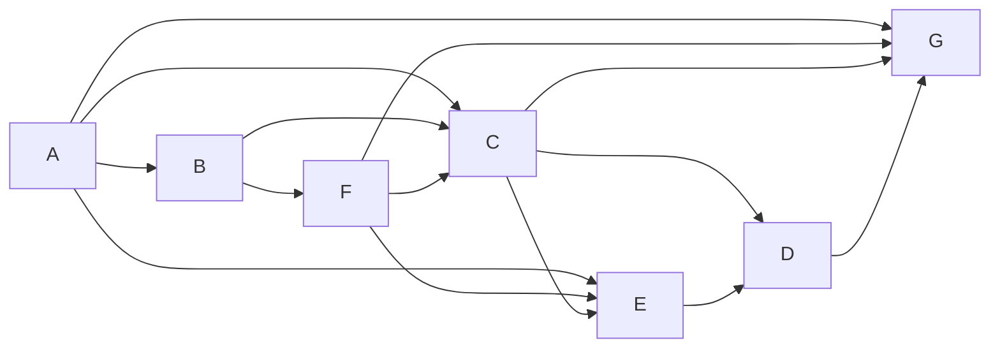

Текстовое описание: Схема дорог: движение только по стрелкам, начальный город A, конечный G. Вершины: A, B, C, D, E, F, G. Дуги: A → B; A → C; A → E; A → G; B → F; B → C; F → C; F → E; F → G; C → E; C → D; C → G; E → D; D → G.

**Ответ:** 13

### Решение

1. Положи число способов попасть в A равным 1.

2. Для каждого следующего города сложи числа у его непосредственных предшественников: A — 1; B — 1; C — 3; D — 8; E — 5; F — 1; G — 13.

3. Число у конечного города G равно 13.

## 12. Количество путей на схеме

Генератор: paths-diagram-v2

Seed: "t3.15-final-20261017:11"

На рисунке показана схема дорог между городами A, B, C, D, E, F, G, H. Двигаться можно только в направлении стрелок. Сколько различных путей ведёт из A в H?

Схема дорог: движение только по стрелкам, начальный город A, конечный H.

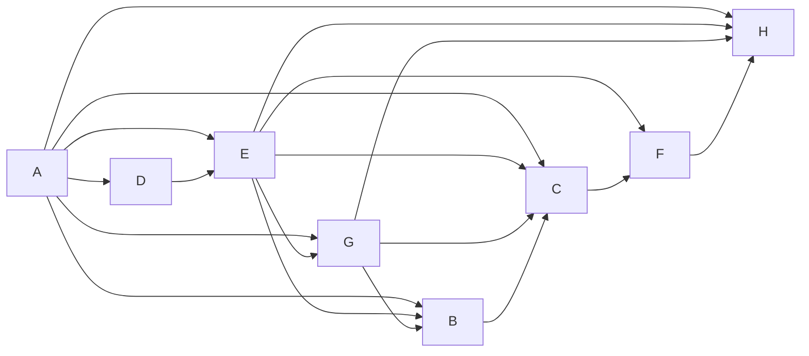

Текстовое описание: Схема дорог: движение только по стрелкам, начальный город A, конечный H. Вершины: A, B, C, D, E, F, G, H. Дуги: A → D; A → E; A → G; A → B; A → C; A → H; D → E; E → G; E → B; E → C; E → F; E → H; G → B; G → C; G → H; B → C; C → F; F → H.

**Ответ:** 20

### Решение

1. Положи число способов попасть в A равным 1.

2. Для каждого следующего города сложи числа у его непосредственных предшественников: A — 1; B — 6; C — 12; D — 1; E — 2; F — 14; G — 3; H — 20.

3. Число у конечного города H равно 20.
