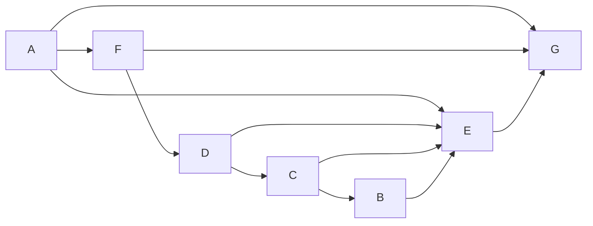

# Учебный вариант V02

Seed: "informatics-variant-v1:V02". 16 заданий, максимум 21 балл. В №13 выбрана презентация (13.1). Альтернативная работа не добавляет номер или баллы.

Набор предназначен для разбора и содержит решения и эталоны. Это авторские учебные задания. Формат — сверенный проект ОГЭ 2027; критерии практических работ учебные.

[Скачать полный комплект файлов](dataset.zip)

## Задание №1

В кодировке каждый символ занимает 8 бит. Записан список слов: «шиповник, берёза, дуб, крапива, можжевельник». Одно слово удалили вместе с лишними запятой и пробелом; двойных пробелов не осталось. Размер текста уменьшился на 10 байт. Какое слово удалили?

**Ответ / эталон:** шиповник

#### Решение

1. Один символ занимает 8 ÷ 8 = 1 байт. Всего удалили 10 ÷ 1 = 10 символов.

2. Вместе со словом удалили запятую и пробел — два символа. На само слово приходится 10 − 2 = 8 символов. Дефис тоже считается символом.

3. В списке такую длину имеет слово «шиповник». Проверка: (8 + 2) · 1 = 10 байт.

## Задание №2

Сообщение закодировано с помощью таблицы. Между кодами букв нет дополнительных разделителей.

| Буква | Код   |
| ----- | ----- |
| Е     | `...` |
| Д     | `..o` |
| В     | `.o.` |
| А     | `.oo` |
| Б     | `o..` |
| Г     | `o.o` |

Сигнал: `........oo.o..o.o..ooo..`. Какие буквы встречаются в сообщении более одного раза? Запиши каждую такую букву один раз, в любом порядке.

**Ответ / эталон:** ДЕ, ЕД

#### Решение

1. Все коды в таблице состоят из 3 знаков. Поэтому делим запись на группы по 3 знака, начиная с первого знака.

Начало записи — `...` (3 знака). По таблице это буква «Е». Продолжаем с позиции 4.

2. Разделим всю запись на коды букв:

`... / ... / ..o / o.o / ..o / .o. / .oo / o..`

| № буквы | Код   | Буква |
| ------- | ----- | ----- |
| 1       | `...` | Е     |
| 2       | `...` | Е     |
| 3       | `..o` | Д     |
| 4       | `o.o` | Г     |
| 5       | `..o` | Д     |
| 6       | `.o.` | В     |
| 7       | `.oo` | А     |
| 8       | `o..` | Б     |

Читаем буквы сверху вниз: **ЕЕДГДВАБ**.

3. Подсчитаем буквы в сообщении ЕЕДГДВАБ: «Е» — 2 раза; «Д» — 2 раза; «Г» — 1 раз; «В» — 1 раз; «А» — 1 раз; «Б» — 1 раз.

Хотя бы дважды встретились «Е», «Д». Каждую записываем один раз. Ответ: **ДЕ**. Порядок этих букв может быть любым.

## Задание №3

Сколько натуральных чисел X делают выражение истинным?

Выражение: `((X > 6) И (НЕ ((X >= 20) ИЛИ (НЕ (X нечётное)))))`.

Натуральные числа начинаются с 1.

**Ответ / эталон:** 7

#### Решение

1. После раскрытия НЕ условие истинности: (X > 6 И (X < 20 И X нечётное)). Для И выполняются обе части, для ИЛИ достаточно одной.

2. Подходящие натуральные X: 7, 9, 11, 13, 15, 17, 19.

3. Количество подходящих значений: 7. Проверка границ: при X = 6 выражение ложно; при X = 20 выражение ложно. Ноль в натуральные числа не включён.

## Задание №4

В таблице указаны длины дорог между пунктами в километрах. Знак — означает, что прямой дороги нет. По каждой дороге можно двигаться в обе стороны.

| Пункт | A   | B   | C   | D   | E   | F   |
| ----- | --- | --- | --- | --- | --- | --- |
| A     | —   | 6   | —   | —   | —   | —   |
| B     | 6   | —   | 8   | —   | —   | —   |
| C     | —   | 8   | —   | 8   | —   | —   |
| D     | —   | —   | 8   | —   | 3   | —   |
| E     | —   | —   | —   | 3   | —   | 4   |
| F     | —   | —   | —   | —   | 4   | —   |

Какова длина кратчайшего пути из A в F? В ответе запиши число километров.

**Ответ / эталон:** 29

#### Решение

1. До A расстояние 0. Прямые дороги из A: B: 6 км. При переходе к соседу прибавляй длину дороги; сохраняй меньшую из найденных сумм.

2. Минимальные расстояния от A: A — 0; B — 6; C — 14; D — 22; E — 25; F — 29 км.

3. Кратчайший маршрут: A → B → C → D → E → F. Проверка по таблице: 6 + 8 + 8 + 3 + 4 = 29 км. Число дорог само по себе длину пути не определяет.

## Задание №5

У исполнителя две команды:

1. Умножь на 3.
2. Прибавь 4.

Составь программу, которая переводит число 8 в число 44 и содержит не более 5 команд. В ответе запиши только номера команд. Если подходящих программ несколько, запиши любую.

**Ответ / эталон:** 2122

#### Решение

1. От 44 можно идти назад: обратная команда 2 вычитает 4, а обратная команда 1 делит на 3. Нужен возврат к 8 не более чем за 5 команд.

2. Один подходящий вариант — 2122: 8 → 12 → 36 → 40 → 44.

3. Последнее значение равно 44, длина программы 4 не превышает 5. Другие подходящие программы также принимаются.

## Задание №6

Программа запускалась девять раз; в каждом запуске вводилась одна из пар (s, t) из таблицы и одно и то же целое число A.

```python
s = int(input())
t = int(input())
A = int(input())
if s > A or t > 7:
    print("YES")
else:
    print("NO")
```

| s   | t   |
| --- | --- |
| 6   | -1  |
| -1  | 12  |
| -7  | 5   |
| 9   | 2   |
| -7  | 8   |
| -10 | 15  |
| -8  | 2   |
| -6  | 14  |
| -6  | 9   |

Укажи наибольшее целое значение A, при котором программа напечатала YES ровно 9 раз.

**Ответ / эталон:** -9

#### Решение

1. От A не зависят запуски, где t > 7: (-1, 12), (-7, 8), (-10, 15), (-6, 14), (-6, 9). Число этих YES: 5. Остальные значения s: -8, -7, 6, 9. Требуемое число значений больше A: 4.

2. При A = -9 результаты девяти запусков: YES, YES, YES, YES, YES, YES, YES, YES, YES. Получено 9 YES.

3. Допустимые целые значения: A ≤ -9. Сравнение строгое; последнее подходящее A равно -9. Проверь соседнее целое за указанной границей: нужное число YES уже не получается.

## Задание №7

Доступ к файлу ftp.jpg на сервере school.ru осуществляется по протоколу FTP. Фрагменты адреса закодированы цифрами от 1 до 7. Запиши последовательность цифр, кодирующую адрес файла.

| Цифра | Фрагмент |
| ----- | -------- |
| 1     | `://`    |
| 2     | `ftp`    |
| 3     | `jpg`    |
| 4     | `/`      |
| 5     | `school` |
| 6     | `ftp.`   |
| 7     | `.ru`    |

**Ответ / эталон:** 2157463

#### Решение

1. Для протокола FTP запиши начало ftp://. Затем идут сервер school.ru, знак / и файл ftp.jpg.

2. Полный адрес: ftp://school.ru/ftp.jpg.

3. Замени его части цифрами из таблицы: 2157463. Проверь, что использованы все семь фрагментов.

## Задание №8

В языке поисковых запросов | означает «ИЛИ», & — «И». Все запросы выполнены по одной неизменной базе страниц. Количества указаны в тысячах.

| Запрос                     | Найдено страниц (тыс.) |
| -------------------------- | ---------------------- |
| `Лира & (Вега \| Альтаир)` | 920                    |
| `Лира & Вега`              | 770                    |
| `Лира & Вега & Альтаир`    | 320                    |

Сколько тысяч страниц найдёт запрос `Лира & Альтаир`? Запиши целое число.

**Ответ / эталон:** 470

#### Решение

1. Запрос «Лира & (Вега | Альтаир)» объединяет страницы двух запросов: «Лира & Вега» и «Лира & Альтаир». В объединении 920 тыс. страниц.

2. В запросе «Лира & Вега» 770 тыс. страниц. В общем пересечении 320 тыс.; вычитая первое множество, нужно вернуть эту общую часть.

3. Искомое множество: 920 − 770 + 320 = 470 тыс. Проверка объединения: 770 + 470 − 320 = 920.

## Задание №9

На рисунке показана схема дорог между городами A, B, C, D, E, F, G. Двигаться можно только в направлении стрелок. Сколько различных путей ведёт из A в G?

Схема дорог: движение только по стрелкам, начальный город A, конечный G.



Текстовое описание: Схема дорог: движение только по стрелкам, начальный город A, конечный G. Вершины: A, B, C, D, E, F, G. Дуги: A → F; A → E; A → G; F → D; F → G; D → C; D → E; C → B; C → E; B → E; E → G.

**Ответ / эталон:** 6

#### Решение

1. Положи число способов попасть в A равным 1.

2. У города E входящие стрелки из A, D, C, B: сложи числа путей к этим городам. Получаются количества: A — 1; B — 1; C — 1; D — 1; E — 4; F — 1; G — 6.

3. Проверка у конечного города G: 1 + 1 + 4 = 6. Группы путей не пересекаются: у каждой группы своя последняя дорога.

## Задание №10

Вычисли значение выражения $\mathrm{1010010010}_{2} + \mathrm{411}_{8} + \mathrm{1AC}_{16}$. В ответе запиши десятичное число, основание указывать не нужно.

**Ответ / эталон:** 1351

#### Решение

1. Разложи каждое число по степеням его основания, начиная справа со степени 0: 1010010010 (основание 2): 1·2^9 + 0·2^8 + 1·2^7 + 0·2^6 + 0·2^5 + 1·2^4 + 0·2^3 + 0·2^2 + 1·2^1 + 0·2^0 = 658; 411 (основание 8): 4·8^2 + 1·8^1 + 1·8^0 = 265; 1AC (основание 16): 1·16^2 + 10·16^1 + 12·16^0 = 428.

2. 1010010010 (основание 2) = 658; 411 (основание 8) = 265; 1AC (основание 16) = 428.

3. 658 + 265 + 428 = 1351.

## Задание №11

Скачай и распакуй корпус рассказов. Автор рассказа — Ирина Полевая. Найди эпизод: Денис починил полевой компас. Как называется профессия человека, произнёсшего реплику о труде в этом эпизоде? Запиши одно слово.

**Ответ / эталон:** мастер

#### Решение

1. Открой папку Тексты/Ирина Полевая. Ищи имя Денис и слова «починил полевой компас»: одного совпадения имени недостаточно, нужен указанный эпизод.

2. Прочитай эпизод и соседние абзацы. Реплика: «Это полезный труд». Профессия этого человека названа при встрече на причале, перед описанием события.

3. Профессия говорящего — мастер. Для проверки сопоставь найденное слово с героем Денис и событием «починил полевой компас», а не с соседним рассказом. Ответ: мастер.

## Задание №12

Скачай и распакуй файловый набор. Сколько файлов с расширениями .htm, .tiff находится в следующих каталогах, включая все вложенные папки?

- Проза-архив/Павел Листьев
- Проза/Нина Речная
- Письма

Другие каталоги не учитывай.

**Ответ / эталон:** 22

#### Решение

1. В каждом указанном каталоге включи поиск во вложенных папках. Отбирай .htm, .tiff по расширению файла.

2. Подходящие файлы:

- Письма/Ирина Полевая/Черновики/работа-06.tiff
- Письма/Ирина Полевая/работа-05.htm
- Письма/Ирина Полевая/работа-13.htm
- Письма/Ирина Полевая/работа-14.tiff
- Письма/Павел Листьев/Черновики/работа-09.htm
- Письма/Павел Листьев/Черновики/работа-18.tiff
- Письма/Павел Листьев/работа-01.htm
- Письма/Павел Листьев/работа-02.tiff
- Письма/Павел Листьев/работа-10.tiff
- Письма/Павел Листьев/работа-17.htm
- Проза-архив/Павел Листьев/Черновики/работа-03.tiff
- Проза-архив/Павел Листьев/Черновики/работа-18.htm
- Проза-архив/Павел Листьев/работа-02.htm
- Проза-архив/Павел Листьев/работа-10.htm
- Проза-архив/Павел Листьев/работа-11.tiff
- Проза-архив/Павел Листьев/работа-19.tiff
- Проза/Нина Речная/Черновики/работа-01.htm
- Проза/Нина Речная/Черновики/работа-10.tiff
- Проза/Нина Речная/работа-02.tiff
- Проза/Нина Речная/работа-09.htm
- Проза/Нина Речная/работа-17.htm
- Проза/Нина Речная/работа-18.tiff

3. Проверка по каталогам: Проза-архив/Павел Листьев — 6; Проза/Нина Речная — 6; Письма — 10. Всего 22 файла. Одинаковые имена в разных каталогах обозначают разные файлы; каждый полный путь учтён один раз.

## Задание №13

### 13.1 Презентация — выбрана

Создай презентацию «Энергия солнечного света» из трёх слайдов по макету набора. Используй исходный ODT и авторские иллюстрации. Формат 16:9, альбомная ориентация, без анимации. Единый тип шрифта: название на титуле 40 пт; его подзаголовок и заголовки остальных слайдов 24 пт; основной текст 20 пт.

Первый слайд: название и учебный идентификатор P03 в подзаголовке. Второй: «От света к электричеству», два изображения и два текстовых блока. Третий: «Свет и тень», три изображения и три текстовых блока. Взаимное расположение объектов сохрани по макетам. Сохраняй пропорции изображений; текст и изображения должны помещаться на слайде. Используй единое оформление. Сохрани результат как P03.odp.

Имена, фамилии и контакты вводить не нужно. Это авторское учебное задание; критерии в наборе предназначены для самооценки и не заменяют официальную экспертную проверку.

**Ответ / эталон:** curated-presentations-v2:P03:reference

#### Решение

1. Открой материалы «Энергия солнечного света» и макеты. Создай три слайда 16:9. На титуле размести название «Энергия солнечного света» шрифтом 40 пт и идентификатор P03 шрифтом 24 пт.

2. На слайде «От света к электричеству» размести два изображения и два текстовых блока; на слайде «Свет и тень» — три изображения и три блока. Заголовки набери шрифтом 24 пт, основной текст — 20 пт. Сравни положение объектов с макетами; пропорции изображений сохраняй.

3. Сохрани P03.odp, открой файл повторно и сравни с требованиями к структуре, шрифту и изображениям. Проверь отсутствие обрезанного текста и искажённых изображений; затем при необходимости открой эталон.

#### Учебные критерии

- 0: Не выполнены условия на 1 или 2 балла либо файл имеет недопустимый формат.

- 1: Три слайда по теме, на втором и третьем есть текст и иллюстрации; не более одной ошибки в структуре, шрифте или изображениях. Однотипные ошибки считаются одной. Либо два слайда по теме без таких ошибок.

- 2: Три слайда полностью соответствуют теме, макетам, размерам шрифта и требованиям к изображениям; ошибок нет.

### 13.2 Документ

Оформи документ «СЕТЬ ШКОЛЬНОЙ ЛАБОРАТОРИИ» по визуальному образцу layout/sample.pdf. Текст и данные для набора находятся в source/material.odt. Повтори взаимное расположение текста и таблицы, объединение ячеек и выделения полужирным, курсивом и подчёркиванием.

A4, книжная ориентация, поля 2 см. Единый шрифт DejaVu Serif, весь текст 14 пт. Заголовок прописными буквами, по центру. Основной текст по ширине; первая строка 1 см, межстрочный интервал 150%, интервалы между заголовком, абзацами и таблицей 14 пт. Отступы и интервалы задавай свойствами абзаца; разбиение на строки автоматическое.

Таблица: два столбца шириной 7 и 8 см, по центру страницы, уже основного текста; все ячейки по вертикали по центру. Первый столбец по центру, второй по левому краю; строки заголовков разделов объединены и выровнены по центру. Сохрани границы, выделения и все данные образца. Не используй пустые абзацы, пробелы вместо отступов или разрывы строк. Сохрани D06.odt.

Имена, фамилии и контакты вводить не нужно. Это авторское учебное задание; критерии предназначены для самооценки и не заменяют официальную экспертную проверку.

**Ответ / эталон:** curated-documents-v2:D06:reference

#### Решение

1. Открой текст «СЕТЬ ШКОЛЬНОЙ ЛАБОРАТОРИИ» и layout/sample.pdf. Настрой A4, поля 2 см и шрифт DejaVu Serif 14 пт. Перенеси заголовок и оба абзаца без изменения текста.

2. Задай межстрочный интервал 150%, отступ первой строки 1 см и интервалы между блоками 14 пт. Вставь таблицу со столбцами 7 и 8 см; объедини строки заголовков разделов и повтори выравнивание образца.

3. Сохрани D06.odt и открой повторно. Сравни две группы требований — основной текст и таблицу; затем при необходимости открой эталон.

#### Учебные критерии

- 0: Не выполнены условия на 1 или 2 балла либо файл имеет недопустимый формат.

- 1: В основном тексте и таблицах не более трёх нарушений требований в каждой группе. Либо одна группа выполнена полностью верно, а другая отсутствует или содержит более трёх нарушений. Также 1 балл при верной работе с существенными расхождениями макета.

- 2: Основной текст и таблицы оформлены по образцу. В основном тексте допускается до пяти текстовых ошибок, в таблицах — до трёх; остальные требования выполнены.

## Задание №14

В таблицу внесены 1000 записей. Открой source/data.ods: лист «Данные», заголовки A1:D1, записи A2:D1001. Столбцы по порядку: номер участника; номер школы; класс; баллы. Порядок записей произвольный.

1. Сколько участников из 8 класса набрали более 229 баллов? Ответ запиши в H2.
2. Каков средний балл участников школы №26? Укажи не менее двух знаков после запятой. Ответ запиши в H3.
3. Построй круговую диаграмму соотношения количества участников из 7, 8 и 9 классов. Левый верхний угол размести вблизи G6. В поле диаграммы должны присутствовать легенда и числовые значения исходных данных.

Используй свободные столбцы для вычислений, сохрани исходные данные и результат в result.ods. Это авторское учебное задание по подтверждённому формату ФИПИ; самооценка не заменяет экспертную проверку файла.

**Ответ / эталон:** sheet-count-mean-v2:["informatics-variant-v1","informatics-variant-v1:V02",14]:reference

#### Решение

1. Первое условие: Сколько участников из 8 класса набрали более 229 баллов? Используй формулу `=COUNTIFS(C2:C1001;8;D2:D1001;">229")`. Результат 142 запиши в H2.

2. Второе условие: Каков средний балл участников школы №26? Укажи не менее двух знаков после запятой. Используй формулу `=ROUND(AVERAGEIF(B2:B1001;26;D2:D1001);2)`. Результат 196.1 запиши в H3. Это отдельная выборка, её условия могут отличаться от первого расчёта.

3. Создай вспомогательную таблицу: 7 класс — 334; 8 класс — 325; 9 класс — 341. Формулы по порядку: `=COUNTIF(C2:C1001;7)`; `=COUNTIF(C2:C1001;8)`; `=COUNTIF(C2:C1001;9)`. Построй круговую диаграмму по этой таблице, добавь легенду и подписи значений. Проверь подписи 7 класс, 8 класс, 9 класс и ответы H2, H3 после повторного открытия result.ods. Приведены английские имена функций Calc; в настройках редактора может быть включён их перевод.

#### Учебные критерии

- 0: Ни один из трёх элементов не выполнен верно.

- 1: Верно выполнен один элемент: первый расчёт, второй расчёт или диаграмма.

- 2: Верно выполнены два из трёх элементов.

- 3: Оба числа найдены верно; диаграмма отображает правильные данные и их соотношение, содержит легенду и числовые подписи.

## Задание №15

Робот находится в нижней клетке вертикального пути длиной от 1 до 12 клеток. Путь продолжается строго вверх до верхней границы поля, в этом столбце внутренних горизонтальных стен нет. Слева от каждой клетки пути может быть стена или проход; справа есть хотя бы одна клетка или граница, на алгоритм это не влияет. Закрась только клетки пути, слева от которых стена. Слева от пути всегда есть отдельный столбец: границу поля нельзя спутать со стеной. Допустимы отсутствие стен, сплошная стена и произвольное расположение проходов.

Все клетки первоначально не закрашены. Лишние клетки закрашивать нельзя; конечная позиция не задана. Используй датчики и циклы, не подставляй размеры с рисунка. Показан только один пример семейства: сетка 3 × 2, старт (строка 2, столбец 1), индексы с 0. Данные и рисунок находятся в source; проверочные поля — в validation/fields.json.

Сохрани программу в answer.txt, UTF-8. Поддерживаются движения, закраска, датчики, если/иначе и нц пока; описание языка есть в README.txt. Нужно нормальное завершение без столкновений и точная закраска на всех допустимых полях семейства. Учебные критерии 0/1/2 и конечный набор проверок не заменяют официальную экспертную оценку.

**Ответ / эталон:** robot-wall-gaps-v2:["informatics-variant-v1","informatics-variant-v1:V02",15]:reference

#### Решение

1. В показанном поле старт: строка 2, столбец 1. Проверь левую стену уже в стартовой клетке. Проход — причина пропустить закраску, а не перейти в соседний столбец.

2. Поднимайся по одной клетке, пока сверху свободно, и после каждого шага проверяй стену слева.

3. Число оставшихся клеток сверху убывает. Ни одна клетка вне исходного столбца не посещается; проходы не закрашиваются. Сверь закраску с изображённым примером: число целевых клеток — 3, лишних быть не должно. Затем проверь остальные поля семейства; размеры 3 × 2 нельзя зашивать в программу.

```
использовать Робот
алг
нач
если слева стена то
  закрасить
все
нц пока сверху свободно
  вверх
если слева стена то
  закрасить
все
кц
кон

```

#### Учебные критерии

- 0: Не выполнены условия для 1 или 2: есть ошибка разбора, столкновение, незавершение либо хотя бы на одном проверочном поле более 10 лишних или более 10 незакрашенных целевых клеток.

- 1: На каждом из восьми проверочных полей программа завершилась без столкновения, закрасив не более 10 лишних и пропустив не более 10 целевых клеток; точность для 2 не достигнута. Это применение критерия ФИПИ к конечной учебной выборке, не официальный балл.

- 2: Все восемь проверочных полей пройдены с нормальным завершением, без столкновений и с точной закраской.

## Задание №16

Напиши программу на Python 3. Среди N целых чисел найди количество и сумму тех, которые делятся на 6 без остатка и не меньше -42. Выведи два целых числа: сначала количество, затем сумму. Если подходящих чисел нет, выведи 0 0.

Ввод: первая строка — N, целое от 1 до 1000 включительно. Затем ровно N строк, по одному целому числу от −10000 до 10000 включительно. Порядок чисел сохраняется.
Выводи только указанные целые числа, без приглашений и пояснений. Числа результата разделяй пробелом.

Пример ввода:

```
13
21
-94
-31
-15
26
-58
-22
75
-71
10
-39
-57
62
```

Пример вывода:

```
0 0
```

Сохрани код в answer.py, UTF-8. В архиве находятся десять тестов, эталон и инструкция локального запуска. Проверка использует лимит 2 секунды на тест; это учебное ограничение, а не норма экзамена. Учебные критерии 0/1/2 относятся к результатам запусков и не заменяют официальную экспертную оценку.

**Ответ / эталон:** python-filter-v1:["informatics-variant-v1","informatics-variant-v1:V02",16]:reference

#### Решение

1. После N прочитай ровно N чисел. Начни со счётчика 0 и суммы 0; в ответ попадают только числа, кратные 6 и не меньше -42.

2. Для каждого x проверь одновременно x % 6 == 0 и x >= -42. Знак >= включает границу -42. Только при выполнении обеих проверок увеличивай счётчик и сумму.

3. Проверка на примере: подходят ни одно число. Количество 0, сумма 0; это даёт вывод 0 0. Если подходящих чисел нет, начальные нули сохраняются.

```
n = int(input())
count = 0
total = 0
for i in range(n):
    x = int(input())
    if x % 6 == 0 and x >= -42:
        count += 1
        total += x
print(count, total)

```

#### Учебные критерии

- 0: Ни один тест не пройден: нет запуска, ошибка исполнения или неверный вывод. Само наличие файла не даёт балла.

- 1: Программа нормально завершилась и дала верный вывод на части из десяти тестов, но не на всех.

- 2: Программа нормально завершилась и дала верный вывод на всех десяти тестах, включая граничные случаи.
