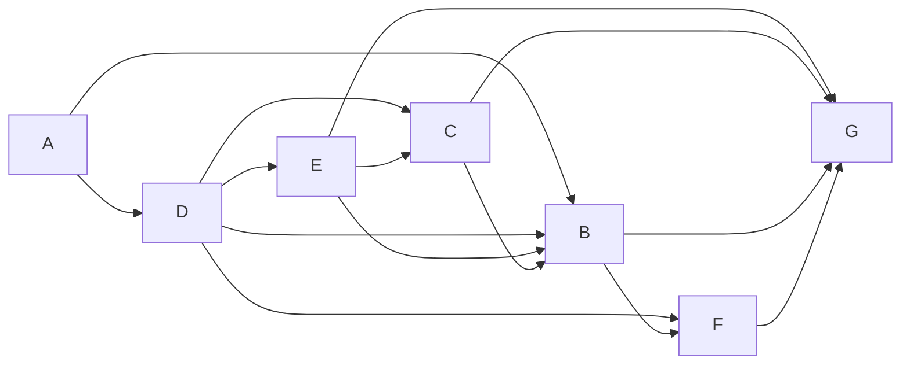

# Учебный вариант V03

Seed: "informatics-variant-v1:V03". 16 заданий, максимум 21 балл. В №13 выбрана презентация (13.1). Альтернативная работа не добавляет номер или баллы.

Набор предназначен для разбора и содержит решения и эталоны. Это авторские учебные задания. Формат — сверенный проект ОГЭ 2027; критерии практических работ учебные.

[Скачать полный комплект файлов](dataset.zip)

## Задание №1

В кодировке каждый символ занимает 8 бит. Записан список слов: «можжевельник, сосна, клён, лиственница, крапива, земляника, хризантема». Одно слово удалили вместе с лишними запятой и пробелом; двойных пробелов не осталось. Размер текста уменьшился на 11 байт. Какое слово удалили?

**Ответ / эталон:** земляника

#### Решение

1. Один символ занимает 1 байт. Удалено 11 символов.

2. Запятая и пробел — ещё два символа. В слове 9 букв (дефис, если он есть, тоже символ).

3. В списке такую длину имеет слово «земляника». Проверка: (9 + 2) · 1 = 11 байт.

## Задание №2

Сообщение закодировано с помощью таблицы. Между кодами букв нет дополнительных разделителей.

| Буква | Код   |
| ----- | ----- |
| Г     | `~`   |
| В     | `~#`  |
| Д     | `~##` |
| Б     | `###` |

Сигнал: `######~####~#####`. Расшифруй сообщение и запиши последовательность букв.

**Ответ / эталон:** ББВБДБ

#### Решение

1. Разбирай весь сигнал по таблице: короткий код не всегда определяет границу следующей буквы.

2. Разбиение: ### / ### / ~# / ### / ~## / ###. Сообщение: ББВБДБ.

3. Соедини буквы в порядке кодовых блоков: ББВБДБ.

## Задание №3

Найди наименьшее натуральное число X, при котором выражение ложно.

Выражение: `(НЕ (X >= 5))`.

Натуральные числа начинаются с 1.

**Ответ / эталон:** 5

#### Решение

1. Нужно ложное значение всего выражения. Разбирай операции с учётом скобок.

2. При X = 5 выражение ложно. При меньших натуральных X оно истинно.

3. Первое ложное значение достигается при X = 5.

## Задание №4

В таблице указаны длины дорог между пунктами в километрах. Знак — означает, что прямой дороги нет. По каждой дороге можно двигаться в обе стороны.

| Пункт | A   | B   | C   | D   | E   |
| ----- | --- | --- | --- | --- | --- |
| A     | —   | 8   | 4   | 4   | 6   |
| B     | 8   | —   | 2   | 9   | —   |
| C     | 4   | 2   | —   | 7   | 9   |
| D     | 4   | 9   | 7   | —   | 1   |
| E     | 6   | —   | 9   | 1   | —   |

Какова длина кратчайшего пути из A в E? В ответе запиши число километров.

**Ответ / эталон:** 5

#### Решение

1. Начни с расстояния 0 до A. Для соседнего пункта сравни уже найденный путь и путь через текущий пункт.

2. Минимальные расстояния от A: A — 0; B — 6; C — 4; D — 4; E — 5 км.

3. Минимальная суммарная длина до E равна 5 км. Число дорог само по себе длину пути не определяет.

## Задание №5

У исполнителя две команды:

1. Умножь на 3.
2. Прибавь 4.

Составь программу, которая переводит число 4 в число 148 и содержит не более 5 команд. В ответе запиши только номера команд. Если подходящих программ несколько, запиши любую.

**Ответ / эталон:** 12112

#### Решение

1. Проверяй программы от одной команды до 5. Сохраняй порядок действий.

2. Один подходящий вариант — 12112: 4 → 12 → 16 → 48 → 144 → 148.

3. Последнее значение равно 148, длина программы 5 не превышает 5. Другие подходящие программы также принимаются.

## Задание №6

Программа запускалась девять раз; в каждом запуске вводилась одна из пар (s, t) из таблицы и одно и то же целое число A.

```python
s = int(input())
t = int(input())
A = int(input())
if s > A or t > 6:
    print("YES")
else:
    print("NO")
```

| s   | t   |
| --- | --- |
| 15  | -1  |
| 1   | 14  |
| -12 | 12  |
| 6   | 12  |
| 3   | 12  |
| -3  | 0   |
| -13 | 0   |
| -11 | 1   |
| -2  | 0   |

Укажи наибольшее целое значение A, при котором программа напечатала YES ровно 5 раз.

**Ответ / эталон:** 14

#### Решение

1. Отдели запуски, где сравнение с постоянной границей уже даёт YES независимо от A.

2. При A = 14 результаты девяти запусков: YES, YES, YES, YES, YES, NO, NO, NO, NO. Получено 5 YES.

3. Сравнение строгое: значение на границе уже меняет число YES. Поэтому последнее подходящее целое A равно 14.

## Задание №7

Доступ к файлу notes.txt на сервере school.ru осуществляется по протоколу HTTPS. Фрагменты адреса закодированы цифрами от 1 до 7. Запиши последовательность цифр, кодирующую адрес файла.

| Цифра | Фрагмент  |
| ----- | --------- |
| 1     | `.txt`    |
| 2     | `://`     |
| 3     | `school.` |
| 4     | `https`   |
| 5     | `/`       |
| 6     | `ru`      |
| 7     | `notes`   |

**Ответ / эталон:** 4236571

#### Решение

1. Порядок частей URL: протокол, ://, сервер, /, имя файла.

2. Полный адрес: https://school.ru/notes.txt.

3. Замени его части цифрами из таблицы: 4236571. Проверь, что использованы все семь фрагментов.

## Задание №8

В языке поисковых запросов | означает «ИЛИ», & — «И». Все запросы выполнены по одной неизменной базе страниц. Количества указаны в тысячах.

| Запрос                     | Найдено страниц (тыс.) |
| -------------------------- | ---------------------- |
| `Лира & (Вега \| Альтаир)` | 1050                   |
| `Лира & Вега`              | 830                    |
| `Лира & Вега & Альтаир`    | 450                    |

Сколько тысяч страниц найдёт запрос `Лира & Альтаир`? Запиши целое число.

**Ответ / эталон:** 670

#### Решение

1. Рассмотри два множества: страницы с Лирой и Вегой и страницы с Лирой и Альтаиром.

2. Первая строка таблицы — их объединение, тройной запрос — их пересечение.

3. Искомое множество: 1050 − 830 + 450 = 670.

## Задание №9

На рисунке показана схема дорог между городами A, B, C, D, E, F, G. Двигаться можно только в направлении стрелок. Сколько различных путей ведёт из A в G?

Схема дорог: движение только по стрелкам, начальный город A, конечный G.



Текстовое описание: Схема дорог: движение только по стрелкам, начальный город A, конечный G. Вершины: A, B, C, D, E, F, G. Дуги: A → D; A → B; D → E; D → C; D → B; D → F; E → C; E → B; E → G; C → B; C → G; B → F; B → G; F → G.

**Ответ / эталон:** 14

#### Решение

1. Положи число способов попасть в A равным 1.

2. Для каждого следующего города сложи числа у его непосредственных предшественников: A — 1; B — 5; C — 2; D — 1; E — 1; F — 6; G — 14.

3. Число у конечного города G равно 14.

## Задание №10

Вычисли значение выражения $\mathrm{1111}_{2} + \mathrm{24}_{8} + \mathrm{1C}_{16}$. В ответе запиши десятичное число, основание указывать не нужно.

**Ответ / эталон:** 63

#### Решение

1. Переведи каждое слагаемое в десятичную систему по разрядам.

2. 1111 (основание 2) = 15; 24 (основание 8) = 20; 1C (основание 16) = 28.

3. 15 + 20 + 28 = 63.

## Задание №11

Скачай и распакуй корпус рассказов. В рассказе автора «Олег Ветров» герой «Денис» получил посылку с образцами. Какова фамилия человека, произнёсшего слова «Это полезный труд» в этом эпизоде? Запиши одно слово.

**Ответ / эталон:** Ильин

#### Решение

1. Открой папку Тексты/Олег Ветров. Ищи имя героя Денис и слова «получил посылку с образцами».

2. Прочитай эпизод и соседние абзацы. Реплика: «Это полезный труд». Проверь, кому принадлежит реплика и о каком событии идёт речь.

3. Фамилия говорящего — Ильин. Ответ: Ильин.

## Задание №12

Скачай и распакуй файловый набор. Сколько файлов с расширением .htm находится в следующих каталогах, включая все вложенные папки?

- Проза-архив/Павел Листьев
- Заметки/Глеб Озёрный

Другие каталоги не учитывай.

**Ответ / эталон:** 5

#### Решение

1. В каждом указанном каталоге включи поиск во вложенных папках. Отбирай .htm по расширению файла.

2. Подходящие файлы:

- Заметки/Глеб Озёрный/работа-07.htm
- Заметки/Глеб Озёрный/работа-15.htm
- Проза-архив/Павел Листьев/Черновики/работа-18.htm
- Проза-архив/Павел Листьев/работа-02.htm
- Проза-архив/Павел Листьев/работа-10.htm

3. Всего 5 файлов. Одинаковые имена в разных каталогах обозначают разные файлы; каждый полный путь учтён один раз.

## Задание №13

### 13.1 Презентация — выбрана

Создай презентацию «Маяк на побережье» из трёх слайдов по макету набора. Используй исходный ODT и три авторские иллюстрации. Формат слайда — 16:9; заголовки — 30–32 пт, основной текст — не меньше 20 пт.

Первый слайд: название, подзаголовок и учебный идентификатор P12. Второй: «Световой ориентир», два смысловых пункта и иллюстрация. Третий: «Ориентир и наблюдатель», два изображения с подписями. Сохраняй пропорции изображений; текст и изображения должны помещаться на слайде. Используй единое оформление. Сохрани результат как P12.odp.

Имена, фамилии и контакты вводить не нужно. Это авторское учебное задание; критерии в наборе предназначены для самооценки и не заменяют официальную экспертную проверку.

**Ответ / эталон:** curated-presentations-v1:P12:reference

#### Решение

1. Открой исходный ODT, изображения и макеты. Создай три широкоформатных слайда, выбери единые шрифты и цвета.

2. Распредели текст: титул, «Световой ориентир», «Ориентир и наблюдатель». Размести иллюстрации по макету, добавь подписи и идентификатор P12.

3. Сохрани P12.odp, открой файл повторно и сравни с шестью пунктами чек-листа. Проверь отсутствие обрезанного текста и искажённых изображений; затем при необходимости открой эталон.

#### Учебные критерии

- 0: ODP отсутствует или не открывается либо выполнены не более трёх из шести пунктов учебного чек-листа.

- 1: ODP открывается; выполнены четыре или пять из шести пунктов учебного чек-листа.

- 2: ODP открывается; выполнены все шесть пунктов учебного чек-листа.

### 13.2 Документ

Оформи одностраничный документ «План исследовательского проекта» по образцу layout/sample.odt. Возьми текст и данные из source/material.odt; слова образца заменяются исходными материалами.

Страница A4, книжная ориентация, все поля 2 см. Шрифт DejaVu Serif. Заголовок: 18 пт, полужирный, по центру, отступ после 0,5 см. Два основных абзаца: 12 пт, по ширине, первая строка 1,25 см, межстрочный интервал 115%, отступ после 0,3 см.

Создай настоящую таблицу: 3 столбца, строк — 4 (включая заголовки). Ширины столбцов слева направо: 5, 5, 7 см. Таблица слева, отступ перед 0,3 см; все границы 0,5 пт, внутренние поля ячеек 0,15 см. Текст ячеек 12 пт. Заголовки столбцов полужирные, по центру, заливка #E6F0EF; остальные ячейки по левому краю. Подпись «Учебный идентификатор: D07»: 10 пт, курсив, справа, отступ перед 0,4 см. Сохрани D07.odt.

Имена, фамилии и контакты вводить не нужно. Это авторское учебное задание; критерии предназначены для самооценки и не заменяют официальную экспертную проверку.

**Ответ / эталон:** curated-documents-v1:D07:reference

#### Решение

1. Открой исходный текст и образец. Настрой A4, поля и шрифт; перенеси заголовок и оба абзаца без изменения текста.

2. Задай параметры абзацев. Вставь таблицу нужного размера, перенеси все ячейки и настрой ширины, границы, заливку и выравнивание.

3. Добавь подпись D07, сохрани D07.odt и открой повторно. Сравни с шестью пунктами учебного чек-листа; затем при необходимости открой эталон.

#### Учебные критерии

- 0: ODT отсутствует или не открывается либо выполнены не более трёх из шести пунктов учебного чек-листа.

- 1: ODT открывается; выполнены четыре или пять из шести пунктов учебного чек-листа.

- 2: ODT открывается; выполнены все шесть пунктов учебного чек-листа.

## Задание №14

Открой source/data.ods: лист «Данные», заголовки в A1:D1, 240 записей в A2:D241. Каждый ID — отдельная запись.

Выполни три связанных запроса:

1. Количество записей: кружок «Бета», класс не меньше 8.
2. Сумма баллов этих записей.
3. Максимальный балл среди этих записей.

Запиши ответы в H2, H3, H4 по порядку. Для вычислений можно использовать E и другие свободные столбцы; исходные A:D не меняй. Не включай заголовки и ячейки ответов в диапазоны. Сохрани result.ods с формулами и исходными данными. Это авторское учебное задание; критерии 0–3 предназначены для самооценки и не заменяют официальную экспертную проверку.

**Ответ / эталон:** sheet-filter-v1:["informatics-variant-v1","informatics-variant-v1:V03",14]:reference

#### Решение

1. Проверь исходные столбцы и выдели строки по условию первого запроса. Формула H2 в записи OpenFormula: of:=COUNTIFS([.B2:.B241];"Бета";[.C2:.C241];">=8"). Ответ: 53.

2. В E2 запиши of:=IF(AND([.B2]="Бета";[.C2]>=8);[.D2];0) и протяни до E241. Для H3 используй of:=SUM([.E2:.E241]). Ответ: 2945.

3. В H4 запиши of:=MAX([.E2:.E241]). Ответ: 98. Открой сохранённый result.ods повторно и сравни три результата. В интерфейсе Calc имена функций могут быть локализованы; of:= и квадратные скобки — запись внутри ODS.

#### Учебные критерии

- 0: ODS отсутствует или не открывается либо ни один из трёх результатов не верен.

- 1: ODS открывается, исходные данные сохранены; верен один из трёх результатов.

- 2: ODS открывается, исходные данные сохранены; верны два из трёх результатов.

- 3: ODS открывается, исходные данные сохранены; верны все три результата.

## Задание №15

Робот находится в нижней клетке вертикального пути длиной от 1 до 12 клеток. Путь продолжается строго вверх до верхней границы поля, в этом столбце внутренних горизонтальных стен нет. Слева от каждой клетки пути может быть стена или проход; справа есть хотя бы одна клетка или граница, на алгоритм это не влияет. Закрась только клетки пути, слева от которых стена. Слева от пути всегда есть отдельный столбец: границу поля нельзя спутать со стеной. Допустимы отсутствие стен, сплошная стена и произвольное расположение проходов.

Все клетки первоначально не закрашены. Лишние клетки закрашивать нельзя; конечная позиция не задана. Используй датчики и циклы, не подставляй размеры с рисунка. Показан только один пример семейства: сетка 1 × 3, старт (строка 0, столбец 1), индексы с 0. Данные и рисунок находятся в source; проверочные поля — в validation/fields.json.

Сохрани программу в answer.txt, UTF-8. Поддерживаются движения, закраска, датчики, если/иначе и нц пока; описание языка есть в README.txt. Нужно нормальное завершение без столкновений и точная закраска на всех допустимых полях семейства. Учебные критерии 0/1/2 и конечный набор проверок не заменяют официальную экспертную оценку.

**Ответ / эталон:** robot-wall-gaps-v2:["informatics-variant-v1","informatics-variant-v1:V03",15]:reference

#### Решение

1. Проверь левую стену уже в стартовой клетке. Проход — причина пропустить закраску, а не перейти в соседний столбец.

2. Поднимайся по одной клетке, пока сверху свободно, и после каждого шага проверяй стену слева.

3. Число оставшихся клеток сверху убывает. Ни одна клетка вне исходного столбца не посещается; проходы не закрашиваются.

```
использовать Робот
алг
нач
если слева стена то
  закрасить
все
нц пока сверху свободно
  вверх
если слева стена то
  закрасить
все
кц
кон

```

#### Учебные критерии

- 0: Не выполнены условия для 1 или 2: есть ошибка разбора, столкновение, незавершение либо хотя бы на одном проверочном поле более 10 лишних или более 10 незакрашенных целевых клеток.

- 1: На каждом из восьми проверочных полей программа завершилась без столкновения, закрасив не более 10 лишних и пропустив не более 10 целевых клеток; точность для 2 не достигнута. Это применение критерия ФИПИ к конечной учебной выборке, не официальный балл.

- 2: Все восемь проверочных полей пройдены с нормальным завершением, без столкновений и с точной закраской.

## Задание №16

Напиши программу на Python 3. Рассмотри соседние пары N целых чисел: первое и второе, второе и третье и далее. Пары могут перекрываться. Найди количество пар, сумма которых делится на 7 без остатка, и наибольшую из этих сумм. Сначала выведи количество, затем максимум. Суммы могут быть отрицательными. При отсутствии подходящих пар, в том числе при N = 1, выведи 0 0.

Ввод: первая строка — N, целое от 1 до 1000 включительно. Затем ровно N строк, по одному целому числу от −10000 до 10000 включительно. Порядок чисел сохраняется.
Выводи только указанные целые числа, без приглашений и пояснений. Числа результата разделяй пробелом.

Пример ввода:

```
20
-95
87
-20
-86
90
-65
51
-55
56
-48
-7
-35
44
54
84
-64
-45
68
-34
77
```

Пример вывода:

```
3 98
```

Сохрани код в answer.py, UTF-8. В архиве находятся десять тестов, эталон и инструкция локального запуска. Проверка использует лимит 2 секунды на тест; это учебное ограничение, а не норма экзамена. Учебные критерии 0/1/2 относятся к результатам запусков и не заменяют официальную экспертную оценку.

**Ответ / эталон:** python-pairs-v1:["informatics-variant-v1","informatics-variant-v1:V03",16]:reference

#### Решение

1. Запомни первое число. Каждое следующее образует пару с предыдущим; при N = 1 пар нет.

2. Для подходящей пары обнови счётчик и максимум. Первая подходящая сумма задаёт максимум даже тогда, когда она отрицательная.

3. На каждом шаге сохраняй текущее число как предыдущее. Так соседние пары могут перекрываться; при отсутствии подходящих выведи 0 0.

```
n = int(input())
previous = int(input())
count = 0
best = 0
for i in range(n - 1):
    current = int(input())
    pair_sum = previous + current
    if pair_sum % 7 == 0:
        if count == 0 or pair_sum > best:
            best = pair_sum
        count += 1
    previous = current
print(count, best)

```

#### Учебные критерии

- 0: Ни один тест не пройден: нет запуска, ошибка исполнения или неверный вывод. Само наличие файла не даёт балла.

- 1: Программа нормально завершилась и дала верный вывод на части из десяти тестов, но не на всех.

- 2: Программа нормально завершилась и дала верный вывод на всех десяти тестах, включая граничные случаи.
