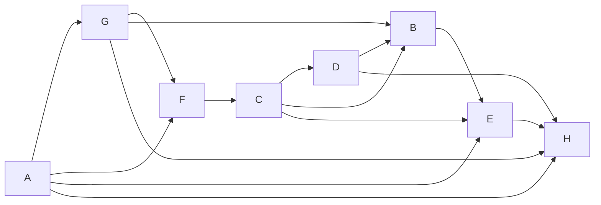

# Учебный вариант V05

Seed: "informatics-variant-v1:V05". 16 заданий, максимум 21 балл. В №13 выбрана презентация (13.1). Альтернативная работа не добавляет номер или баллы.

Набор предназначен для разбора и содержит решения и эталоны. Это авторские учебные задания. Формат — сверенный проект ОГЭ 2027; критерии практических работ учебные.

[Скачать полный комплект файлов](dataset.zip)

## Задание №1

В кодировке каждый символ занимает 8 бит. Записан список слов: «берёза, сосна, шиповник, хризантема, земляника, можжевельник, лиственница». Одно слово удалили вместе с лишними запятой и пробелом; двойных пробелов не осталось. Размер текста уменьшился на 8 байт. Какое слово удалили?

**Ответ / эталон:** берёза

#### Решение

1. Один символ занимает 1 байт. Удалено 8 символов.

2. Запятая и пробел — ещё два символа. В слове 6 букв (дефис, если он есть, тоже символ).

3. В списке такую длину имеет слово «берёза». Проверка: (6 + 2) · 1 = 8 байт.

## Задание №2

Сообщение закодировано с помощью таблицы. Между кодами букв нет дополнительных разделителей.

| Буква | Код   |
| ----- | ----- |
| Б     | `.`   |
| Е     | `-.`  |
| В     | `--.` |
| Г     | `---` |

Сигнал: `--.--.-.--..-----.-.---`. Расшифруй сообщение и запиши последовательность букв.

**Ответ / эталон:** ВВЕВБГВЕГ

#### Решение

1. Ни один код в таблице не совпадает с началом другого. Читаем слева направо: как только набран код из таблицы, записываем букву и начинаем читать следующую.

Начало записи — `--.` (3 знака). По таблице это буква «В». Продолжаем с позиции 4.

2. Разделим всю запись на коды букв:

`--. / --. / -. / --. / . / --- / --. / -. / ---`

| № буквы | Код   | Буква |
| ------- | ----- | ----- |
| 1       | `--.` | В     |
| 2       | `--.` | В     |
| 3       | `-.`  | Е     |
| 4       | `--.` | В     |
| 5       | `.`   | Б     |
| 6       | `---` | Г     |
| 7       | `--.` | В     |
| 8       | `-.`  | Е     |
| 9       | `---` | Г     |

Читаем буквы сверху вниз: **ВВЕВБГВЕГ**.

3. Проверим обратным кодированием: «В» → `--.`; «В» → `--.`; «Е» → `-.`; «В» → `--.`; «Б» → `.`; «Г» → `---`; «В» → `--.`; «Е» → `-.`; «Г» → `---`.

Соединив коды без разделителей, получим `--.--.-.--..-----.-.---` — исходную запись. Значит, все знаки использованы. Ответ: **ВВЕВБГВЕГ**.

## Задание №3

Найди наименьшее натуральное число X, при котором выражение ложно.

Выражение: `((НЕ (X >= 3)) ИЛИ (X >= 17))`.

Натуральные числа начинаются с 1.

**Ответ / эталон:** 3

#### Решение

1. Нужно ложное значение всего выражения. Разбирай операции с учётом скобок.

2. При X = 3 выражение ложно. При меньших натуральных X оно истинно.

3. Первое ложное значение достигается при X = 3.

## Задание №4

В таблице указаны длины дорог между пунктами в километрах. Знак — означает, что прямой дороги нет. По каждой дороге можно двигаться в обе стороны.

| Пункт | A   | B   | C   | D   | E   |
| ----- | --- | --- | --- | --- | --- |
| A     | —   | 1   | —   | 8   | 7   |
| B     | 1   | —   | 2   | —   | 1   |
| C     | —   | 2   | —   | 7   | —   |
| D     | 8   | —   | 7   | —   | 7   |
| E     | 7   | 1   | —   | 7   | —   |

Какова длина кратчайшего пути из A в E? В ответе запиши число километров.

**Ответ / эталон:** 2

#### Решение

1. Начни с расстояния 0 до A. Для соседнего пункта сравни уже найденный путь и путь через текущий пункт.

2. Минимальные расстояния от A: A — 0; B — 1; C — 3; D — 8; E — 2 км.

3. Минимальная суммарная длина до E равна 2 км. Число дорог само по себе длину пути не определяет.

## Задание №5

У исполнителя две команды:

1. Возведи число в квадрат.
2. Прибавь 1.

Составь программу, которая переводит число 2 в число 19 и содержит не более 5 команд. В ответе запиши только номера команд. Если подходящих программ несколько, запиши любую.

**Ответ / эталон:** 11222

#### Решение

1. Проверяй программы от одной команды до 5. Сохраняй порядок действий.

2. Один подходящий вариант — 11222: 2 → 4 → 16 → 17 → 18 → 19.

3. Последнее значение равно 19, длина программы 5 не превышает 5. Другие подходящие программы также принимаются.

## Задание №6

Программа запускалась девять раз; в каждом запуске вводилась одна из пар (s, t) из таблицы и одно и то же целое число A.

```python
s = int(input())
t = int(input())
A = int(input())
if s > 3 or t > A:
    print("YES")
else:
    print("NO")
```

| s   | t   |
| --- | --- |
| -2  | -13 |
| -1  | 1   |
| -4  | -5  |
| 1   | -1  |
| -1  | -4  |
| 7   | 13  |
| -4  | -15 |
| -1  | -3  |
| -2  | -8  |

Укажи наибольшее целое значение A, при котором программа напечатала YES ровно 7 раз.

**Ответ / эталон:** -9

#### Решение

1. Отдели запуски, где сравнение с постоянной границей уже даёт YES независимо от A.

2. При A = -9 результаты девяти запусков: NO, YES, YES, YES, YES, YES, NO, YES, YES. Получено 7 YES.

3. Сравнение строгое: значение на границе уже меняет число YES. Поэтому последнее подходящее целое A равно -9.

## Задание №7

Доступ к файлу data.xls на сервере paper.ru осуществляется по протоколу HTTP. Фрагменты адреса закодированы цифрами от 1 до 7. Запиши последовательность цифр, кодирующую адрес файла.

| Цифра | Фрагмент |
| ----- | -------- |
| 1     | `ru`     |
| 2     | `http`   |
| 3     | `.xls`   |
| 4     | `paper.` |
| 5     | `/`      |
| 6     | `data`   |
| 7     | `://`    |

**Ответ / эталон:** 2741563

#### Решение

1. Порядок частей URL: протокол, ://, сервер, /, имя файла.

2. Полный адрес: http://paper.ru/data.xls.

3. Замени его части цифрами из таблицы: 2741563. Проверь, что использованы все семь фрагментов.

## Задание №8

В языке поисковых запросов | означает «ИЛИ», & — «И». Все запросы выполнены по одной неизменной базе страниц. Количества указаны в тысячах.

| Запрос                     | Найдено страниц (тыс.) |
| -------------------------- | ---------------------- |
| `Лира & (Вега \| Альтаир)` | 890                    |
| `Лира & Вега`              | 430                    |
| `Лира & Вега & Альтаир`    | 20                     |

Сколько тысяч страниц найдёт запрос `Лира & Альтаир`? Запиши целое число.

**Ответ / эталон:** 480

#### Решение

1. Рассмотри два множества: страницы с Лирой и Вегой и страницы с Лирой и Альтаиром.

2. Первая строка таблицы — их объединение, тройной запрос — их пересечение.

3. Искомое множество: 890 − 430 + 20 = 480.

## Задание №9

На рисунке показана схема дорог между городами A, B, C, D, E, F, G, H. Двигаться можно только в направлении стрелок. Сколько различных путей ведёт из A в H?

Схема дорог: движение только по стрелкам, начальный город A, конечный H.



Текстовое описание: Схема дорог: движение только по стрелкам, начальный город A, конечный H. Вершины: A, B, C, D, E, F, G, H. Дуги: A → G; A → F; A → E; A → H; G → F; G → B; G → H; F → C; C → D; C → B; C → E; D → B; D → H; B → E; E → H.

**Ответ / эталон:** 12

#### Решение

1. Положи число способов попасть в A равным 1.

2. Для каждого следующего города сложи числа у его непосредственных предшественников: A — 1; B — 5; C — 2; D — 2; E — 8; F — 2; G — 1; H — 12.

3. Число у конечного города H равно 12.

## Задание №10

Вычисли значение выражения $\mathrm{1001110}_{2} + \mathrm{57}_{8} + \mathrm{2A}_{16}$. В ответе запиши десятичное число, основание указывать не нужно.

**Ответ / эталон:** 167

#### Решение

1. Переведи каждое слагаемое в десятичную систему по разрядам.

2. 1001110 (основание 2) = 78; 57 (основание 8) = 47; 2A (основание 16) = 42.

3. 78 + 47 + 42 = 167.

## Задание №11

Скачай и распакуй корпус рассказов. В рассказе автора «Алла Северина» герой «Вадим» помог нанести остров на карту. Как звали щенка, который был рядом с героем в этом эпизоде? Запиши одно слово.

**Ответ / эталон:** Дружок

#### Решение

1. Открой папку Тексты/Алла Северина. Ищи имя героя Вадим и слова «помог нанести остров на карту».

2. Прочитай эпизод и соседние абзацы. Кличка щенка названа при описании встречи на причале, перед событием.

3. Кличка щенка — Дружок. Ответ: Дружок.

## Задание №12

Скачай и распакуй файловый набор. Сколько файлов с расширением .htm находится в следующих каталогах, включая все вложенные папки?

- Письма/Ирина Полевая
- Проза

Другие каталоги не учитывай.

**Ответ / эталон:** 7

#### Решение

1. В каждом указанном каталоге включи поиск во вложенных папках. Отбирай .htm по расширению файла.

2. Подходящие файлы:

- Письма/Ирина Полевая/работа-05.htm
- Письма/Ирина Полевая/работа-13.htm
- Проза/Нина Речная/Черновики/работа-01.htm
- Проза/Нина Речная/работа-09.htm
- Проза/Нина Речная/работа-17.htm
- Проза/Олег Ветров/Черновики/работа-13.htm
- Проза/Олег Ветров/работа-05.htm

3. Всего 7 файлов. Одинаковые имена в разных каталогах обозначают разные файлы; каждый полный путь учтён один раз.

## Задание №13

### 13.1 Презентация — выбрана

Создай презентацию «От семени к дереву» из трёх слайдов по макету набора. Используй исходный ODT и авторские иллюстрации. Формат 16:9, альбомная ориентация, без анимации. Единый тип шрифта: название на титуле 40 пт; его подзаголовок и заголовки остальных слайдов 24 пт; основной текст 20 пт.

Первый слайд: название и учебный идентификатор P01 в подзаголовке. Второй: «Что нужно ростку», два изображения и два текстовых блока. Третий: «Сравниваем этапы», три изображения и три текстовых блока. Взаимное расположение объектов сохрани по макетам. Сохраняй пропорции изображений; текст и изображения должны помещаться на слайде. Используй единое оформление. Сохрани результат как P01.odp.

Имена, фамилии и контакты вводить не нужно. Это авторское учебное задание; критерии в наборе предназначены для самооценки и не заменяют официальную экспертную проверку.

**Ответ / эталон:** curated-presentations-v2:P01:reference

#### Решение

1. Открой исходный ODT, изображения и макеты. Создай три широкоформатных слайда, выбери единые шрифты и цвета.

2. Распредели текст: титул, «Что нужно ростку», «Сравниваем этапы». Размести иллюстрации по макету, добавь подписи и идентификатор P01.

3. Сохрани P01.odp, открой файл повторно и сравни с требованиями к структуре, шрифту и изображениям. Проверь отсутствие обрезанного текста и искажённых изображений; затем при необходимости открой эталон.

#### Учебные критерии

- 0: Не выполнены условия на 1 или 2 балла либо файл имеет недопустимый формат.

- 1: Три слайда по теме, на втором и третьем есть текст и иллюстрации; не более одной ошибки в структуре, шрифте или изображениях. Однотипные ошибки считаются одной. Либо два слайда по теме без таких ошибок.

- 2: Три слайда полностью соответствуют теме, макетам, размерам шрифта и требованиям к изображениям; ошибок нет.

### 13.2 Документ

Оформи документ «МЕДИАТЕКА КРУЖКА» по визуальному образцу layout/sample.pdf. Текст и данные для набора находятся в source/material.odt. Повтори взаимное расположение текста и таблицы, объединение ячеек и выделения полужирным, курсивом и подчёркиванием.

A4, книжная ориентация, поля 2 см. Единый шрифт DejaVu Serif, весь текст 14 пт. Заголовок прописными буквами, по центру. Основной текст по ширине; первая строка 1 см, межстрочный интервал 150%, интервалы между заголовком, абзацами и таблицей 14 пт. Отступы и интервалы задавай свойствами абзаца; разбиение на строки автоматическое.

Таблица: два столбца шириной 7 и 8 см, по центру страницы, уже основного текста; все ячейки по вертикали по центру. Первый столбец по левому краю, второй по центру; строка заголовков по центру. Сохрани границы, выделения и все данные образца. Не используй пустые абзацы, пробелы вместо отступов или разрывы строк. Сохрани D08.odt.

Имена, фамилии и контакты вводить не нужно. Это авторское учебное задание; критерии предназначены для самооценки и не заменяют официальную экспертную проверку.

**Ответ / эталон:** curated-documents-v2:D08:reference

#### Решение

1. Открой исходный текст и образец. Настрой A4, поля и шрифт; перенеси заголовок и оба абзаца без изменения текста.

2. Задай параметры абзацев и выделения по образцу. Вставь таблицу, объедини нужные ячейки и настрой ширины, границы и выравнивание.

3. Сохрани D08.odt и открой повторно. Сравни две группы требований — основной текст и таблицу; затем при необходимости открой эталон.

#### Учебные критерии

- 0: Не выполнены условия на 1 или 2 балла либо файл имеет недопустимый формат.

- 1: В основном тексте и таблицах не более трёх нарушений требований в каждой группе. Либо одна группа выполнена полностью верно, а другая отсутствует или содержит более трёх нарушений. Также 1 балл при верной работе с существенными расхождениями макета.

- 2: Основной текст и таблицы оформлены по образцу. В основном тексте допускается до пяти текстовых ошибок, в таблицах — до трёх; остальные требования выполнены.

## Задание №14

В таблицу внесены 1000 записей. Открой source/data.ods: лист «Данные», заголовки A1:D1, записи A2:D1001. Столбцы по порядку: номер участника; номер школы; класс; баллы. Порядок записей произвольный.

1. Сколько участников из 9 класса набрали более 193 баллов? Ответ запиши в H2.
2. Каков средний балл участников школы №11? Укажи не менее двух знаков после запятой. Ответ запиши в H3.
3. Построй круговую диаграмму соотношения количества участников из 7, 8 и 9 классов. Левый верхний угол размести вблизи G6. В поле диаграммы должны присутствовать легенда и числовые значения исходных данных.

Используй свободные столбцы для вычислений, сохрани исходные данные и результат в result.ods. Это авторское учебное задание по подтверждённому формату ФИПИ; самооценка не заменяет экспертную проверку файла.

**Ответ / эталон:** sheet-count-mean-v2:["informatics-variant-v1","informatics-variant-v1:V05",14]:reference

#### Решение

1. Первый расчёт: of:=COUNTIFS([.C2:.C1001];9;[.D2:.D1001];">193"). Результат 157.

2. Второй расчёт: of:=ROUND(AVERAGEIF([.B2:.B1001];11;[.D2:.D1001]);2). Результат 210.5.

3. Создай вспомогательную таблицу: 7 класс — 332; 8 класс — 352; 9 класс — 316. Формулы: of:=COUNTIF([.C2:.C1001];7); of:=COUNTIF([.C2:.C1001];8); of:=COUNTIF([.C2:.C1001];9). Построй круговую диаграмму по этой таблице, добавь легенду и подписи значений. Открой сохранённый ODS повторно. Имена функций Calc могут быть локализованы; of:= и квадратные скобки — запись внутри ODS.

#### Учебные критерии

- 0: Ни один из трёх элементов не выполнен верно.

- 1: Верно выполнен один элемент: первый расчёт, второй расчёт или диаграмма.

- 2: Верно выполнены два из трёх элементов.

- 3: Оба числа найдены верно; диаграмма отображает правильные данные и их соотношение, содержит легенду и числовые подписи.

## Задание №15

Робот находится в нижней клетке вертикального пути длиной от 1 до 12 клеток. Путь продолжается строго вверх до верхней границы поля, в этом столбце внутренних горизонтальных стен нет. Слева от каждой клетки пути может быть стена или проход; справа есть хотя бы одна клетка или граница, на алгоритм это не влияет. Закрась только клетки пути, слева от которых стена. Слева от пути всегда есть отдельный столбец: границу поля нельзя спутать со стеной. Допустимы отсутствие стен, сплошная стена и произвольное расположение проходов.

Все клетки первоначально не закрашены. Лишние клетки закрашивать нельзя; конечная позиция не задана. Используй датчики и циклы, не подставляй размеры с рисунка. Показан только один пример семейства: сетка 11 × 3, старт (строка 10, столбец 1), индексы с 0. Данные и рисунок находятся в source; проверочные поля — в validation/fields.json.

Сохрани программу в answer.txt, UTF-8. Поддерживаются движения, закраска, датчики, если/иначе и нц пока; описание языка есть в README.txt. Нужно нормальное завершение без столкновений и точная закраска на всех допустимых полях семейства. Учебные критерии 0/1/2 и конечный набор проверок не заменяют официальную экспертную оценку.

**Ответ / эталон:** robot-wall-gaps-v2:["informatics-variant-v1","informatics-variant-v1:V05",15]:reference

#### Решение

1. Проверь левую стену уже в стартовой клетке. Проход — причина пропустить закраску, а не перейти в соседний столбец.

2. Поднимайся по одной клетке, пока сверху свободно, и после каждого шага проверяй стену слева.

3. Число оставшихся клеток сверху убывает. Ни одна клетка вне исходного столбца не посещается; проходы не закрашиваются.

```
использовать Робот
алг
нач
если слева стена то
  закрасить
все
нц пока сверху свободно
  вверх
если слева стена то
  закрасить
все
кц
кон

```

#### Учебные критерии

- 0: Не выполнены условия для 1 или 2: есть ошибка разбора, столкновение, незавершение либо хотя бы на одном проверочном поле более 10 лишних или более 10 незакрашенных целевых клеток.

- 1: На каждом из восьми проверочных полей программа завершилась без столкновения, закрасив не более 10 лишних и пропустив не более 10 целевых клеток; точность для 2 не достигнута. Это применение критерия ФИПИ к конечной учебной выборке, не официальный балл.

- 2: Все восемь проверочных полей пройдены с нормальным завершением, без столкновений и с точной закраской.

## Задание №16

Напиши программу на Python 3. Для неотрицательного целого числа найди количество и сумму цифр его обычной десятичной записи, которые делятся на 3 без остатка. Запись не содержит ведущих нулей; число 0 записывается одной цифрой 0, которая делится на любое положительное целое. Выведи количество и сумму через пробел; если подходящих цифр нет, выведи 0 0.

Ввод: одна строка, целое число от 0 до 999999999999 включительно.
Выводи только указанные целые числа, без приглашений и пояснений. Числа результата разделяй пробелом.

Пример ввода:

```
914316111958
```

Пример вывода:

```
4 27
```

Сохрани код в answer.py, UTF-8. В архиве находятся десять тестов, эталон и инструкция локального запуска. Проверка использует лимит 2 секунды на тест; это учебное ограничение, а не норма экзамена. Учебные критерии 0/1/2 относятся к результатам запусков и не заменяют официальную экспертную оценку.

**Ответ / эталон:** python-digits-v1:["informatics-variant-v1","informatics-variant-v1:V05",16]:reference

#### Решение

1. Учти, что запись числа 0 состоит из одной подходящей цифры 0.

2. Остаток от деления на 10 даёт последнюю цифру. Проверь её кратность, обнови счётчик и сумму, затем отбрось цифру целочисленным делением.

3. Частное уменьшается до 0, поэтому цикл завершится. Порядок просмотра цифр на количество и сумму не влияет.

```
n = int(input())
count = 0
total = 0
if n == 0:
    count = 1
while n > 0:
    digit = n % 10
    if digit % 3 == 0:
        count += 1
        total += digit
    n //= 10
print(count, total)

```

#### Учебные критерии

- 0: Ни один тест не пройден: нет запуска, ошибка исполнения или неверный вывод. Само наличие файла не даёт балла.

- 1: Программа нормально завершилась и дала верный вывод на части из десяти тестов, но не на всех.

- 2: Программа нормально завершилась и дала верный вывод на всех десяти тестах, включая граничные случаи.
