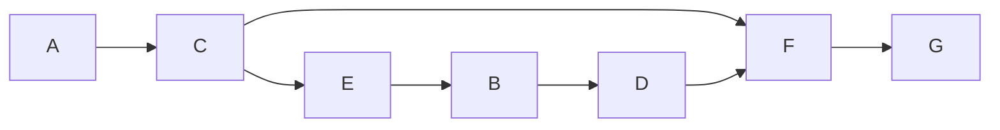

# Учебный вариант V06

Seed: "informatics-variant-v1:V06". 16 заданий, максимум 21 балл. В №13 выбрана презентация (13.1). Альтернативная работа не добавляет номер или баллы.

Набор предназначен для разбора и содержит решения и эталоны. Это авторские учебные задания. Формат — сверенный проект ОГЭ 2027; критерии практических работ учебные.

[Скачать полный комплект файлов](dataset.zip)

## Задание №1

В кодировке каждый символ занимает 16 бит. Записан список слов: «можжевельник, шиповник, сосна, клён, берёза, земляника, хризантема, лиственница, дуб, крапива». Одно слово удалили вместе с лишними запятой и пробелом; двойных пробелов не осталось. Размер текста уменьшился на 26 байт. Какое слово удалили?

**Ответ / эталон:** лиственница

#### Решение

1. Один символ занимает 2 байт. Удалено 13 символов.

2. Запятая и пробел — ещё два символа. В слове 11 букв (дефис, если он есть, тоже символ).

3. В списке такую длину имеет слово «лиственница». Проверка: (11 + 2) · 2 = 26 байт.

## Задание №2

Сообщение закодировано с помощью таблицы. Между кодами букв нет дополнительных разделителей.

| Буква | Код   |
| ----- | ----- |
| А     | `...` |
| В     | `..o` |
| Е     | `.o.` |
| Г     | `.oo` |
| Б     | `o..` |
| Д     | `o.o` |

Сигнал: `.o...oo..o.o....oo..o...`. Какие буквы встречаются в сообщении более одного раза? Запиши каждую такую букву один раз, в любом порядке.

**Ответ / эталон:** АВ, ВА

#### Решение

1. Разбирай весь сигнал по таблице: короткий код не всегда определяет границу следующей буквы.

2. Разбиение: .o. / ..o / o.. / o.o / ... / .oo / ..o / .... Сообщение: ЕВБДАГВА.

3. Число вхождений: Е — 1; В — 2; Б — 1; Д — 1; А — 2; Г — 1. Повторяющиеся буквы: АВ; их порядок в ответе произвольный.

## Задание №3

Сколько натуральных чисел X делают выражение истинным?

Выражение: `((X > 8) И (НЕ ((X >= 19) ИЛИ (НЕ (X нечётное)))))`.

Натуральные числа начинаются с 1.

**Ответ / эталон:** 5

#### Решение

1. Раскрой НЕ и учитывай скобки: для И нужны оба условия, для ИЛИ достаточно одного.

2. Подходящие натуральные X: 9, 11, 13, 15, 17.

3. Количество подходящих значений: 5. Ноль в натуральные числа не включён.

## Задание №4

В таблице указаны длины дорог между пунктами в километрах. Знак — означает, что прямой дороги нет. По каждой дороге можно двигаться в обе стороны.

| Пункт | A   | B   | C   | D   | E   |
| ----- | --- | --- | --- | --- | --- |
| A     | —   | 2   | 6   | —   | 6   |
| B     | 2   | —   | 3   | —   | 3   |
| C     | 6   | 3   | —   | 9   | —   |
| D     | —   | —   | 9   | —   | 7   |
| E     | 6   | 3   | —   | 7   | —   |

Какова длина кратчайшего пути из A в E? В ответе запиши число километров.

**Ответ / эталон:** 5

#### Решение

1. Начни с расстояния 0 до A. Для соседнего пункта сравни уже найденный путь и путь через текущий пункт.

2. Минимальные расстояния от A: A — 0; B — 2; C — 5; D — 12; E — 5 км.

3. Минимальная суммарная длина до E равна 5 км. Число дорог само по себе длину пути не определяет.

## Задание №5

У исполнителя две команды:

1. Умножь на 3.
2. Прибавь 4.

Составь программу, которая переводит число 2 в число 94 и содержит не более 5 команд. В ответе запиши только номера команд. Если подходящих программ несколько, запиши любую.

**Ответ / эталон:** 12112, 22112

#### Решение

1. Проверяй программы от одной команды до 5. Сохраняй порядок действий.

2. Один подходящий вариант — 12112: 2 → 6 → 10 → 30 → 90 → 94.

3. Последнее значение равно 94, длина программы 5 не превышает 5. Другие подходящие программы также принимаются.

## Задание №6

Программа запускалась девять раз; в каждом запуске вводилась одна из пар (s, t) из таблицы и одно и то же целое число A.

```python
s = int(input())
t = int(input())
A = int(input())
if s > 10 or t > A:
    print("YES")
else:
    print("NO")
```

| s   | t   |
| --- | --- |
| 14  | -14 |
| 6   | 1   |
| 18  | 5   |
| 11  | -4  |
| 6   | -7  |
| 15  | 6   |
| 12  | 11  |
| 9   | 10  |
| 11  | 2   |

Укажи любое целое значение A, при котором программа напечатала YES ровно 8 раз.

**Ответ / эталон:** любое целое A ≥ -7 и A ≤ 0

#### Решение

1. Отдели запуски, где сравнение с постоянной границей уже даёт YES независимо от A.

2. При A = -7 результаты девяти запусков: YES, YES, YES, YES, NO, YES, YES, YES, YES. Получено 8 YES.

3. Подходит каждое целое A ≥ -7 и A ≤ 0. Например, -7.

## Задание №7

Доступ к файлу data.txt на сервере smile.info осуществляется по протоколу FTP. Фрагменты адреса закодированы цифрами от 1 до 7. Запиши последовательность цифр, кодирующую адрес файла.

| Цифра | Фрагмент |
| ----- | -------- |
| 1     | `.txt`   |
| 2     | `/`      |
| 3     | `data`   |
| 4     | `info`   |
| 5     | `smile.` |
| 6     | `://`    |
| 7     | `ftp`    |

**Ответ / эталон:** 7654231

#### Решение

1. Порядок частей URL: протокол, ://, сервер, /, имя файла.

2. Полный адрес: ftp://smile.info/data.txt.

3. Замени его части цифрами из таблицы: 7654231. Проверь, что использованы все семь фрагментов.

## Задание №8

В языке поисковых запросов | означает «ИЛИ», & — «И». Все запросы выполнены по одной неизменной базе страниц. Количества указаны в тысячах.

| Запрос                     | Найдено страниц (тыс.) |
| -------------------------- | ---------------------- |
| `Лира & (Вега \| Альтаир)` | 880                    |
| `Лира & Вега`              | 730                    |
| `Лира & Вега & Альтаир`    | 460                    |

Сколько тысяч страниц найдёт запрос `Лира & Альтаир`? Запиши целое число.

**Ответ / эталон:** 610

#### Решение

1. Рассмотри два множества: страницы с Лирой и Вегой и страницы с Лирой и Альтаиром.

2. Первая строка таблицы — их объединение, тройной запрос — их пересечение.

3. Искомое множество: 880 − 730 + 460 = 610.

## Задание №9

На рисунке показана схема дорог между городами A, B, C, D, E, F, G. Двигаться можно только в направлении стрелок. Сколько различных путей ведёт из A в G?

Схема дорог: движение только по стрелкам, начальный город A, конечный G.



Текстовое описание: Схема дорог: движение только по стрелкам, начальный город A, конечный G. Вершины: A, B, C, D, E, F, G. Дуги: A → C; C → E; C → F; E → B; B → D; D → F; F → G.

**Ответ / эталон:** 2

#### Решение

1. Положи число способов попасть в A равным 1.

2. Для каждого следующего города сложи числа у его непосредственных предшественников: A — 1; B — 1; C — 1; D — 1; E — 1; F — 2; G — 2.

3. Число у конечного города G равно 2.

## Задание №10

Вычисли значение выражения $\mathrm{11011}_{2} + \mathrm{37}_{8} + \mathrm{8}_{16}$. В ответе запиши десятичное число, основание указывать не нужно.

**Ответ / эталон:** 66

#### Решение

1. Переведи каждое слагаемое в десятичную систему по разрядам.

2. 11011 (основание 2) = 27; 37 (основание 8) = 31; 8 (основание 16) = 8.

3. 27 + 31 + 8 = 66.

## Задание №11

Скачай и распакуй корпус рассказов. В рассказе автора «Глеб Озёрный» герой «Тимур» проверил показания берегового флюгера. Какова фамилия человека, произнёсшего слова «Это ответственный труд» в этом эпизоде? Запиши одно слово.

**Ответ / эталон:** Кузнецов

#### Решение

1. Открой папку Тексты/Глеб Озёрный. Ищи имя героя Тимур и слова «проверил показания берегового флюгера».

2. Прочитай эпизод и соседние абзацы. Реплика: «Это ответственный труд». Проверь, кому принадлежит реплика и о каком событии идёт речь.

3. Фамилия говорящего — Кузнецов. Ответ: Кузнецов.

## Задание №12

Скачай и распакуй файловый набор. Сколько файлов с расширениями .htm, .tiff находится в следующих каталогах, включая все вложенные папки?

- Иллюстрации/Нина Речная
- Проза-архив/Павел Листьев
- Проза-архив/Ирина Полевая

Другие каталоги не учитывай.

**Ответ / эталон:** 15

#### Решение

1. В каждом указанном каталоге включи поиск во вложенных папках. Отбирай .htm, .tiff по расширению файла.

2. Подходящие файлы:

- Иллюстрации/Нина Речная/Черновики/работа-01.tiff
- Иллюстрации/Нина Речная/Черновики/работа-16.htm
- Иллюстрации/Нина Речная/работа-08.htm
- Иллюстрации/Нина Речная/работа-09.tiff
- Иллюстрации/Нина Речная/работа-17.tiff
- Проза-архив/Ирина Полевая/Черновики/работа-06.htm
- Проза-архив/Ирина Полевая/Черновики/работа-15.tiff
- Проза-архив/Ирина Полевая/работа-07.tiff
- Проза-архив/Ирина Полевая/работа-14.htm
- Проза-архив/Павел Листьев/Черновики/работа-03.tiff
- Проза-архив/Павел Листьев/Черновики/работа-18.htm
- Проза-архив/Павел Листьев/работа-02.htm
- Проза-архив/Павел Листьев/работа-10.htm
- Проза-архив/Павел Листьев/работа-11.tiff
- Проза-архив/Павел Листьев/работа-19.tiff

3. Всего 15 файлов. Одинаковые имена в разных каталогах обозначают разные файлы; каждый полный путь учтён один раз.

## Задание №13

### 13.1 Презентация — выбрана

Создай презентацию «Маяк на побережье» из трёх слайдов по макету набора. Используй исходный ODT и три авторские иллюстрации. Формат слайда — 16:9; заголовки — 30–32 пт, основной текст — не меньше 20 пт.

Первый слайд: название, подзаголовок и учебный идентификатор P12. Второй: «Световой ориентир», два смысловых пункта и иллюстрация. Третий: «Ориентир и наблюдатель», два изображения с подписями. Сохраняй пропорции изображений; текст и изображения должны помещаться на слайде. Используй единое оформление. Сохрани результат как P12.odp.

Имена, фамилии и контакты вводить не нужно. Это авторское учебное задание; критерии в наборе предназначены для самооценки и не заменяют официальную экспертную проверку.

**Ответ / эталон:** curated-presentations-v1:P12:reference

#### Решение

1. Открой исходный ODT, изображения и макеты. Создай три широкоформатных слайда, выбери единые шрифты и цвета.

2. Распредели текст: титул, «Световой ориентир», «Ориентир и наблюдатель». Размести иллюстрации по макету, добавь подписи и идентификатор P12.

3. Сохрани P12.odp, открой файл повторно и сравни с шестью пунктами чек-листа. Проверь отсутствие обрезанного текста и искажённых изображений; затем при необходимости открой эталон.

#### Учебные критерии

- 0: ODP отсутствует или не открывается либо выполнены не более трёх из шести пунктов учебного чек-листа.

- 1: ODP открывается; выполнены четыре или пять из шести пунктов учебного чек-листа.

- 2: ODP открывается; выполнены все шесть пунктов учебного чек-листа.

### 13.2 Документ

Оформи одностраничный документ «Проверка цифрового макета» по образцу layout/sample.odt. Возьми текст и данные из source/material.odt; слова образца заменяются исходными материалами.

Страница A4, книжная ориентация, все поля 2 см. Шрифт DejaVu Serif. Заголовок: 18 пт, полужирный, по левому краю, отступ после 0,5 см. Два основных абзаца: 12 пт, по ширине, первая строка 1,25 см, межстрочный интервал 150%, отступ после 0,3 см.

Создай настоящую таблицу: 3 столбца, строк — 4 (включая заголовки). Ширины столбцов слева направо: 5, 5, 7 см. Таблица слева, отступ перед 0,3 см; все границы 0,5 пт, внутренние поля ячеек 0,15 см. Текст ячеек 12 пт. Заголовки столбцов полужирные, по центру, заливка #E6F0EF; остальные ячейки по левому краю. Подпись «Учебный идентификатор: D11»: 10 пт, курсив, справа, отступ перед 0,4 см. Сохрани D11.odt.

Имена, фамилии и контакты вводить не нужно. Это авторское учебное задание; критерии предназначены для самооценки и не заменяют официальную экспертную проверку.

**Ответ / эталон:** curated-documents-v1:D11:reference

#### Решение

1. Открой исходный текст и образец. Настрой A4, поля и шрифт; перенеси заголовок и оба абзаца без изменения текста.

2. Задай параметры абзацев. Вставь таблицу нужного размера, перенеси все ячейки и настрой ширины, границы, заливку и выравнивание.

3. Добавь подпись D11, сохрани D11.odt и открой повторно. Сравни с шестью пунктами учебного чек-листа; затем при необходимости открой эталон.

#### Учебные критерии

- 0: ODT отсутствует или не открывается либо выполнены не более трёх из шести пунктов учебного чек-листа.

- 1: ODT открывается; выполнены четыре или пять из шести пунктов учебного чек-листа.

- 2: ODT открывается; выполнены все шесть пунктов учебного чек-листа.

## Задание №14

Открой source/data.ods: лист «Данные», заголовки в A1:D1, 240 записей в A2:D241. Каждый ID — отдельная запись.

Выполни три связанных запроса:

1. Количество записей: категория «Кисти».
2. Суммарная выручка этих записей (цена × количество), в рублях.
3. Максимальная выручка одной из этих записей, в рублях.

Запиши ответы в H2, H3, H4 по порядку. Для вычислений можно использовать E и другие свободные столбцы; исходные A:D не меняй. Не включай заголовки и ячейки ответов в диапазоны. Сохрани result.ods с формулами и исходными данными. Это авторское учебное задание; критерии 0–3 предназначены для самооценки и не заменяют официальную экспертную проверку.

**Ответ / эталон:** sheet-revenue-v1:["informatics-variant-v1","informatics-variant-v1:V06",14]:reference

#### Решение

1. Проверь исходные столбцы и выдели строки по условию первого запроса. Формула H2 в записи OpenFormula: of:=COUNTIF([.B2:.B241];"Кисти"). Ответ: 80.

2. В E2 запиши of:=IF([.B2]="Кисти";[.C2]*[.D2];0) и протяни до E241. Для H3 используй of:=SUM([.E2:.E241]). Ответ: 130160.

3. В H4 запиши of:=MAX([.E2:.E241]). Ответ: 4680. Открой сохранённый result.ods повторно и сравни три результата. В интерфейсе Calc имена функций могут быть локализованы; of:= и квадратные скобки — запись внутри ODS.

#### Учебные критерии

- 0: ODS отсутствует или не открывается либо ни один из трёх результатов не верен.

- 1: ODS открывается, исходные данные сохранены; верен один из трёх результатов.

- 2: ODS открывается, исходные данные сохранены; верны два из трёх результатов.

- 3: ODS открывается, исходные данные сохранены; верны все три результата.

## Задание №15

Робот находится в нижней клетке вертикального пути длиной от 1 до 12 клеток. Путь продолжается строго вверх до верхней границы поля, в этом столбце внутренних горизонтальных стен нет. Слева от каждой клетки пути может быть стена или проход; справа есть хотя бы одна клетка или граница, на алгоритм это не влияет. Закрась только клетки пути, слева от которых стена. Слева от пути всегда есть отдельный столбец: границу поля нельзя спутать со стеной. Допустимы отсутствие стен, сплошная стена и произвольное расположение проходов.

Все клетки первоначально не закрашены. Лишние клетки закрашивать нельзя; конечная позиция не задана. Используй датчики и циклы, не подставляй размеры с рисунка. Показан только один пример семейства: сетка 11 × 3, старт (строка 10, столбец 2), индексы с 0. Данные и рисунок находятся в source; проверочные поля — в validation/fields.json.

Сохрани программу в answer.txt, UTF-8. Поддерживаются движения, закраска, датчики, если/иначе и нц пока; описание языка есть в README.txt. Нужно нормальное завершение без столкновений и точная закраска на всех допустимых полях семейства. Учебные критерии 0/1/2 и конечный набор проверок не заменяют официальную экспертную оценку.

**Ответ / эталон:** robot-wall-gaps-v2:["informatics-variant-v1","informatics-variant-v1:V06",15]:reference

#### Решение

1. Проверь левую стену уже в стартовой клетке. Проход — причина пропустить закраску, а не перейти в соседний столбец.

2. Поднимайся по одной клетке, пока сверху свободно, и после каждого шага проверяй стену слева.

3. Число оставшихся клеток сверху убывает. Ни одна клетка вне исходного столбца не посещается; проходы не закрашиваются.

```
использовать Робот
алг
нач
если слева стена то
  закрасить
все
нц пока сверху свободно
  вверх
если слева стена то
  закрасить
все
кц
кон

```

#### Учебные критерии

- 0: Не выполнены условия для 1 или 2: есть ошибка разбора, столкновение, незавершение либо хотя бы на одном проверочном поле более 10 лишних или более 10 незакрашенных целевых клеток.

- 1: На каждом из восьми проверочных полей программа завершилась без столкновения, закрасив не более 10 лишних и пропустив не более 10 целевых клеток; точность для 2 не достигнута. Это применение критерия ФИПИ к конечной учебной выборке, не официальный балл.

- 2: Все восемь проверочных полей пройдены с нормальным завершением, без столкновений и с точной закраской.

## Задание №16

Напиши программу на Python 3. Для неотрицательного целого числа найди количество и сумму цифр его обычной десятичной записи, которые делятся на 2 без остатка. Запись не содержит ведущих нулей; число 0 записывается одной цифрой 0, которая делится на любое положительное целое. Выведи количество и сумму через пробел; если подходящих цифр нет, выведи 0 0.

Ввод: одна строка, целое число от 0 до 999999999999 включительно.
Выводи только указанные целые числа, без приглашений и пояснений. Числа результата разделяй пробелом.

Пример ввода:

```
32182820118
```

Пример вывода:

```
7 30
```

Сохрани код в answer.py, UTF-8. В архиве находятся десять тестов, эталон и инструкция локального запуска. Проверка использует лимит 2 секунды на тест; это учебное ограничение, а не норма экзамена. Учебные критерии 0/1/2 относятся к результатам запусков и не заменяют официальную экспертную оценку.

**Ответ / эталон:** python-digits-v1:["informatics-variant-v1","informatics-variant-v1:V06",16]:reference

#### Решение

1. Учти, что запись числа 0 состоит из одной подходящей цифры 0.

2. Остаток от деления на 10 даёт последнюю цифру. Проверь её кратность, обнови счётчик и сумму, затем отбрось цифру целочисленным делением.

3. Частное уменьшается до 0, поэтому цикл завершится. Порядок просмотра цифр на количество и сумму не влияет.

```
n = int(input())
count = 0
total = 0
if n == 0:
    count = 1
while n > 0:
    digit = n % 10
    if digit % 2 == 0:
        count += 1
        total += digit
    n //= 10
print(count, total)

```

#### Учебные критерии

- 0: Ни один тест не пройден: нет запуска, ошибка исполнения или неверный вывод. Само наличие файла не даёт балла.

- 1: Программа нормально завершилась и дала верный вывод на части из десяти тестов, но не на всех.

- 2: Программа нормально завершилась и дала верный вывод на всех десяти тестах, включая граничные случаи.
