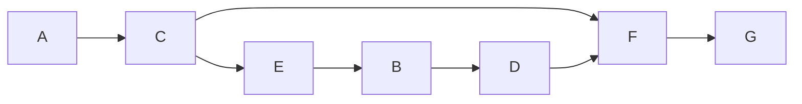

# Учебный вариант V06

Seed: "informatics-variant-v1:V06". 16 заданий, максимум 21 балл. В №13 выбрана презентация (13.1). Альтернативная работа не добавляет номер или баллы.

Набор предназначен для разбора и содержит решения и эталоны. Это авторские учебные задания. Формат — сверенный проект ОГЭ 2027; критерии практических работ учебные.

[Скачать полный комплект файлов](dataset.zip)

## Задание №1

В кодировке каждый символ занимает 16 бит. Записан список слов: «можжевельник, шиповник, сосна, клён, берёза, земляника, хризантема, лиственница, дуб, крапива». Одно слово удалили вместе с лишними запятой и пробелом; двойных пробелов не осталось. Размер текста уменьшился на 26 байт. Какое слово удалили?

**Ответ / эталон:** лиственница

#### Решение

1. Один символ занимает 16 ÷ 8 = 2 байта. Всего удалили 26 ÷ 2 = 13 символов.

2. Вместе со словом удалили запятую и пробел — два символа. На само слово приходится 13 − 2 = 11 символов. Дефис тоже считается символом.

3. В списке такую длину имеет слово «лиственница». Проверка: (11 + 2) · 2 = 26 байт.

## Задание №2

Сообщение закодировано с помощью таблицы. Между кодами букв нет дополнительных разделителей.

| Буква | Код   |
| ----- | ----- |
| А     | `...` |
| В     | `..o` |
| Е     | `.o.` |
| Г     | `.oo` |
| Б     | `o..` |
| Д     | `o.o` |

Сигнал: `.o...oo..o.o....oo..o...`. Какие буквы встречаются в сообщении более одного раза? Запиши каждую такую букву один раз, в любом порядке.

**Ответ / эталон:** АВ, ВА

#### Решение

1. Все коды в таблице состоят из 3 знаков. Поэтому делим запись на группы по 3 знака, начиная с первого знака.

Начало записи — `.o.` (3 знака). По таблице это буква «Е». Продолжаем с позиции 4.

2. Разделим всю запись на коды букв:

`.o. / ..o / o.. / o.o / ... / .oo / ..o / ...`

| № буквы | Код   | Буква |
| ------- | ----- | ----- |
| 1       | `.o.` | Е     |
| 2       | `..o` | В     |
| 3       | `o..` | Б     |
| 4       | `o.o` | Д     |
| 5       | `...` | А     |
| 6       | `.oo` | Г     |
| 7       | `..o` | В     |
| 8       | `...` | А     |

Читаем буквы сверху вниз: **ЕВБДАГВА**.

3. Подсчитаем буквы в сообщении ЕВБДАГВА: «Е» — 1 раз; «В» — 2 раза; «Б» — 1 раз; «Д» — 1 раз; «А» — 2 раза; «Г» — 1 раз.

Хотя бы дважды встретились «В», «А». Каждую записываем один раз. Ответ: **АВ**. Порядок этих букв может быть любым.

## Задание №3

Сколько натуральных чисел X делают выражение истинным?

Выражение: `((X > 8) И (НЕ ((X >= 19) ИЛИ (НЕ (X нечётное)))))`.

Натуральные числа начинаются с 1.

**Ответ / эталон:** 5

#### Решение

1. После раскрытия НЕ условие истинности: (X > 8 И (X < 19 И X нечётное)). Для И выполняются обе части, для ИЛИ достаточно одной.

2. Подходящие натуральные X: 9, 11, 13, 15, 17.

3. Количество подходящих значений: 5. Проверка границ: при X = 8 выражение ложно; при X = 19 выражение ложно. Ноль в натуральные числа не включён.

## Задание №4

В таблице указаны длины дорог между пунктами в километрах. Знак — означает, что прямой дороги нет. По каждой дороге можно двигаться в обе стороны.

| Пункт | A   | B   | C   | D   | E   |
| ----- | --- | --- | --- | --- | --- |
| A     | —   | 2   | 6   | —   | 6   |
| B     | 2   | —   | 3   | —   | 3   |
| C     | 6   | 3   | —   | 9   | —   |
| D     | —   | —   | 9   | —   | 7   |
| E     | 6   | 3   | —   | 7   | —   |

Какова длина кратчайшего пути из A в E? В ответе запиши число километров.

**Ответ / эталон:** 5

#### Решение

1. До A расстояние 0. Прямые дороги из A: B: 2 км; C: 6 км; E: 6 км. При переходе к соседу прибавляй длину дороги; сохраняй меньшую из найденных сумм.

2. Минимальные расстояния от A: A — 0; B — 2; C — 5; D — 12; E — 5 км.

3. Кратчайший маршрут: A → B → E. Проверка по таблице: 2 + 3 = 5 км. Число дорог само по себе длину пути не определяет.

## Задание №5

У исполнителя две команды:

1. Умножь на 3.
2. Прибавь 4.

Составь программу, которая переводит число 2 в число 94 и содержит не более 5 команд. В ответе запиши только номера команд. Если подходящих программ несколько, запиши любую.

**Ответ / эталон:** 12112, 22112

#### Решение

1. От 94 можно идти назад: обратная команда 2 вычитает 4, а обратная команда 1 делит на 3. Нужен возврат к 2 не более чем за 5 команд.

2. Один подходящий вариант — 12112: 2 → 6 → 10 → 30 → 90 → 94.

3. Последнее значение равно 94, длина программы 5 не превышает 5. Другие подходящие программы также принимаются.

## Задание №6

Программа запускалась девять раз; в каждом запуске вводилась одна из пар (s, t) из таблицы и одно и то же целое число A.

```python
s = int(input())
t = int(input())
A = int(input())
if s > 10 or t > A:
    print("YES")
else:
    print("NO")
```

| s   | t   |
| --- | --- |
| 14  | -14 |
| 6   | 1   |
| 18  | 5   |
| 11  | -4  |
| 6   | -7  |
| 15  | 6   |
| 12  | 11  |
| 9   | 10  |
| 11  | 2   |

Укажи любое целое значение A, при котором программа напечатала YES ровно 8 раз.

**Ответ / эталон:** любое целое A ≥ -7 и A ≤ 0

#### Решение

1. От A не зависят запуски, где s > 10: (14, -14), (18, 5), (11, -4), (15, 6), (12, 11), (11, 2). Число этих YES: 6. Остальные значения t: -7, 1, 10. Требуемое число значений больше A: 2.

2. При A = -7 результаты девяти запусков: YES, YES, YES, YES, NO, YES, YES, YES, YES. Получено 8 YES.

3. Подходит каждое целое A ≥ -7 и A ≤ 0. Например, -7.

## Задание №7

Доступ к файлу data.txt на сервере smile.info осуществляется по протоколу FTP. Фрагменты адреса закодированы цифрами от 1 до 7. Запиши последовательность цифр, кодирующую адрес файла.

| Цифра | Фрагмент |
| ----- | -------- |
| 1     | `.txt`   |
| 2     | `/`      |
| 3     | `data`   |
| 4     | `info`   |
| 5     | `smile.` |
| 6     | `://`    |
| 7     | `ftp`    |

**Ответ / эталон:** 7654231

#### Решение

1. Для протокола FTP запиши начало ftp://. Затем идут сервер smile.info, знак / и файл data.txt.

2. Полный адрес: ftp://smile.info/data.txt.

3. Замени его части цифрами из таблицы: 7654231. Проверь, что использованы все семь фрагментов.

## Задание №8

В языке поисковых запросов | означает «ИЛИ», & — «И». Все запросы выполнены по одной неизменной базе страниц. Количества указаны в тысячах.

| Запрос                     | Найдено страниц (тыс.) |
| -------------------------- | ---------------------- |
| `Лира & (Вега \| Альтаир)` | 880                    |
| `Лира & Вега`              | 730                    |
| `Лира & Вега & Альтаир`    | 460                    |

Сколько тысяч страниц найдёт запрос `Лира & Альтаир`? Запиши целое число.

**Ответ / эталон:** 610

#### Решение

1. Запрос «Лира & (Вега | Альтаир)» объединяет страницы двух запросов: «Лира & Вега» и «Лира & Альтаир». В объединении 880 тыс. страниц.

2. В запросе «Лира & Вега» 730 тыс. страниц. В общем пересечении 460 тыс.; вычитая первое множество, нужно вернуть эту общую часть.

3. Искомое множество: 880 − 730 + 460 = 610 тыс. Проверка объединения: 730 + 610 − 460 = 880.

## Задание №9

На рисунке показана схема дорог между городами A, B, C, D, E, F, G. Двигаться можно только в направлении стрелок. Сколько различных путей ведёт из A в G?

Схема дорог: движение только по стрелкам, начальный город A, конечный G.



Текстовое описание: Схема дорог: движение только по стрелкам, начальный город A, конечный G. Вершины: A, B, C, D, E, F, G. Дуги: A → C; C → E; C → F; E → B; B → D; D → F; F → G.

**Ответ / эталон:** 2

#### Решение

1. Положи число способов попасть в A равным 1.

2. У города F входящие стрелки из C, D: сложи числа путей к этим городам. Получаются количества: A — 1; B — 1; C — 1; D — 1; E — 1; F — 2; G — 2.

3. Проверка у конечного города G: 2 = 2. Группы путей не пересекаются: у каждой группы своя последняя дорога.

## Задание №10

Вычисли значение выражения $\mathrm{11011}_{2} + \mathrm{37}_{8} + \mathrm{8}_{16}$. В ответе запиши десятичное число, основание указывать не нужно.

**Ответ / эталон:** 66

#### Решение

1. Разложи каждое число по степеням его основания, начиная справа со степени 0: 11011 (основание 2): 1·2^4 + 1·2^3 + 0·2^2 + 1·2^1 + 1·2^0 = 27; 37 (основание 8): 3·8^1 + 7·8^0 = 31; 8 (основание 16): 8·16^0 = 8.

2. 11011 (основание 2) = 27; 37 (основание 8) = 31; 8 (основание 16) = 8.

3. 27 + 31 + 8 = 66.

## Задание №11

Скачай и распакуй корпус рассказов. Автор рассказа — Глеб Озёрный. Найди эпизод: Тимур проверил показания берегового флюгера. Какова фамилия человека, произнёсшего слова «Это ответственный труд» в этом эпизоде? Запиши одно слово.

**Ответ / эталон:** Кузнецов

#### Решение

1. Открой папку Тексты/Глеб Озёрный. Ищи имя Тимур и слова «проверил показания берегового флюгера»: одного совпадения имени недостаточно, нужен указанный эпизод.

2. Прочитай эпизод и соседние абзацы. Реплика: «Это ответственный труд». Проверь, кому принадлежит реплика и о каком событии идёт речь.

3. Фамилия говорящего — Кузнецов. Для проверки сопоставь найденное слово с героем Тимур и событием «проверил показания берегового флюгера», а не с соседним рассказом. Ответ: Кузнецов.

## Задание №12

Скачай и распакуй файловый набор. Сколько файлов с расширениями .htm, .tiff находится в следующих каталогах, включая все вложенные папки?

- Иллюстрации/Нина Речная
- Проза-архив/Павел Листьев
- Проза-архив/Ирина Полевая

Другие каталоги не учитывай.

**Ответ / эталон:** 15

#### Решение

1. В каждом указанном каталоге включи поиск во вложенных папках. Отбирай .htm, .tiff по расширению файла.

2. Подходящие файлы:

- Иллюстрации/Нина Речная/Черновики/работа-01.tiff
- Иллюстрации/Нина Речная/Черновики/работа-16.htm
- Иллюстрации/Нина Речная/работа-08.htm
- Иллюстрации/Нина Речная/работа-09.tiff
- Иллюстрации/Нина Речная/работа-17.tiff
- Проза-архив/Ирина Полевая/Черновики/работа-06.htm
- Проза-архив/Ирина Полевая/Черновики/работа-15.tiff
- Проза-архив/Ирина Полевая/работа-07.tiff
- Проза-архив/Ирина Полевая/работа-14.htm
- Проза-архив/Павел Листьев/Черновики/работа-03.tiff
- Проза-архив/Павел Листьев/Черновики/работа-18.htm
- Проза-архив/Павел Листьев/работа-02.htm
- Проза-архив/Павел Листьев/работа-10.htm
- Проза-архив/Павел Листьев/работа-11.tiff
- Проза-архив/Павел Листьев/работа-19.tiff

3. Проверка по каталогам: Иллюстрации/Нина Речная — 5; Проза-архив/Павел Листьев — 6; Проза-архив/Ирина Полевая — 4. Всего 15 файлов. Одинаковые имена в разных каталогах обозначают разные файлы; каждый полный путь учтён один раз.

## Задание №13

### 13.1 Презентация — выбрана

Создай презентацию «Маяк на побережье» из трёх слайдов по макету набора. Используй исходный ODT и авторские иллюстрации. Формат 16:9, альбомная ориентация, без анимации. Единый тип шрифта: название на титуле 40 пт; его подзаголовок и заголовки остальных слайдов 24 пт; основной текст 20 пт.

Первый слайд: название и учебный идентификатор P12 в подзаголовке. Второй: «Световой ориентир», два изображения и два текстовых блока. Третий: «Ориентир и наблюдатель», три изображения и три текстовых блока. Взаимное расположение объектов сохрани по макетам. Сохраняй пропорции изображений; текст и изображения должны помещаться на слайде. Используй единое оформление. Сохрани результат как P12.odp.

Имена, фамилии и контакты вводить не нужно. Это авторское учебное задание; критерии в наборе предназначены для самооценки и не заменяют официальную экспертную проверку.

**Ответ / эталон:** curated-presentations-v2:P12:reference

#### Решение

1. Открой материалы «Маяк на побережье» и макеты. Создай три слайда 16:9. На титуле размести название «Маяк на побережье» шрифтом 40 пт и идентификатор P12 шрифтом 24 пт.

2. На слайде «Световой ориентир» размести два изображения и два текстовых блока; на слайде «Ориентир и наблюдатель» — три изображения и три блока. Заголовки набери шрифтом 24 пт, основной текст — 20 пт. Сравни положение объектов с макетами; пропорции изображений сохраняй.

3. Сохрани P12.odp, открой файл повторно и сравни с требованиями к структуре, шрифту и изображениям. Проверь отсутствие обрезанного текста и искажённых изображений; затем при необходимости открой эталон.

#### Учебные критерии

- 0: Не выполнены условия на 1 или 2 балла либо файл имеет недопустимый формат.

- 1: Три слайда по теме, на втором и третьем есть текст и иллюстрации; не более одной ошибки в структуре, шрифте или изображениях. Однотипные ошибки считаются одной. Либо два слайда по теме без таких ошибок.

- 2: Три слайда полностью соответствуют теме, макетам, размерам шрифта и требованиям к изображениям; ошибок нет.

### 13.2 Документ

Оформи документ «ПРОВЕРКА ЦИФРОВОГО МАКЕТА» по визуальному образцу layout/sample.pdf. Текст и данные для набора находятся в source/material.odt. Повтори взаимное расположение текста и таблицы, объединение ячеек и выделения полужирным, курсивом и подчёркиванием.

A4, книжная ориентация, поля 2 см. Единый шрифт DejaVu Serif, весь текст 14 пт. Заголовок прописными буквами, по центру. Основной текст по ширине; первая строка 1 см, межстрочный интервал 150%, интервалы между заголовком, абзацами и таблицей 14 пт. Отступы и интервалы задавай свойствами абзаца; разбиение на строки автоматическое.

Таблица: два столбца шириной 7 и 8 см, по центру страницы, уже основного текста; все ячейки по вертикали по центру. Первый столбец по левому краю, второй по центру; строка заголовков по центру. Сохрани границы, выделения и все данные образца. Не используй пустые абзацы, пробелы вместо отступов или разрывы строк. Сохрани D11.odt.

Имена, фамилии и контакты вводить не нужно. Это авторское учебное задание; критерии предназначены для самооценки и не заменяют официальную экспертную проверку.

**Ответ / эталон:** curated-documents-v2:D11:reference

#### Решение

1. Открой текст «ПРОВЕРКА ЦИФРОВОГО МАКЕТА» и layout/sample.pdf. Настрой A4, поля 2 см и шрифт DejaVu Serif 14 пт. Перенеси заголовок и оба абзаца без изменения текста.

2. Задай межстрочный интервал 150%, отступ первой строки 1 см и интервалы между блоками 14 пт. Вставь таблицу со столбцами 7 и 8 см; выдели строку заголовков и повтори выравнивание образца.

3. Сохрани D11.odt и открой повторно. Сравни две группы требований — основной текст и таблицу; затем при необходимости открой эталон.

#### Учебные критерии

- 0: Не выполнены условия на 1 или 2 балла либо файл имеет недопустимый формат.

- 1: В основном тексте и таблицах не более трёх нарушений требований в каждой группе. Либо одна группа выполнена полностью верно, а другая отсутствует или содержит более трёх нарушений. Также 1 балл при верной работе с существенными расхождениями макета.

- 2: Основной текст и таблицы оформлены по образцу. В основном тексте допускается до пяти текстовых ошибок, в таблицах — до трёх; остальные требования выполнены.

## Задание №14

В таблицу внесены 1000 записей. Открой source/data.ods: лист «Данные», заголовки A1:D1, записи A2:D1001. Столбцы по порядку: номер участника; номер школы; класс; баллы. Порядок записей произвольный.

1. Сколько участников из 8 класса набрали более 170 баллов? Ответ запиши в H2.
2. Каков средний балл участников школы №44? Укажи не менее двух знаков после запятой. Ответ запиши в H3.
3. Построй круговую диаграмму соотношения количества участников из 7, 8 и 9 классов. Левый верхний угол размести вблизи G6. В поле диаграммы должны присутствовать легенда и числовые значения исходных данных.

Используй свободные столбцы для вычислений, сохрани исходные данные и результат в result.ods. Это авторское учебное задание по подтверждённому формату ФИПИ; самооценка не заменяет экспертную проверку файла.

**Ответ / эталон:** sheet-count-mean-v2:["informatics-variant-v1","informatics-variant-v1:V06",14]:reference

#### Решение

1. Первое условие: Сколько участников из 8 класса набрали более 170 баллов? Используй формулу `=COUNTIFS(C2:C1001;8;D2:D1001;">170")`. Результат 185 запиши в H2.

2. Второе условие: Каков средний балл участников школы №44? Укажи не менее двух знаков после запятой. Используй формулу `=ROUND(AVERAGEIF(B2:B1001;44;D2:D1001);2)`. Результат 192.8 запиши в H3. Это отдельная выборка, её условия могут отличаться от первого расчёта.

3. Создай вспомогательную таблицу: 7 класс — 344; 8 класс — 332; 9 класс — 324. Формулы по порядку: `=COUNTIF(C2:C1001;7)`; `=COUNTIF(C2:C1001;8)`; `=COUNTIF(C2:C1001;9)`. Построй круговую диаграмму по этой таблице, добавь легенду и подписи значений. Проверь подписи 7 класс, 8 класс, 9 класс и ответы H2, H3 после повторного открытия result.ods. Приведены английские имена функций Calc; в настройках редактора может быть включён их перевод.

#### Учебные критерии

- 0: Ни один из трёх элементов не выполнен верно.

- 1: Верно выполнен один элемент: первый расчёт, второй расчёт или диаграмма.

- 2: Верно выполнены два из трёх элементов.

- 3: Оба числа найдены верно; диаграмма отображает правильные данные и их соотношение, содержит легенду и числовые подписи.

## Задание №15

Робот находится в нижней клетке вертикального пути длиной от 1 до 12 клеток. Путь продолжается строго вверх до верхней границы поля, в этом столбце внутренних горизонтальных стен нет. Слева от каждой клетки пути может быть стена или проход; справа есть хотя бы одна клетка или граница, на алгоритм это не влияет. Закрась только клетки пути, слева от которых стена. Слева от пути всегда есть отдельный столбец: границу поля нельзя спутать со стеной. Допустимы отсутствие стен, сплошная стена и произвольное расположение проходов.

Все клетки первоначально не закрашены. Лишние клетки закрашивать нельзя; конечная позиция не задана. Используй датчики и циклы, не подставляй размеры с рисунка. Показан только один пример семейства: сетка 11 × 3, старт (строка 10, столбец 2), индексы с 0. Данные и рисунок находятся в source; проверочные поля — в validation/fields.json.

Сохрани программу в answer.txt, UTF-8. Поддерживаются движения, закраска, датчики, если/иначе и нц пока; описание языка есть в README.txt. Нужно нормальное завершение без столкновений и точная закраска на всех допустимых полях семейства. Учебные критерии 0/1/2 и конечный набор проверок не заменяют официальную экспертную оценку.

**Ответ / эталон:** robot-wall-gaps-v2:["informatics-variant-v1","informatics-variant-v1:V06",15]:reference

#### Решение

1. В показанном поле старт: строка 10, столбец 2. Проверь левую стену уже в стартовой клетке. Проход — причина пропустить закраску, а не перейти в соседний столбец.

2. Поднимайся по одной клетке, пока сверху свободно, и после каждого шага проверяй стену слева.

3. Число оставшихся клеток сверху убывает. Ни одна клетка вне исходного столбца не посещается; проходы не закрашиваются. Сверь закраску с изображённым примером: число целевых клеток — 5, лишних быть не должно. Затем проверь остальные поля семейства; размеры 11 × 3 нельзя зашивать в программу.

```
использовать Робот
алг
нач
если слева стена то
  закрасить
все
нц пока сверху свободно
  вверх
если слева стена то
  закрасить
все
кц
кон

```

#### Учебные критерии

- 0: Не выполнены условия для 1 или 2: есть ошибка разбора, столкновение, незавершение либо хотя бы на одном проверочном поле более 10 лишних или более 10 незакрашенных целевых клеток.

- 1: На каждом из восьми проверочных полей программа завершилась без столкновения, закрасив не более 10 лишних и пропустив не более 10 целевых клеток; точность для 2 не достигнута. Это применение критерия ФИПИ к конечной учебной выборке, не официальный балл.

- 2: Все восемь проверочных полей пройдены с нормальным завершением, без столкновений и с точной закраской.

## Задание №16

Напиши программу на Python 3. Среди N натуральных чисел найди сумму тех, последняя цифра семеричной записи которых равна 1. Выведи сумму в десятичной системе. Если подходящих чисел нет, выведи 0.

Ввод: первая строка — N, целое от 1 до 1000 включительно. Затем N строк, по одному натуральному числу от 1 до 10000 включительно.
Выводи только указанные целые числа, без приглашений и пояснений. Числа результата разделяй пробелом.

Пример ввода:

```
17
8559
4829
5173
6165
4687
713
1814
3385
7799
8926
4910
8723
519
2676
3004
8206
6943
```

Пример вывода:

```
30785
```

Сохрани код в answer.py, UTF-8. В архиве находятся десять тестов, эталон и инструкция локального запуска. Проверка использует лимит 2 секунды на тест; это учебное ограничение, а не норма экзамена. Учебные критерии 0/1/2 относятся к результатам запусков и не заменяют официальную экспертную оценку.

**Ответ / эталон:** python-base7-sum-v1:["informatics-variant-v1","informatics-variant-v1:V06",16]:reference

#### Решение

1. Последняя цифра записи по основанию 7 равна остатку от деления числа на 7. Поэтому нужна проверка x % 7 == 1.

2. Прочитай N и ровно N чисел. Начни сумму с нуля и прибавляй только подходящие значения. Если их нет, сумма останется нулём.

3. В примере подходят числа: 1814, 7799, 8926, 8723, 519, 3004. Их сумма 30785. Например, 15 в десятичной системе — это 21 в семеричной, а 11 — это 14: десятичная последняя цифра здесь не помогает.

```
n = int(input())
total = 0
for i in range(n):
    x = int(input())
    if x % 7 == 1:
        total += x
print(total)

```

#### Учебные критерии

- 0: Ни один тест не пройден: нет запуска, ошибка исполнения или неверный вывод. Само наличие файла не даёт балла.

- 1: Программа нормально завершилась и дала верный вывод на части из десяти тестов, но не на всех.

- 2: Программа нормально завершилась и дала верный вывод на всех десяти тестах, включая граничные случаи.
