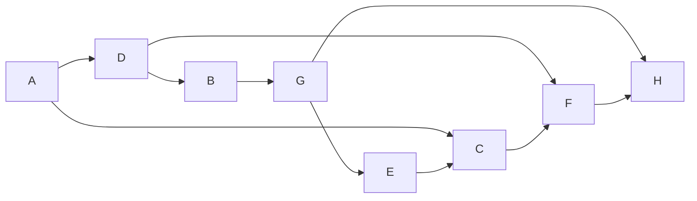

# Учебный вариант V08

Seed: "informatics-variant-v1:V08". 16 заданий, максимум 21 балл. В №13 выбрана презентация (13.1). Альтернативная работа не добавляет номер или баллы.

Набор предназначен для разбора и содержит решения и эталоны. Это авторские учебные задания. Формат — сверенный проект ОГЭ 2027; критерии практических работ учебные.

[Скачать полный комплект файлов](dataset.zip)

## Задание №1

В кодировке каждый символ занимает 8 бит. Записан список слов: «крапива, можжевельник, берёза, земляника, клён, хризантема, дуб, шиповник, сосна, лиственница». Одно слово удалили вместе с лишними запятой и пробелом; двойных пробелов не осталось. Размер текста уменьшился на 13 байт. Какое слово удалили?

**Ответ / эталон:** лиственница

#### Решение

1. Один символ занимает 1 байт. Удалено 13 символов.

2. Запятая и пробел — ещё два символа. В слове 11 букв (дефис, если он есть, тоже символ).

3. В списке такую длину имеет слово «лиственница». Проверка: (11 + 2) · 1 = 13 байт.

## Задание №2

Сообщение закодировано с помощью таблицы. Между кодами букв нет дополнительных разделителей.

| Буква | Код   |
| ----- | ----- |
| Е     | `...` |
| Д     | `..o` |
| А     | `.o.` |
| Б     | `.oo` |
| В     | `o..` |
| Г     | `o.o` |

Сигнал: `..o..o...o...o.....o..ooo.o`. Какие буквы встречаются в сообщении более одного раза? Запиши каждую такую букву один раз, в любом порядке.

**Ответ / эталон:** АДЕ, АЕД, ДАЕ, ДЕА, ЕАД, ЕДА

#### Решение

1. Все коды в таблице состоят из 3 знаков. Поэтому делим запись на группы по 3 знака, начиная с первого знака.

Начало записи — `..o` (3 знака). По таблице это буква «Д». Продолжаем с позиции 4.

2. Разделим всю запись на коды букв:

`..o / ..o / ... / o.. / .o. / ... / .o. / .oo / o.o`

| № буквы | Код   | Буква |
| ------- | ----- | ----- |
| 1       | `..o` | Д     |
| 2       | `..o` | Д     |
| 3       | `...` | Е     |
| 4       | `o..` | В     |
| 5       | `.o.` | А     |
| 6       | `...` | Е     |
| 7       | `.o.` | А     |
| 8       | `.oo` | Б     |
| 9       | `o.o` | Г     |

Читаем буквы сверху вниз: **ДДЕВАЕАБГ**.

3. Подсчитаем буквы в сообщении ДДЕВАЕАБГ: «Д» — 2 раза; «Е» — 2 раза; «В» — 1 раз; «А» — 2 раза; «Б» — 1 раз; «Г» — 1 раз.

Хотя бы дважды встретились «Д», «Е», «А». Каждую записываем один раз. Ответ: **АДЕ**. Порядок этих букв может быть любым.

## Задание №3

Сколько натуральных чисел X делают выражение истинным?

Выражение: `((X > 12) И (НЕ (X >= 31)))`.

Натуральные числа начинаются с 1.

**Ответ / эталон:** 18

#### Решение

1. Раскрой НЕ и учитывай скобки: для И нужны оба условия, для ИЛИ достаточно одного.

2. Подходящие натуральные X: 13, 14, 15, 16, 17, 18, 19, 20, 21, 22, 23, 24, 25, 26, 27, 28, 29, 30.

3. Количество подходящих значений: 18. Ноль в натуральные числа не включён.

## Задание №4

В таблице указаны длины дорог между пунктами в километрах. Знак — означает, что прямой дороги нет. По каждой дороге можно двигаться в обе стороны.

| Пункт | A   | B   | C   | D   | E   | F   |
| ----- | --- | --- | --- | --- | --- | --- |
| A     | —   | 6   | —   | 7   | 6   | 9   |
| B     | 6   | —   | 1   | —   | 3   | 8   |
| C     | —   | 1   | —   | 7   | 7   | 3   |
| D     | 7   | —   | 7   | —   | 9   | —   |
| E     | 6   | 3   | 7   | 9   | —   | 7   |
| F     | 9   | 8   | 3   | —   | 7   | —   |

Какова длина кратчайшего пути из A в F? В ответе запиши число километров.

**Ответ / эталон:** 9

#### Решение

1. Начни с расстояния 0 до A. Для соседнего пункта сравни уже найденный путь и путь через текущий пункт.

2. Минимальные расстояния от A: A — 0; B — 6; C — 7; D — 7; E — 6; F — 9 км.

3. Минимальная суммарная длина до F равна 9 км. Число дорог само по себе длину пути не определяет.

## Задание №5

У исполнителя две команды:

1. Возведи число в квадрат.
2. Прибавь 3.

Составь программу, которая переводит число 3 в число 42 и содержит не более 5 команд. В ответе запиши только номера команд. Если подходящих программ несколько, запиши любую.

**Ответ / эталон:** 2122

#### Решение

1. Проверяй программы от одной команды до 5. Сохраняй порядок действий.

2. Один подходящий вариант — 2122: 3 → 6 → 36 → 39 → 42.

3. Последнее значение равно 42, длина программы 4 не превышает 5. Другие подходящие программы также принимаются.

## Задание №6

Программа запускалась девять раз; в каждом запуске вводилась одна из пар (s, t) из таблицы и одно и то же целое число A.

```python
s = int(input())
t = int(input())
A = int(input())
if s > A or t > 11:
    print("YES")
else:
    print("NO")
```

| s   | t   |
| --- | --- |
| 0   | 12  |
| -8  | 5   |
| -4  | 9   |
| -13 | 10  |
| 14  | 8   |
| 3   | 13  |
| -3  | 17  |
| -6  | 6   |
| 12  | 4   |

Укажи наименьшее целое значение A, при котором программа напечатала YES ровно 6 раз.

**Ответ / эталон:** -6

#### Решение

1. Отдели запуски, где сравнение с постоянной границей уже даёт YES независимо от A.

2. При A = -6 результаты девяти запусков: YES, NO, YES, NO, YES, YES, YES, NO, YES. Получено 6 YES.

3. Сравнение строгое: значение на границе уже меняет число YES. Поэтому первое подходящее целое A равно -6.

## Задание №7

Доступ к файлу ru.jpg на сервере atlas.ru осуществляется по протоколу HTTPS. Фрагменты адреса закодированы цифрами от 1 до 7. Запиши последовательность цифр, кодирующую адрес файла.

| Цифра | Фрагмент |
| ----- | -------- |
| 1     | `ru.`    |
| 2     | `jpg`    |
| 3     | `https`  |
| 4     | `atlas`  |
| 5     | `://`    |
| 6     | `.ru`    |
| 7     | `/`      |

**Ответ / эталон:** 3546712

#### Решение

1. Порядок частей URL: протокол, ://, сервер, /, имя файла.

2. Полный адрес: https://atlas.ru/ru.jpg.

3. Замени его части цифрами из таблицы: 3546712. Проверь, что использованы все семь фрагментов.

## Задание №8

В языке поисковых запросов | означает «ИЛИ», & — «И». Все запросы выполнены по одной неизменной базе страниц. Количества указаны в тысячах.

| Запрос                     | Найдено страниц (тыс.) |
| -------------------------- | ---------------------- |
| `Лира & (Вега \| Альтаир)` | 440                    |
| `Лира & Вега`              | 210                    |
| `Лира & Вега & Альтаир`    | 170                    |

Сколько тысяч страниц найдёт запрос `Лира & Альтаир`? Запиши целое число.

**Ответ / эталон:** 400

#### Решение

1. Рассмотри два множества: страницы с Лирой и Вегой и страницы с Лирой и Альтаиром.

2. Первая строка таблицы — их объединение, тройной запрос — их пересечение.

3. Искомое множество: 440 − 210 + 170 = 400.

## Задание №9

На рисунке показана схема дорог между городами A, B, C, D, E, F, G, H. Двигаться можно только в направлении стрелок. Сколько различных путей ведёт из A в H?

Схема дорог: движение только по стрелкам, начальный город A, конечный H.



Текстовое описание: Схема дорог: движение только по стрелкам, начальный город A, конечный H. Вершины: A, B, C, D, E, F, G, H. Дуги: A → D; A → C; D → B; D → F; B → G; G → E; G → H; E → C; C → F; F → H.

**Ответ / эталон:** 4

#### Решение

1. Положи число способов попасть в A равным 1.

2. Для каждого следующего города сложи числа у его непосредственных предшественников: A — 1; B — 1; C — 2; D — 1; E — 1; F — 3; G — 1; H — 4.

3. Число у конечного города H равно 4.

## Задание №10

Вычисли значение выражения $\mathrm{1100000}_{2} + \mathrm{127}_{8} + \mathrm{AA}_{16}$. В ответе запиши десятичное число, основание указывать не нужно.

**Ответ / эталон:** 353

#### Решение

1. Переведи каждое слагаемое в десятичную систему по разрядам.

2. 1100000 (основание 2) = 96; 127 (основание 8) = 87; AA (основание 16) = 170.

3. 96 + 87 + 170 = 353.

## Задание №11

Скачай и распакуй корпус рассказов. В рассказе автора «Нина Речная» герой «Тимур» проверил показания берегового флюгера. Какова фамилия человека, произнёсшего слова «Это полезный труд» в этом эпизоде? Запиши одно слово.

**Ответ / эталон:** Серов

#### Решение

1. Открой папку Тексты/Нина Речная. Ищи имя героя Тимур и слова «проверил показания берегового флюгера».

2. Прочитай эпизод и соседние абзацы. Реплика: «Это полезный труд». Проверь, кому принадлежит реплика и о каком событии идёт речь.

3. Фамилия говорящего — Серов. Ответ: Серов.

## Задание №12

Скачай и распакуй файловый набор. Сколько файлов с расширениями .jpeg, .pdf находится в следующих каталогах, включая все вложенные папки?

- Заметки/Глеб Озёрный
- Проза

Другие каталоги не учитывай.

**Ответ / эталон:** 15

#### Решение

1. В каждом указанном каталоге включи поиск во вложенных папках. Отбирай .jpeg, .pdf по расширению файла.

2. Подходящие файлы:

- Заметки/Глеб Озёрный/Черновики/работа-02.jpeg
- Заметки/Глеб Озёрный/Черновики/работа-17.pdf
- Заметки/Глеб Озёрный/работа-01.pdf
- Заметки/Глеб Озёрный/работа-09.pdf
- Заметки/Глеб Озёрный/работа-10.jpeg
- Заметки/Глеб Озёрный/работа-18.jpeg
- Проза/Нина Речная/Черновики/работа-04.jpeg
- Проза/Нина Речная/Черновики/работа-19.pdf
- Проза/Нина Речная/работа-03.pdf
- Проза/Нина Речная/работа-11.pdf
- Проза/Нина Речная/работа-12.jpeg
- Проза/Олег Ветров/Черновики/работа-07.pdf
- Проза/Олег Ветров/Черновики/работа-16.jpeg
- Проза/Олег Ветров/работа-08.jpeg
- Проза/Олег Ветров/работа-15.pdf

3. Всего 15 файлов. Одинаковые имена в разных каталогах обозначают разные файлы; каждый полный путь учтён один раз.

## Задание №13

### 13.1 Презентация — выбрана

Создай презентацию «Робот на маршруте» из трёх слайдов по макету набора. Используй исходный ODT и авторские иллюстрации. Формат 16:9, альбомная ориентация, без анимации. Единый тип шрифта: название на титуле 40 пт; его подзаголовок и заголовки остальных слайдов 24 пт; основной текст 20 пт.

Первый слайд: название и учебный идентификатор P06 в подзаголовке. Второй: «Команды и проверка», два изображения и два текстовых блока. Третий: «План и исполнение», три изображения и три текстовых блока. Взаимное расположение объектов сохрани по макетам. Сохраняй пропорции изображений; текст и изображения должны помещаться на слайде. Используй единое оформление. Сохрани результат как P06.odp.

Имена, фамилии и контакты вводить не нужно. Это авторское учебное задание; критерии в наборе предназначены для самооценки и не заменяют официальную экспертную проверку.

**Ответ / эталон:** curated-presentations-v2:P06:reference

#### Решение

1. Открой исходный ODT, изображения и макеты. Создай три широкоформатных слайда, выбери единые шрифты и цвета.

2. Распредели текст: титул, «Команды и проверка», «План и исполнение». Размести иллюстрации по макету, добавь подписи и идентификатор P06.

3. Сохрани P06.odp, открой файл повторно и сравни с требованиями к структуре, шрифту и изображениям. Проверь отсутствие обрезанного текста и искажённых изображений; затем при необходимости открой эталон.

#### Учебные критерии

- 0: Не выполнены условия на 1 или 2 балла либо файл имеет недопустимый формат.

- 1: Три слайда по теме, на втором и третьем есть текст и иллюстрации; не более одной ошибки в структуре, шрифте или изображениях. Однотипные ошибки считаются одной. Либо два слайда по теме без таких ошибок.

- 2: Три слайда полностью соответствуют теме, макетам, размерам шрифта и требованиям к изображениям; ошибок нет.

### 13.2 Документ

Оформи документ «ПЛАН ИССЛЕДОВАТЕЛЬСКОГО ПРОЕКТА» по визуальному образцу layout/sample.pdf. Текст и данные для набора находятся в source/material.odt. Повтори взаимное расположение текста и таблицы, объединение ячеек и выделения полужирным, курсивом и подчёркиванием.

A4, книжная ориентация, поля 2 см. Единый шрифт DejaVu Serif, весь текст 14 пт. Заголовок прописными буквами, по центру. Основной текст по ширине; первая строка 1 см, межстрочный интервал 115%, интервалы между заголовком, абзацами и таблицей 14 пт. Отступы и интервалы задавай свойствами абзаца; разбиение на строки автоматическое.

Таблица: два столбца шириной 7 и 8 см, по центру страницы, уже основного текста; все ячейки по вертикали по центру. Первый столбец по левому краю, второй по центру; строка заголовков по центру. Сохрани границы, выделения и все данные образца. Не используй пустые абзацы, пробелы вместо отступов или разрывы строк. Сохрани D07.odt.

Имена, фамилии и контакты вводить не нужно. Это авторское учебное задание; критерии предназначены для самооценки и не заменяют официальную экспертную проверку.

**Ответ / эталон:** curated-documents-v2:D07:reference

#### Решение

1. Открой исходный текст и образец. Настрой A4, поля и шрифт; перенеси заголовок и оба абзаца без изменения текста.

2. Задай параметры абзацев и выделения по образцу. Вставь таблицу, объедини нужные ячейки и настрой ширины, границы и выравнивание.

3. Сохрани D07.odt и открой повторно. Сравни две группы требований — основной текст и таблицу; затем при необходимости открой эталон.

#### Учебные критерии

- 0: Не выполнены условия на 1 или 2 балла либо файл имеет недопустимый формат.

- 1: В основном тексте и таблицах не более трёх нарушений требований в каждой группе. Либо одна группа выполнена полностью верно, а другая отсутствует или содержит более трёх нарушений. Также 1 балл при верной работе с существенными расхождениями макета.

- 2: Основной текст и таблицы оформлены по образцу. В основном тексте допускается до пяти текстовых ошибок, в таблицах — до трёх; остальные требования выполнены.

## Задание №14

В таблицу внесены 370 записей. Открой source/data.ods: лист «Данные», заголовки A1:F1, записи A2:F371. Столбцы по порядку: Дата; Пункт отправления; Пункт назначения; Расстояние; Расход бензина; Масса груза. Перевозки расположены в хронологическом порядке.

1. Какова суммарная протяжённость перевозок с 5 по 7 октября включительно? Ответ запиши в H2.
2. Какова средняя масса груза при перевозках из пункта «Липки»? Укажи не менее одного знака после запятой. Ответ запиши в H3.
3. Построй круговую диаграмму соотношения количества перевозок 1, 2 и 3 октября. Левый верхний угол размести вблизи G6. В поле диаграммы должны присутствовать легенда и числовые значения исходных данных.

Используй свободные столбцы для вычислений, сохрани исходные данные и результат в result.ods. Это авторское учебное задание по подтверждённому формату ФИПИ; самооценка не заменяет экспертную проверку файла.

**Ответ / эталон:** sheet-sum-mean-v2:["informatics-variant-v1","informatics-variant-v1:V08",14]:reference

#### Решение

1. Первый расчёт: of:=SUM(SUMIF([.A2:.A371];"5 октября";[.D2:.D371]);SUMIF([.A2:.A371];"6 октября";[.D2:.D371]);SUMIF([.A2:.A371];"7 октября";[.D2:.D371])). Результат 38872.

2. Второй расчёт: of:=ROUND(AVERAGEIF([.B2:.B371];"Липки";[.F2:.F371]);1). Результат 556.5.

3. Создай вспомогательную таблицу: 1 октября — 42; 2 октября — 41; 3 октября — 41. Формулы: of:=COUNTIF([.A2:.A371];"1 октября"); of:=COUNTIF([.A2:.A371];"2 октября"); of:=COUNTIF([.A2:.A371];"3 октября"). Построй круговую диаграмму по этой таблице, добавь легенду и подписи значений. Открой сохранённый ODS повторно. Имена функций Calc могут быть локализованы; of:= и квадратные скобки — запись внутри ODS.

#### Учебные критерии

- 0: Ни один из трёх элементов не выполнен верно.

- 1: Верно выполнен один элемент: первый расчёт, второй расчёт или диаграмма.

- 2: Верно выполнены два из трёх элементов.

- 3: Оба числа найдены верно; диаграмма отображает правильные данные и их соотношение, содержит легенду и числовые подписи.

## Задание №15

Робот находится в левой клетке нижнего горизонтального основания «гребёнки». Основание содержит от 1 до 10 клеток и ограничено снизу и на концах стенами. Из каждой клетки основания вверх ведёт зубец длиной от 0 до 6 клеток до стены; между соседними зубцами стоят вертикальные стены. Закрась все клетки зубцов, не закрашивая основание. Все зубцы могут иметь длину 0.

Все клетки первоначально не закрашены. Лишние клетки закрашивать нельзя; конечная позиция не задана. Используй датчики и циклы, не подставляй размеры с рисунка. Показан только один пример семейства: сетка 6 × 8, старт (строка 5, столбец 0), индексы с 0. Данные и рисунок находятся в source; проверочные поля — в validation/fields.json.

Сохрани программу в answer.txt, UTF-8. Поддерживаются движения, закраска, датчики, если/иначе и нц пока; описание языка есть в README.txt. Нужно нормальное завершение без столкновений и точная закраска на всех допустимых полях семейства. Учебные критерии 0/1/2 и конечный набор проверок не заменяют официальную экспертную оценку.

**Ответ / эталон:** robot-comb-v2:["informatics-variant-v1","informatics-variant-v1:V08",15]:reference

#### Решение

1. Для одного зубца поднимайся до стены, закрашивая только после шага вверх.

2. Вернись вниз до стены под основанием; переместись вправо лишь после проверки датчика.

3. Число зубцов справа убывает. После внешнего цикла обработай последний зубец отдельно, включая случай единственного зубца.

```
использовать Робот
алг
нач
нц пока справа свободно
нц пока сверху свободно
  вверх
  закрасить
кц
нц пока снизу свободно
  вниз
кц
  вправо
кц
нц пока сверху свободно
  вверх
  закрасить
кц
нц пока снизу свободно
  вниз
кц
кон

```

#### Учебные критерии

- 0: Не выполнены условия для 1 или 2: есть ошибка разбора, столкновение, незавершение либо хотя бы на одном проверочном поле более 10 лишних или более 10 незакрашенных целевых клеток.

- 1: На каждом из восьми проверочных полей программа завершилась без столкновения, закрасив не более 10 лишних и пропустив не более 10 целевых клеток; точность для 2 не достигнута. Это применение критерия ФИПИ к конечной учебной выборке, не официальный балл.

- 2: Все восемь проверочных полей пройдены с нормальным завершением, без столкновений и с точной закраской.

## Задание №16

Напиши программу на Python 3. Рассмотри соседние пары N целых чисел: первое и второе, второе и третье и далее. Пары могут перекрываться. Найди количество пар, сумма которых делится на 9 без остатка, и наибольшую из этих сумм. Сначала выведи количество, затем максимум. Суммы могут быть отрицательными. При отсутствии подходящих пар, в том числе при N = 1, выведи 0 0.

Ввод: первая строка — N, целое от 1 до 1000 включительно. Затем ровно N строк, по одному целому числу от −10000 до 10000 включительно. Порядок чисел сохраняется.
Выводи только указанные целые числа, без приглашений и пояснений. Числа результата разделяй пробелом.

Пример ввода:

```
9
-98
-82
85
-58
94
-98
10
18
39
```

Пример вывода:

```
3 36
```

Сохрани код в answer.py, UTF-8. В архиве находятся десять тестов, эталон и инструкция локального запуска. Проверка использует лимит 2 секунды на тест; это учебное ограничение, а не норма экзамена. Учебные критерии 0/1/2 относятся к результатам запусков и не заменяют официальную экспертную оценку.

**Ответ / эталон:** python-pairs-v1:["informatics-variant-v1","informatics-variant-v1:V08",16]:reference

#### Решение

1. Запомни первое число. Каждое следующее образует пару с предыдущим; при N = 1 пар нет.

2. Для подходящей пары обнови счётчик и максимум. Первая подходящая сумма задаёт максимум даже тогда, когда она отрицательная.

3. На каждом шаге сохраняй текущее число как предыдущее. Так соседние пары могут перекрываться; при отсутствии подходящих выведи 0 0.

```
n = int(input())
previous = int(input())
count = 0
best = 0
for i in range(n - 1):
    current = int(input())
    pair_sum = previous + current
    if pair_sum % 9 == 0:
        if count == 0 or pair_sum > best:
            best = pair_sum
        count += 1
    previous = current
print(count, best)

```

#### Учебные критерии

- 0: Ни один тест не пройден: нет запуска, ошибка исполнения или неверный вывод. Само наличие файла не даёт балла.

- 1: Программа нормально завершилась и дала верный вывод на части из десяти тестов, но не на всех.

- 2: Программа нормально завершилась и дала верный вывод на всех десяти тестах, включая граничные случаи.
