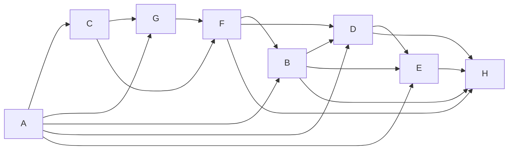

# Учебный вариант V09

Seed: "informatics-variant-v1:V09". 16 заданий, максимум 21 балл. В №13 выбрана презентация (13.1). Альтернативная работа не добавляет номер или баллы.

Набор предназначен для разбора и содержит решения и эталоны. Это авторские учебные задания. Формат — сверенный проект ОГЭ 2027; критерии практических работ учебные.

[Скачать полный комплект файлов](dataset.zip)

## Задание №1

В кодировке каждый символ занимает 16 бит. Записан список слов: «клён, шиповник, земляника, можжевельник». Одно слово удалили вместе с лишними запятой и пробелом; двойных пробелов не осталось. Размер текста уменьшился на 12 байт. Какое слово удалили?

**Ответ / эталон:** клён

#### Решение

1. Один символ занимает 16 ÷ 8 = 2 байта. Всего удалили 12 ÷ 2 = 6 символов.

2. Вместе со словом удалили запятую и пробел — два символа. На само слово приходится 6 − 2 = 4 символа. Дефис тоже считается символом.

3. В списке такую длину имеет слово «клён». Проверка: (4 + 2) · 2 = 12 байт.

## Задание №2

Сообщение закодировано с помощью таблицы. Между кодами букв нет дополнительных разделителей.

| Буква | Код   |
| ----- | ----- |
| В     | `...` |
| А     | `..o` |
| Е     | `.o.` |
| Д     | `.oo` |
| Б     | `o..` |
| Г     | `o.o` |

Сигнал: `.ooo.....o.o..o..o....o.`. Какие буквы встречаются в сообщении более одного раза? Запиши каждую такую букву один раз, в любом порядке.

**Ответ / эталон:** АВ, ВА

#### Решение

1. Все коды в таблице состоят из 3 знаков. Поэтому делим запись на группы по 3 знака, начиная с первого знака.

Начало записи — `.oo` (3 знака). По таблице это буква «Д». Продолжаем с позиции 4.

2. Разделим всю запись на коды букв:

`.oo / o.. / ... / o.o / ..o / ..o / ... / .o.`

| № буквы | Код   | Буква |
| ------- | ----- | ----- |
| 1       | `.oo` | Д     |
| 2       | `o..` | Б     |
| 3       | `...` | В     |
| 4       | `o.o` | Г     |
| 5       | `..o` | А     |
| 6       | `..o` | А     |
| 7       | `...` | В     |
| 8       | `.o.` | Е     |

Читаем буквы сверху вниз: **ДБВГААВЕ**.

3. Подсчитаем буквы в сообщении ДБВГААВЕ: «Д» — 1 раз; «Б» — 1 раз; «В» — 2 раза; «Г» — 1 раз; «А» — 2 раза; «Е» — 1 раз.

Хотя бы дважды встретились «В», «А». Каждую записываем один раз. Ответ: **АВ**. Порядок этих букв может быть любым.

## Задание №3

Найди наименьшее натуральное число X, при котором выражение ложно.

Выражение: `((НЕ (X >= 8)) ИЛИ (X >= 23))`.

Натуральные числа начинаются с 1.

**Ответ / эталон:** 8

#### Решение

1. Нужно ложное значение всего выражения, поэтому условие поиска после раскрытия отрицания: (X ≥ 8 И X < 23).

2. При X = 8 выражение ложно. При меньших натуральных X оно истинно.

3. Проверка соседнего числа: при X = 7 выражение истинно. Первое ложное значение достигается при X = 8.

## Задание №4

В таблице указаны длины дорог между пунктами в километрах. Знак — означает, что прямой дороги нет. По каждой дороге можно двигаться в обе стороны.

| Пункт | A   | B   | C   | D   | E   | F   |
| ----- | --- | --- | --- | --- | --- | --- |
| A     | —   | 6   | —   | —   | —   | —   |
| B     | 6   | —   | 1   | 7   | 4   | 1   |
| C     | —   | 1   | —   | 1   | —   | 7   |
| D     | —   | 7   | 1   | —   | 5   | 3   |
| E     | —   | 4   | —   | 5   | —   | 4   |
| F     | —   | 1   | 7   | 3   | 4   | —   |

Какова длина кратчайшего пути из A в F? В ответе запиши число километров.

**Ответ / эталон:** 7

#### Решение

1. До A расстояние 0. Прямые дороги из A: B: 6 км. При переходе к соседу прибавляй длину дороги; сохраняй меньшую из найденных сумм.

2. Минимальные расстояния от A: A — 0; B — 6; C — 7; D — 8; E — 10; F — 7 км.

3. Кратчайший маршрут: A → B → F. Проверка по таблице: 6 + 1 = 7 км. Число дорог само по себе длину пути не определяет.

## Задание №5

У исполнителя две команды:

1. Умножь на 2.
2. Прибавь 3.

Составь программу, которая переводит число 5 в число 32 и содержит не более 5 команд. В ответе запиши только номера команд. Если подходящих программ несколько, запиши любую.

**Ответ / эталон:** 211, 1221, 12122

#### Решение

1. От 32 можно идти назад: обратная команда 2 вычитает 3, а обратная команда 1 делит на 2. Нужен возврат к 5 не более чем за 5 команд.

2. Один подходящий вариант — 211: 5 → 8 → 16 → 32.

3. Последнее значение равно 32, длина программы 3 не превышает 5. Другие подходящие программы также принимаются.

## Задание №6

Программа запускалась девять раз; в каждом запуске вводилась одна из пар (s, t) из таблицы и одно и то же целое число A.

```python
s = int(input())
t = int(input())
A = int(input())
if s > 12 or t > A:
    print("YES")
else:
    print("NO")
```

| s   | t   |
| --- | --- |
| 12  | 7   |
| 18  | -13 |
| 17  | 15  |
| 17  | 1   |
| 14  | 7   |
| 19  | 15  |
| 9   | -14 |
| 7   | -9  |
| 8   | 15  |

Укажи наименьшее целое значение A, при котором программа напечатала YES ровно 5 раз.

**Ответ / эталон:** 15

#### Решение

1. От A не зависят запуски, где s > 12: (18, -13), (17, 15), (17, 1), (14, 7), (19, 15). Число этих YES: 5. Остальные значения t: -14, -9, 7, 15. Требуемое число значений больше A: 0.

2. При A = 15 результаты девяти запусков: NO, YES, YES, YES, YES, YES, NO, NO, NO. Получено 5 YES.

3. Допустимые целые значения: A ≥ 15. Сравнение строгое; первое подходящее A равно 15. Проверь соседнее целое за указанной границей: нужное число YES уже не получается.

## Задание №7

Доступ к файлу result.txt на сервере school.ru осуществляется по протоколу FTP. Фрагменты адреса закодированы цифрами от 1 до 7. Запиши последовательность цифр, кодирующую адрес файла.

| Цифра | Фрагмент  |
| ----- | --------- |
| 1     | `/`       |
| 2     | `.txt`    |
| 3     | `school.` |
| 4     | `result`  |
| 5     | `ru`      |
| 6     | `://`     |
| 7     | `ftp`     |

**Ответ / эталон:** 7635142

#### Решение

1. Для протокола FTP запиши начало ftp://. Затем идут сервер school.ru, знак / и файл result.txt.

2. Полный адрес: ftp://school.ru/result.txt.

3. Замени его части цифрами из таблицы: 7635142. Проверь, что использованы все семь фрагментов.

## Задание №8

В языке поисковых запросов | означает «ИЛИ», & — «И». Все запросы выполнены по одной неизменной базе страниц. Количества указаны в тысячах.

| Запрос                     | Найдено страниц (тыс.) |
| -------------------------- | ---------------------- |
| `Лира & (Вега \| Альтаир)` | 830                    |
| `Лира & Вега`              | 550                    |
| `Лира & Альтаир`           | 670                    |

Сколько тысяч страниц найдёт запрос `Лира & Вега & Альтаир`? Запиши целое число.

**Ответ / эталон:** 390

#### Решение

1. Запрос «Лира & (Вега | Альтаир)» объединяет страницы двух запросов: «Лира & Вега» и «Лира & Альтаир». В объединении 830 тыс. страниц.

2. В запросе «Лира & Вега» 550 тыс. страниц. В запросе «Лира & Альтаир» 670 тыс.; при сложении пересечение учитывается дважды.

3. Пересечение: 550 + 670 − 830 = 390 тыс. Проверка объединения: 550 + 670 − 390 = 830.

## Задание №9

На рисунке показана схема дорог между городами A, B, C, D, E, F, G, H. Двигаться можно только в направлении стрелок. Сколько различных путей ведёт из A в H?

Схема дорог: движение только по стрелкам, начальный город A, конечный H.



Текстовое описание: Схема дорог: движение только по стрелкам, начальный город A, конечный H. Вершины: A, B, C, D, E, F, G, H. Дуги: A → C; A → G; A → B; A → D; A → E; C → G; C → F; G → F; F → B; F → D; F → H; B → D; B → E; B → H; D → E; D → H; E → H.

**Ответ / эталон:** 28

#### Решение

1. Положи число способов попасть в A равным 1.

2. У города B входящие стрелки из A, F: сложи числа путей к этим городам. Получаются количества: A — 1; B — 4; C — 1; D — 8; E — 13; F — 3; G — 2; H — 28.

3. Проверка у конечного города H: 3 + 4 + 8 + 13 = 28. Группы путей не пересекаются: у каждой группы своя последняя дорога.

## Задание №10

Вычисли значение выражения $\mathrm{1011101}_{2} + \mathrm{141}_{8} + \mathrm{21}_{16}$. В ответе запиши десятичное число, основание указывать не нужно.

**Ответ / эталон:** 223

#### Решение

1. Разложи каждое число по степеням его основания, начиная справа со степени 0: 1011101 (основание 2): 1·2^6 + 0·2^5 + 1·2^4 + 1·2^3 + 1·2^2 + 0·2^1 + 1·2^0 = 93; 141 (основание 8): 1·8^2 + 4·8^1 + 1·8^0 = 97; 21 (основание 16): 2·16^1 + 1·16^0 = 33.

2. 1011101 (основание 2) = 93; 141 (основание 8) = 97; 21 (основание 16) = 33.

3. 93 + 97 + 33 = 223.

## Задание №11

Скачай и распакуй корпус рассказов. Автор рассказа — Алла Северина. Найди эпизод: Тимур помог нанести остров на карту. Как называется профессия человека, произнёсшего реплику о труде в этом эпизоде? Запиши одно слово.

**Ответ / эталон:** почтальон

#### Решение

1. Открой папку Тексты/Алла Северина. Ищи имя Тимур и слова «помог нанести остров на карту»: одного совпадения имени недостаточно, нужен указанный эпизод.

2. Прочитай эпизод и соседние абзацы. Реплика: «Это упорный труд». Профессия этого человека названа при встрече на причале, перед описанием события.

3. Профессия говорящего — почтальон. Для проверки сопоставь найденное слово с героем Тимур и событием «помог нанести остров на карту», а не с соседним рассказом. Ответ: почтальон.

## Задание №12

Скачай и распакуй файловый набор. Сколько файлов с расширениями .jpeg, .pdf находится в следующих каталогах, включая все вложенные папки?

- Проза/Олег Ветров
- Проза-архив/Павел Листьев
- Иллюстрации/Нина Речная

Другие каталоги не учитывай.

**Ответ / эталон:** 14

#### Решение

1. В каждом указанном каталоге включи поиск во вложенных папках. Отбирай .jpeg, .pdf по расширению файла.

2. Подходящие файлы:

- Иллюстрации/Нина Речная/Черновики/работа-10.pdf
- Иллюстрации/Нина Речная/Черновики/работа-19.jpeg
- Иллюстрации/Нина Речная/работа-02.pdf
- Иллюстрации/Нина Речная/работа-03.jpeg
- Иллюстрации/Нина Речная/работа-11.jpeg
- Иллюстрации/Нина Речная/работа-18.pdf
- Проза-архив/Павел Листьев/Черновики/работа-12.pdf
- Проза-архив/Павел Листьев/работа-04.pdf
- Проза-архив/Павел Листьев/работа-05.jpeg
- Проза-архив/Павел Листьев/работа-13.jpeg
- Проза/Олег Ветров/Черновики/работа-07.pdf
- Проза/Олег Ветров/Черновики/работа-16.jpeg
- Проза/Олег Ветров/работа-08.jpeg
- Проза/Олег Ветров/работа-15.pdf

3. Проверка по каталогам: Проза/Олег Ветров — 4; Проза-архив/Павел Листьев — 4; Иллюстрации/Нина Речная — 6. Всего 14 файлов. Одинаковые имена в разных каталогах обозначают разные файлы; каждый полный путь учтён один раз.

## Задание №13

### 13.1 Презентация — выбрана

Создай презентацию «Путешествие капли» из трёх слайдов по макету набора. Используй исходный ODT и авторские иллюстрации. Формат 16:9, альбомная ориентация, без анимации. Единый тип шрифта: название на титуле 40 пт; его подзаголовок и заголовки остальных слайдов 24 пт; основной текст 20 пт.

Первый слайд: название и учебный идентификатор P02 в подзаголовке. Второй: «Вода меняет состояние», два изображения и два текстовых блока. Третий: «Два участка пути», три изображения и три текстовых блока. Взаимное расположение объектов сохрани по макетам. Сохраняй пропорции изображений; текст и изображения должны помещаться на слайде. Используй единое оформление. Сохрани результат как P02.odp.

Имена, фамилии и контакты вводить не нужно. Это авторское учебное задание; критерии в наборе предназначены для самооценки и не заменяют официальную экспертную проверку.

**Ответ / эталон:** curated-presentations-v2:P02:reference

#### Решение

1. Открой материалы «Путешествие капли» и макеты. Создай три слайда 16:9. На титуле размести название «Путешествие капли» шрифтом 40 пт и идентификатор P02 шрифтом 24 пт.

2. На слайде «Вода меняет состояние» размести два изображения и два текстовых блока; на слайде «Два участка пути» — три изображения и три блока. Заголовки набери шрифтом 24 пт, основной текст — 20 пт. Сравни положение объектов с макетами; пропорции изображений сохраняй.

3. Сохрани P02.odp, открой файл повторно и сравни с требованиями к структуре, шрифту и изображениям. Проверь отсутствие обрезанного текста и искажённых изображений; затем при необходимости открой эталон.

#### Учебные критерии

- 0: Не выполнены условия на 1 или 2 балла либо файл имеет недопустимый формат.

- 1: Три слайда по теме, на втором и третьем есть текст и иллюстрации; не более одной ошибки в структуре, шрифте или изображениях. Однотипные ошибки считаются одной. Либо два слайда по теме без таких ошибок.

- 2: Три слайда полностью соответствуют теме, макетам, размерам шрифта и требованиям к изображениям; ошибок нет.

### 13.2 Документ

Оформи документ «ПЛАН ИССЛЕДОВАТЕЛЬСКОГО ПРОЕКТА» по визуальному образцу layout/sample.pdf. Текст и данные для набора находятся в source/material.odt. Повтори взаимное расположение текста и таблицы, объединение ячеек и выделения полужирным, курсивом и подчёркиванием.

A4, книжная ориентация, поля 2 см. Единый шрифт DejaVu Serif, весь текст 14 пт. Заголовок прописными буквами, по центру. Основной текст по ширине; первая строка 1 см, межстрочный интервал 115%, интервалы между заголовком, абзацами и таблицей 14 пт. Отступы и интервалы задавай свойствами абзаца; разбиение на строки автоматическое.

Таблица: два столбца шириной 7 и 8 см, по центру страницы, уже основного текста; все ячейки по вертикали по центру. Первый столбец по левому краю, второй по центру; строка заголовков по центру. Сохрани границы, выделения и все данные образца. Не используй пустые абзацы, пробелы вместо отступов или разрывы строк. Сохрани D07.odt.

Имена, фамилии и контакты вводить не нужно. Это авторское учебное задание; критерии предназначены для самооценки и не заменяют официальную экспертную проверку.

**Ответ / эталон:** curated-documents-v2:D07:reference

#### Решение

1. Открой текст «ПЛАН ИССЛЕДОВАТЕЛЬСКОГО ПРОЕКТА» и layout/sample.pdf. Настрой A4, поля 2 см и шрифт DejaVu Serif 14 пт. Перенеси заголовок и оба абзаца без изменения текста.

2. Задай межстрочный интервал 115%, отступ первой строки 1 см и интервалы между блоками 14 пт. Вставь таблицу со столбцами 7 и 8 см; выдели строку заголовков и повтори выравнивание образца.

3. Сохрани D07.odt и открой повторно. Сравни две группы требований — основной текст и таблицу; затем при необходимости открой эталон.

#### Учебные критерии

- 0: Не выполнены условия на 1 или 2 балла либо файл имеет недопустимый формат.

- 1: В основном тексте и таблицах не более трёх нарушений требований в каждой группе. Либо одна группа выполнена полностью верно, а другая отсутствует или содержит более трёх нарушений. Также 1 балл при верной работе с существенными расхождениями макета.

- 2: Основной текст и таблицы оформлены по образцу. В основном тексте допускается до пяти текстовых ошибок, в таблицах — до трёх; остальные требования выполнены.

## Задание №14

В таблицу внесены 1000 записей. Открой source/data.ods: лист «Данные», заголовки A1:D1, записи A2:D1001. Столбцы по порядку: номер участника; номер школы; класс; баллы. Порядок записей произвольный.

1. Сколько участников из 9 класса набрали более 233 баллов? Ответ запиши в H2.
2. Каков средний балл участников школы №35? Укажи не менее двух знаков после запятой. Ответ запиши в H3.
3. Построй круговую диаграмму соотношения количества участников из 7, 8 и 9 классов. Левый верхний угол размести вблизи G6. В поле диаграммы должны присутствовать легенда и числовые значения исходных данных.

Используй свободные столбцы для вычислений, сохрани исходные данные и результат в result.ods. Это авторское учебное задание по подтверждённому формату ФИПИ; самооценка не заменяет экспертную проверку файла.

**Ответ / эталон:** sheet-count-mean-v2:["informatics-variant-v1","informatics-variant-v1:V09",14]:reference

#### Решение

1. Первое условие: Сколько участников из 9 класса набрали более 233 баллов? Используй формулу `=COUNTIFS(C2:C1001;9;D2:D1001;">233")`. Результат 154 запиши в H2.

2. Второе условие: Каков средний балл участников школы №35? Укажи не менее двух знаков после запятой. Используй формулу `=ROUND(AVERAGEIF(B2:B1001;35;D2:D1001);2)`. Результат 199.7 запиши в H3. Это отдельная выборка, её условия могут отличаться от первого расчёта.

3. Создай вспомогательную таблицу: 7 класс — 313; 8 класс — 345; 9 класс — 342. Формулы по порядку: `=COUNTIF(C2:C1001;7)`; `=COUNTIF(C2:C1001;8)`; `=COUNTIF(C2:C1001;9)`. Построй круговую диаграмму по этой таблице, добавь легенду и подписи значений. Проверь подписи 7 класс, 8 класс, 9 класс и ответы H2, H3 после повторного открытия result.ods. Приведены английские имена функций Calc; в настройках редактора может быть включён их перевод.

#### Учебные критерии

- 0: Ни один из трёх элементов не выполнен верно.

- 1: Верно выполнен один элемент: первый расчёт, второй расчёт или диаграмма.

- 2: Верно выполнены два из трёх элементов.

- 3: Оба числа найдены верно; диаграмма отображает правильные данные и их соотношение, содержит легенду и числовые подписи.

## Задание №15

Робот находится в нижней клетке вертикального пути длиной от 1 до 12 клеток. Путь продолжается строго вверх до верхней границы поля, в этом столбце внутренних горизонтальных стен нет. Слева от каждой клетки пути может быть стена или проход; справа есть хотя бы одна клетка или граница, на алгоритм это не влияет. Закрась только клетки пути, слева от которых стена. Слева от пути всегда есть отдельный столбец: границу поля нельзя спутать со стеной. Допустимы отсутствие стен, сплошная стена и произвольное расположение проходов.

Все клетки первоначально не закрашены. Лишние клетки закрашивать нельзя; конечная позиция не задана. Используй датчики и циклы, не подставляй размеры с рисунка. Показан только один пример семейства: сетка 6 × 5, старт (строка 5, столбец 2), индексы с 0. Данные и рисунок находятся в source; проверочные поля — в validation/fields.json.

Сохрани программу в answer.txt, UTF-8. Поддерживаются движения, закраска, датчики, если/иначе и нц пока; описание языка есть в README.txt. Нужно нормальное завершение без столкновений и точная закраска на всех допустимых полях семейства. Учебные критерии 0/1/2 и конечный набор проверок не заменяют официальную экспертную оценку.

**Ответ / эталон:** robot-wall-gaps-v2:["informatics-variant-v1","informatics-variant-v1:V09",15]:reference

#### Решение

1. В показанном поле старт: строка 5, столбец 2. Проверь левую стену уже в стартовой клетке. Проход — причина пропустить закраску, а не перейти в соседний столбец.

2. Поднимайся по одной клетке, пока сверху свободно, и после каждого шага проверяй стену слева.

3. Число оставшихся клеток сверху убывает. Ни одна клетка вне исходного столбца не посещается; проходы не закрашиваются. Сверь закраску с изображённым примером: число целевых клеток — 3, лишних быть не должно. Затем проверь остальные поля семейства; размеры 6 × 5 нельзя зашивать в программу.

```
использовать Робот
алг
нач
если слева стена то
  закрасить
все
нц пока сверху свободно
  вверх
если слева стена то
  закрасить
все
кц
кон

```

#### Учебные критерии

- 0: Не выполнены условия для 1 или 2: есть ошибка разбора, столкновение, незавершение либо хотя бы на одном проверочном поле более 10 лишних или более 10 незакрашенных целевых клеток.

- 1: На каждом из восьми проверочных полей программа завершилась без столкновения, закрасив не более 10 лишних и пропустив не более 10 целевых клеток; точность для 2 не достигнута. Это применение критерия ФИПИ к конечной учебной выборке, не официальный балл.

- 2: Все восемь проверочных полей пройдены с нормальным завершением, без столкновений и с точной закраской.

## Задание №16

Напиши программу на Python 3. Среди N целых чисел найди среднее арифметическое положительных чисел и их количество. Хотя бы одно положительное число есть. Выведи сначала среднее, затем количество. Среднее не округляй до целого: используй обычное деление. Дробную часть записывай через точку; допустима экспоненциальная запись. Проверка принимает абсолютную погрешность среднего не более 0.000001; количество должно быть целым и точным.

Ввод: первая строка — N, целое от 1 до 1000 включительно. Затем ровно N строк, по одному целому числу от −10000 до 10000 включительно. Порядок чисел сохраняется.
Выводи только среднее и целое количество, без приглашений и пояснений. Разделяй числа пробелами или переводами строк.

Пример ввода:

```
17
0
-56
3158
6202
5118
7063
1568
2709
9427
4793
2990
8440
7410
9083
503
957
3529
```

Пример вывода:

```
4863.333333333333 15
```

Сохрани код в answer.py, UTF-8. В архиве находятся десять тестов, эталон и инструкция локального запуска. Проверка использует лимит 2 секунды на тест; это учебное ограничение, а не норма экзамена. Учебные критерии 0/1/2 относятся к результатам запусков и не заменяют официальную экспертную оценку.

**Ответ / эталон:** python-positive-mean-v1:["informatics-variant-v1","informatics-variant-v1:V09",16]:reference

#### Решение

1. Начни сумму и счётчик с нуля. Прочитай N, затем ровно N чисел. Условие положительности — x > 0: ноль не подходит.

2. Для каждого положительного числа увеличивай счётчик и сумму. После цикла раздели сумму на счётчик оператором /, а не //; положительное число гарантировано условием.

3. В примере положительные числа: 3158, 6202, 5118, 7063, 1568, 2709, 9427, 4793, 2990, 8440, 7410, 9083, 503, 957, 3529. Сумма 72950, количество 15; среднее 72950 / 15 = 4863.333333333333. Вывод: 4863.333333333333 15.

```
n = int(input())
count = 0
total = 0
for i in range(n):
    x = int(input())
    if x > 0:
        count += 1
        total += x
print(total / count, count)

```

#### Учебные критерии

- 0: Ни один тест не пройден: нет запуска, ошибка исполнения или неверный вывод. Само наличие файла не даёт балла.

- 1: Программа нормально завершилась и дала верный вывод на части из десяти тестов, но не на всех.

- 2: Программа нормально завершилась и дала верный вывод на всех десяти тестах, включая граничные случаи.
