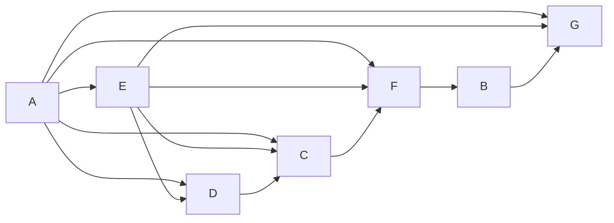

# Учебный вариант V10

Seed: "informatics-variant-v1:V10". 16 заданий, максимум 21 балл. В №13 выбрана презентация (13.1). Альтернативная работа не добавляет номер или баллы.

Набор предназначен для разбора и содержит решения и эталоны. Это авторские учебные задания. Формат — сверенный проект ОГЭ 2027; критерии практических работ учебные.

[Скачать полный комплект файлов](dataset.zip)

## Задание №1

В кодировке каждый символ занимает 16 бит. Записан список слов: «земляника, шиповник, можжевельник, клён, сосна, берёза, крапива». Одно слово удалили вместе с лишними запятой и пробелом; двойных пробелов не осталось. Размер текста уменьшился на 22 байта. Какое слово удалили?

**Ответ / эталон:** земляника

#### Решение

1. Один символ занимает 16 ÷ 8 = 2 байта. Всего удалили 22 ÷ 2 = 11 символов.

2. Вместе со словом удалили запятую и пробел — два символа. На само слово приходится 11 − 2 = 9 символов. Дефис тоже считается символом.

3. В списке такую длину имеет слово «земляника». Проверка: (9 + 2) · 2 = 22 байта.

## Задание №2

Сообщение закодировано с помощью таблицы. Между кодами букв нет дополнительных разделителей.

| Буква | Код   |
| ----- | ----- |
| В     | `.`   |
| Б     | `-.`  |
| А     | `--.` |
| Д     | `---` |

Сигнал: `..-.--.--.--...`. Расшифруй сообщение и запиши последовательность букв.

**Ответ / эталон:** ВВБАААВВ

#### Решение

1. Ни один код в таблице не совпадает с началом другого. Читаем слева направо: как только набран код из таблицы, записываем букву и начинаем читать следующую.

Начало записи — `.` (1 знак). По таблице это буква «В». Продолжаем с позиции 2.

2. Разделим всю запись на коды букв:

`. / . / -. / --. / --. / --. / . / .`

| № буквы | Код   | Буква |
| ------- | ----- | ----- |
| 1       | `.`   | В     |
| 2       | `.`   | В     |
| 3       | `-.`  | Б     |
| 4       | `--.` | А     |
| 5       | `--.` | А     |
| 6       | `--.` | А     |
| 7       | `.`   | В     |
| 8       | `.`   | В     |

Читаем буквы сверху вниз: **ВВБАААВВ**.

3. Проверим обратным кодированием: «В» → `.`; «В» → `.`; «Б» → `-.`; «А» → `--.`; «А» → `--.`; «А» → `--.`; «В» → `.`; «В» → `.`.

Соединив коды без разделителей, получим `..-.--.--.--...` — исходную запись. Значит, все знаки использованы. Ответ: **ВВБАААВВ**.

## Задание №3

Сколько натуральных чисел X делают выражение истинным?

Выражение: `(НЕ (X > 15))`.

Натуральные числа начинаются с 1.

**Ответ / эталон:** 15

#### Решение

1. После раскрытия НЕ условие истинности: X ≤ 15. Для И выполняются обе части, для ИЛИ достаточно одной.

2. Подходящие натуральные X: 1, 2, 3, 4, 5, 6, 7, 8, 9, 10, 11, 12, 13, 14, 15.

3. Количество подходящих значений: 15. Проверка границ: при X = 15 выражение истинно. Ноль в натуральные числа не включён.

## Задание №4

В таблице указаны длины дорог между пунктами в километрах. Знак — означает, что прямой дороги нет. По каждой дороге можно двигаться в обе стороны.

| Пункт | A   | B   | C   | D   | E   |
| ----- | --- | --- | --- | --- | --- |
| A     | —   | 9   | 3   | —   | —   |
| B     | 9   | —   | 9   | —   | —   |
| C     | 3   | 9   | —   | 4   | 3   |
| D     | —   | —   | 4   | —   | 7   |
| E     | —   | —   | 3   | 7   | —   |

Какова длина кратчайшего пути из A в E? В ответе запиши число километров.

**Ответ / эталон:** 6

#### Решение

1. До A расстояние 0. Прямые дороги из A: B: 9 км; C: 3 км. При переходе к соседу прибавляй длину дороги; сохраняй меньшую из найденных сумм.

2. Минимальные расстояния от A: A — 0; B — 9; C — 3; D — 7; E — 6 км.

3. Кратчайший маршрут: A → C → E. Проверка по таблице: 3 + 3 = 6 км. Число дорог само по себе длину пути не определяет.

## Задание №5

У исполнителя две команды:

1. Умножь на 2.
2. Прибавь 2.

Составь программу, которая переводит число 3 в число 40 и содержит не более 5 команд. В ответе запиши только номера команд. Если подходящих программ несколько, запиши любую.

**Ответ / эталон:** 2111, 12211

#### Решение

1. От 40 можно идти назад: обратная команда 2 вычитает 2, а обратная команда 1 делит на 2. Нужен возврат к 3 не более чем за 5 команд.

2. Один подходящий вариант — 2111: 3 → 5 → 10 → 20 → 40.

3. Последнее значение равно 40, длина программы 4 не превышает 5. Другие подходящие программы также принимаются.

## Задание №6

Программа запускалась девять раз; в каждом запуске вводилась одна из пар (s, t) из таблицы и одно и то же целое число A.

```python
s = int(input())
t = int(input())
A = int(input())
if s > 4 or t > A:
    print("YES")
else:
    print("NO")
```

| s   | t   |
| --- | --- |
| 10  | 14  |
| 0   | -10 |
| 5   | 6   |
| 1   | 1   |
| 4   | 5   |
| 6   | -6  |
| 1   | -12 |
| -3  | 2   |
| 11  | 0   |

Укажи наименьшее целое значение A, при котором программа напечатала YES ровно 7 раз.

**Ответ / эталон:** -10

#### Решение

1. От A не зависят запуски, где s > 4: (10, 14), (5, 6), (6, -6), (11, 0). Число этих YES: 4. Остальные значения t: -12, -10, 1, 2, 5. Требуемое число значений больше A: 3.

2. При A = -10 результаты девяти запусков: YES, NO, YES, YES, YES, YES, NO, YES, YES. Получено 7 YES.

3. Допустимые целые значения: A ≥ -10 и A ≤ 0. Сравнение строгое; первое подходящее A равно -10. Проверь соседнее целое за указанной границей: нужное число YES уже не получается.

## Задание №7

Доступ к файлу notes.xls на сервере smile.ru осуществляется по протоколу HTTP. Фрагменты адреса закодированы цифрами от 1 до 7. Запиши последовательность цифр, кодирующую адрес файла.

| Цифра | Фрагмент |
| ----- | -------- |
| 1     | `://`    |
| 2     | `/`      |
| 3     | `.xls`   |
| 4     | `ru`     |
| 5     | `smile.` |
| 6     | `notes`  |
| 7     | `http`   |

**Ответ / эталон:** 7154263

#### Решение

1. Для протокола HTTP запиши начало http://. Затем идут сервер smile.ru, знак / и файл notes.xls.

2. Полный адрес: http://smile.ru/notes.xls.

3. Замени его части цифрами из таблицы: 7154263. Проверь, что использованы все семь фрагментов.

## Задание №8

В языке поисковых запросов | означает «ИЛИ», & — «И». Все запросы выполнены по одной неизменной базе страниц. Количества указаны в тысячах.

| Запрос                     | Найдено страниц (тыс.) |
| -------------------------- | ---------------------- |
| `Лира & (Вега \| Альтаир)` | 530                    |
| `Лира & Вега`              | 470                    |
| `Лира & Альтаир`           | 70                     |

Сколько тысяч страниц найдёт запрос `Лира & Вега & Альтаир`? Запиши целое число.

**Ответ / эталон:** 10

#### Решение

1. Запрос «Лира & (Вега | Альтаир)» объединяет страницы двух запросов: «Лира & Вега» и «Лира & Альтаир». В объединении 530 тыс. страниц.

2. В запросе «Лира & Вега» 470 тыс. страниц. В запросе «Лира & Альтаир» 70 тыс.; при сложении пересечение учитывается дважды.

3. Пересечение: 470 + 70 − 530 = 10 тыс. Проверка объединения: 470 + 70 − 10 = 530.

## Задание №9

На рисунке показана схема дорог между городами A, B, C, D, E, F, G. Двигаться можно только в направлении стрелок. Сколько различных путей ведёт из A в G?

Схема дорог: движение только по стрелкам, начальный город A, конечный G.



Текстовое описание: Схема дорог: движение только по стрелкам, начальный город A, конечный G. Вершины: A, B, C, D, E, F, G. Дуги: A → E; A → D; A → C; A → F; A → G; E → D; E → C; E → F; E → G; D → C; C → F; F → B; B → G.

**Ответ / эталон:** 8

#### Решение

1. Положи число способов попасть в A равным 1.

2. У города C входящие стрелки из A, E, D: сложи числа путей к этим городам. Получаются количества: A — 1; B — 6; C — 4; D — 2; E — 1; F — 6; G — 8.

3. Проверка у конечного города G: 1 + 1 + 6 = 8. Группы путей не пересекаются: у каждой группы своя последняя дорога.

## Задание №10

Вычисли значение выражения $\mathrm{10101}_{2} + \mathrm{15}_{8} + \mathrm{1E}_{16}$. В ответе запиши десятичное число, основание указывать не нужно.

**Ответ / эталон:** 64

#### Решение

1. Разложи каждое число по степеням его основания, начиная справа со степени 0: 10101 (основание 2): 1·2^4 + 0·2^3 + 1·2^2 + 0·2^1 + 1·2^0 = 21; 15 (основание 8): 1·8^1 + 5·8^0 = 13; 1E (основание 16): 1·16^1 + 14·16^0 = 30.

2. 10101 (основание 2) = 21; 15 (основание 8) = 13; 1E (основание 16) = 30.

3. 21 + 13 + 30 = 64.

## Задание №11

Скачай и распакуй корпус рассказов. Автор рассказа — Алла Северина. Найди эпизод: Мирон выступил перед кружком молодых исследователей. Какова фамилия человека, произнёсшего слова «Это упорный труд» в этом эпизоде? Запиши одно слово.

**Ответ / эталон:** Зайцев

#### Решение

1. Открой папку Тексты/Алла Северина. Ищи имя Мирон и слова «выступил перед кружком молодых исследователей»: одного совпадения имени недостаточно, нужен указанный эпизод.

2. Прочитай эпизод и соседние абзацы. Реплика: «Это упорный труд». Проверь, кому принадлежит реплика и о каком событии идёт речь.

3. Фамилия говорящего — Зайцев. Для проверки сопоставь найденное слово с героем Мирон и событием «выступил перед кружком молодых исследователей», а не с соседним рассказом. Ответ: Зайцев.

## Задание №12

Скачай и распакуй файловый набор. Сколько файлов с расширениями .jpeg, .pdf находится в следующих каталогах, включая все вложенные папки?

- Иллюстрации
- Проза-архив/Ирина Полевая
- Проза/Олег Ветров
- Письма/Ирина Полевая

Другие каталоги не учитывай.

**Ответ / эталон:** 23

#### Решение

1. В каждом указанном каталоге включи поиск во вложенных папках. Отбирай .jpeg, .pdf по расширению файла.

2. Подходящие файлы:

- Иллюстрации/Нина Речная/Черновики/работа-10.pdf
- Иллюстрации/Нина Речная/Черновики/работа-19.jpeg
- Иллюстрации/Нина Речная/работа-02.pdf
- Иллюстрации/Нина Речная/работа-03.jpeg
- Иллюстрации/Нина Речная/работа-11.jpeg
- Иллюстрации/Нина Речная/работа-18.pdf
- Иллюстрации/Олег Ветров/Черновики/работа-07.jpeg
- Иллюстрации/Олег Ветров/работа-06.pdf
- Иллюстрации/Олег Ветров/работа-14.pdf
- Иллюстрации/Олег Ветров/работа-15.jpeg
- Письма/Ирина Полевая/Черновики/работа-15.pdf
- Письма/Ирина Полевая/работа-07.pdf
- Письма/Ирина Полевая/работа-08.jpeg
- Письма/Ирина Полевая/работа-16.jpeg
- Проза-архив/Ирина Полевая/Черновики/работа-09.jpeg
- Проза-архив/Ирина Полевая/работа-01.jpeg
- Проза-архив/Ирина Полевая/работа-08.pdf
- Проза-архив/Ирина Полевая/работа-16.pdf
- Проза-архив/Ирина Полевая/работа-17.jpeg
- Проза/Олег Ветров/Черновики/работа-07.pdf
- Проза/Олег Ветров/Черновики/работа-16.jpeg
- Проза/Олег Ветров/работа-08.jpeg
- Проза/Олег Ветров/работа-15.pdf

3. Проверка по каталогам: Иллюстрации — 10; Проза-архив/Ирина Полевая — 5; Проза/Олег Ветров — 4; Письма/Ирина Полевая — 4. Всего 23 файла. Одинаковые имена в разных каталогах обозначают разные файлы; каждый полный путь учтён один раз.

## Задание №13

### 13.1 Презентация — выбрана

Создай презентацию «Робот на маршруте» из трёх слайдов по макету набора. Используй исходный ODT и авторские иллюстрации. Формат 16:9, альбомная ориентация, без анимации. Единый тип шрифта: название на титуле 40 пт; его подзаголовок и заголовки остальных слайдов 24 пт; основной текст 20 пт.

Первый слайд: название и учебный идентификатор P06 в подзаголовке. Второй: «Команды и проверка», два изображения и два текстовых блока. Третий: «План и исполнение», три изображения и три текстовых блока. Взаимное расположение объектов сохрани по макетам. Сохраняй пропорции изображений; текст и изображения должны помещаться на слайде. Используй единое оформление. Сохрани результат как P06.odp.

Имена, фамилии и контакты вводить не нужно. Это авторское учебное задание; критерии в наборе предназначены для самооценки и не заменяют официальную экспертную проверку.

**Ответ / эталон:** curated-presentations-v2:P06:reference

#### Решение

1. Открой материалы «Робот на маршруте» и макеты. Создай три слайда 16:9. На титуле размести название «Робот на маршруте» шрифтом 40 пт и идентификатор P06 шрифтом 24 пт.

2. На слайде «Команды и проверка» размести два изображения и два текстовых блока; на слайде «План и исполнение» — три изображения и три блока. Заголовки набери шрифтом 24 пт, основной текст — 20 пт. Сравни положение объектов с макетами; пропорции изображений сохраняй.

3. Сохрани P06.odp, открой файл повторно и сравни с требованиями к структуре, шрифту и изображениям. Проверь отсутствие обрезанного текста и искажённых изображений; затем при необходимости открой эталон.

#### Учебные критерии

- 0: Не выполнены условия на 1 или 2 балла либо файл имеет недопустимый формат.

- 1: Три слайда по теме, на втором и третьем есть текст и иллюстрации; не более одной ошибки в структуре, шрифте или изображениях. Однотипные ошибки считаются одной. Либо два слайда по теме без таких ошибок.

- 2: Три слайда полностью соответствуют теме, макетам, размерам шрифта и требованиям к изображениям; ошибок нет.

### 13.2 Документ

Оформи документ «МЕДИАТЕКА КРУЖКА» по визуальному образцу layout/sample.pdf. Текст и данные для набора находятся в source/material.odt. Повтори взаимное расположение текста и таблицы, объединение ячеек и выделения полужирным, курсивом и подчёркиванием.

A4, книжная ориентация, поля 2 см. Единый шрифт DejaVu Serif, весь текст 14 пт. Заголовок прописными буквами, по центру. Основной текст по ширине; первая строка 1 см, межстрочный интервал 150%, интервалы между заголовком, абзацами и таблицей 14 пт. Отступы и интервалы задавай свойствами абзаца; разбиение на строки автоматическое.

Таблица: два столбца шириной 7 и 8 см, по центру страницы, уже основного текста; все ячейки по вертикали по центру. Первый столбец по левому краю, второй по центру; строка заголовков по центру. Сохрани границы, выделения и все данные образца. Не используй пустые абзацы, пробелы вместо отступов или разрывы строк. Сохрани D08.odt.

Имена, фамилии и контакты вводить не нужно. Это авторское учебное задание; критерии предназначены для самооценки и не заменяют официальную экспертную проверку.

**Ответ / эталон:** curated-documents-v2:D08:reference

#### Решение

1. Открой текст «МЕДИАТЕКА КРУЖКА» и layout/sample.pdf. Настрой A4, поля 2 см и шрифт DejaVu Serif 14 пт. Перенеси заголовок и оба абзаца без изменения текста.

2. Задай межстрочный интервал 150%, отступ первой строки 1 см и интервалы между блоками 14 пт. Вставь таблицу со столбцами 7 и 8 см; выдели строку заголовков и повтори выравнивание образца.

3. Сохрани D08.odt и открой повторно. Сравни две группы требований — основной текст и таблицу; затем при необходимости открой эталон.

#### Учебные критерии

- 0: Не выполнены условия на 1 или 2 балла либо файл имеет недопустимый формат.

- 1: В основном тексте и таблицах не более трёх нарушений требований в каждой группе. Либо одна группа выполнена полностью верно, а другая отсутствует или содержит более трёх нарушений. Также 1 балл при верной работе с существенными расхождениями макета.

- 2: Основной текст и таблицы оформлены по образцу. В основном тексте допускается до пяти текстовых ошибок, в таблицах — до трёх; остальные требования выполнены.

## Задание №14

В таблицу внесены 370 записей. Открой source/data.ods: лист «Данные», заголовки A1:F1, записи A2:F371. Столбцы по порядку: Дата; Пункт отправления; Пункт назначения; Расстояние; Расход бензина; Масса груза. Перевозки расположены в хронологическом порядке.

1. Какова суммарная протяжённость перевозок с 5 по 7 октября включительно? Ответ запиши в H2.
2. Какова средняя масса груза при перевозках из пункта «Осинки»? Укажи не менее одного знака после запятой. Ответ запиши в H3.
3. Построй круговую диаграмму соотношения количества перевозок 1, 2 и 3 октября. Левый верхний угол размести вблизи G6. В поле диаграммы должны присутствовать легенда и числовые значения исходных данных.

Используй свободные столбцы для вычислений, сохрани исходные данные и результат в result.ods. Это авторское учебное задание по подтверждённому формату ФИПИ; самооценка не заменяет экспертную проверку файла.

**Ответ / эталон:** sheet-sum-mean-v2:["informatics-variant-v1","informatics-variant-v1:V10",14]:reference

#### Решение

1. Первое условие: Какова суммарная протяжённость перевозок с 5 по 7 октября включительно? Используй формулу `=SUM(SUMIF(A2:A371;"5 октября";D2:D371);SUMIF(A2:A371;"6 октября";D2:D371);SUMIF(A2:A371;"7 октября";D2:D371))`. Результат 38304 запиши в H2.

2. Второе условие: Какова средняя масса груза при перевозках из пункта «Осинки»? Укажи не менее одного знака после запятой. Используй формулу `=ROUND(AVERAGEIF(B2:B371;"Осинки";F2:F371);1)`. Результат 574.3 запиши в H3. Это отдельная выборка, её условия могут отличаться от первого расчёта.

3. Создай вспомогательную таблицу: 1 октября — 42; 2 октября — 41; 3 октября — 41. Формулы по порядку: `=COUNTIF(A2:A371;"1 октября")`; `=COUNTIF(A2:A371;"2 октября")`; `=COUNTIF(A2:A371;"3 октября")`. Построй круговую диаграмму по этой таблице, добавь легенду и подписи значений. Проверь подписи 1 октября, 2 октября, 3 октября и ответы H2, H3 после повторного открытия result.ods. Приведены английские имена функций Calc; в настройках редактора может быть включён их перевод.

#### Учебные критерии

- 0: Ни один из трёх элементов не выполнен верно.

- 1: Верно выполнен один элемент: первый расчёт, второй расчёт или диаграмма.

- 2: Верно выполнены два из трёх элементов.

- 3: Оба числа найдены верно; диаграмма отображает правильные данные и их соотношение, содержит легенду и числовые подписи.

## Задание №15

Горизонтальная стена соединена правым концом с верхним концом вертикальной стены, идущей вниз. В каждой стене ровно один проход произвольной положительной ширины, не касающийся концов. Робот стоит слева от нижнего конца вертикальной стены. Закрась клетки непосредственно слева от вертикальной и под горизонтальной стеной, исключая проходы. Длины неизвестны (в проверочных полях 3–18 клеток), вокруг стен свободно. Это авторское семейство по формату демоверсии ФИПИ 2026.

Все клетки первоначально не закрашены. Лишние клетки закрашивать нельзя; конечная позиция не задана. Используй датчики и циклы, не подставляй размеры с рисунка. Показан только один пример семейства: сетка 11 × 11, старт (строка 8, столбец 8), индексы с 0. Данные и рисунок находятся в source; проверочные поля — в validation/fields.json.

Сохрани программу в answer.txt, UTF-8. Поддерживаются движения, закраска, датчики, если/иначе и нц пока; описание языка есть в README.txt. Нужно нормальное завершение без столкновений и точная закраска на всех допустимых полях семейства. Учебные критерии 0/1/2 и конечный набор проверок не заменяют официальную экспертную оценку.

**Ответ / эталон:** robot-corner-left-v2:["informatics-variant-v1","informatics-variant-v1:V10",15]:reference

#### Решение

1. В показанном поле старт: строка 8, столбец 8. Поднимайся вдоль вертикальной стены справа, закрашивая клетки у стены и пропуская её проход.

2. В углу поверни влево: закрась участки под горизонтальной стеной, но не её проход.

3. Движение по каждой оси однонаправленно, расстояние до угла или конца убывает. Датчики различают стены и проходы независимо от их длины. Сверь закраску с изображённым примером: число целевых клеток — 10, лишних быть не должно. Затем проверь остальные поля семейства; размеры 11 × 11 нельзя зашивать в программу.

```
использовать Робот
алг
нач
нц пока не справа свободно
закрасить
вверх
кц
нц пока справа свободно
вверх
кц
нц пока сверху свободно
закрасить
вверх
кц
нц пока не сверху свободно
закрасить
влево
кц
нц пока сверху свободно
влево
кц
нц пока не сверху свободно
закрасить
влево
кц
кон

```

#### Учебные критерии

- 0: Не выполнены условия для 1 или 2: есть ошибка разбора, столкновение, незавершение либо хотя бы на одном проверочном поле более 10 лишних или более 10 незакрашенных целевых клеток.

- 1: На каждом из восьми проверочных полей программа завершилась без столкновения, закрасив не более 10 лишних и пропустив не более 10 целевых клеток; точность для 2 не достигнута. Это применение критерия ФИПИ к конечной учебной выборке, не официальный балл.

- 2: Все восемь проверочных полей пройдены с нормальным завершением, без столкновений и с точной закраской.

## Задание №16

Напиши программу на Python 3. Среди N целых чисел найди среднее арифметическое положительных чисел и их количество. Хотя бы одно положительное число есть. Выведи сначала среднее, затем количество. Среднее не округляй до целого: используй обычное деление. Дробную часть записывай через точку; допустима экспоненциальная запись. Проверка принимает абсолютную погрешность среднего не более 0.000001; количество должно быть целым и точным.

Ввод: первая строка — N, целое от 1 до 1000 включительно. Затем ровно N строк, по одному целому числу от −10000 до 10000 включительно. Порядок чисел сохраняется.
Выводи только среднее и целое количество, без приглашений и пояснений. Разделяй числа пробелами или переводами строк.

Пример ввода:

```
10
0
-10
9855
2080
9625
6381
9794
3642
8969
3039
```

Пример вывода:

```
6673.125 8
```

Сохрани код в answer.py, UTF-8. В архиве находятся десять тестов, эталон и инструкция локального запуска. Проверка использует лимит 2 секунды на тест; это учебное ограничение, а не норма экзамена. Учебные критерии 0/1/2 относятся к результатам запусков и не заменяют официальную экспертную оценку.

**Ответ / эталон:** python-positive-mean-v1:["informatics-variant-v1","informatics-variant-v1:V10",16]:reference

#### Решение

1. Начни сумму и счётчик с нуля. Прочитай N, затем ровно N чисел. Условие положительности — x > 0: ноль не подходит.

2. Для каждого положительного числа увеличивай счётчик и сумму. После цикла раздели сумму на счётчик оператором /, а не //; положительное число гарантировано условием.

3. В примере положительные числа: 9855, 2080, 9625, 6381, 9794, 3642, 8969, 3039. Сумма 53385, количество 8; среднее 53385 / 8 = 6673.125. Вывод: 6673.125 8.

```
n = int(input())
count = 0
total = 0
for i in range(n):
    x = int(input())
    if x > 0:
        count += 1
        total += x
print(total / count, count)

```

#### Учебные критерии

- 0: Ни один тест не пройден: нет запуска, ошибка исполнения или неверный вывод. Само наличие файла не даёт балла.

- 1: Программа нормально завершилась и дала верный вывод на части из десяти тестов, но не на всех.

- 2: Программа нормально завершилась и дала верный вывод на всех десяти тестах, включая граничные случаи.
